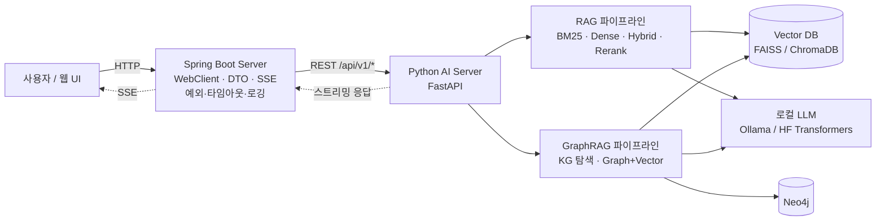

# 아키텍처 (ARCHITECTURE)

## 1. 디렉터리 구조

```text
ai-engineering-lab/
├── README.md
├── docs/
│   ├── PROJECT_PLAN.md
│   ├── REPOSITORY_ANALYSIS.md
│   ├── LEARNING_ROADMAP.md
│   ├── ARCHITECTURE.md
│   ├── ENVIRONMENT.md
│   └── PROGRESS.md
├── requirements/            # base.txt, dev.txt, part1.txt ~ part6.txt
├── part1_ai_fundamentals/
│   ├── tokenizer/           # P1-01
│   ├── embedding/           # P1-02
│   ├── word2vec/            # P1-03
│   ├── pytorch/             # P1-04
│   └── transformer/         # P1-05
├── part2_llm/
│   ├── next_token_prediction/  # P2-01
│   ├── loss/                   # P2-02
│   ├── backpropagation/        # P2-03
│   ├── training/               # P2-04
│   └── finetuning/             # P2-05
├── part3_rag/
│   ├── document_loader/     # P3-01
│   ├── chunking/            # P3-02
│   ├── dense_retrieval/     # P3-03
│   ├── sparse_retrieval/    # P3-04
│   ├── hybrid_search/       # P3-05
│   ├── reranking/           # P3-06
│   └── evaluation/          # P3-07
├── part4_graphrag/
│   ├── knowledge_graph/          # P4-01
│   ├── entity_extraction/        # P4-02
│   ├── relationship_extraction/  # P4-03
│   ├── graph_traversal/          # P4-04
│   ├── graph_retrieval/          # P4-05
│   └── evaluation/               # P4-06
├── part5_finetuning/
│   ├── embedding/           # P5-01
│   ├── reranker/            # P5-02
│   └── llm_lora/            # P5-03
├── part6_ai_service/
│   ├── python_ai_server/    # P6-01 FastAPI
│   └── spring_boot_server/  # P6-02 Spring Boot
├── datasets/                # 데이터셋 설명·다운로드 방법 (원본은 커밋하지 않음)
├── experiments/             # 실험 기록
└── tests/                   # 여러 Part에 걸친 공통 테스트
```

각 실습 디렉터리는 내용이 채워지면 다음 형태가 된다.

```text
part1_ai_fundamentals/transformer/
├── README.md            # 12항목 README
├── starter.py           # TODO + HINT/WHY/REF
├── solution.py          # 정답 + "왜"·shape 주석
└── test_transformer.py  # pytest: starter/solution 공통 검증
```

## 2. 서비스 아키텍처 (Part 6)



### 2-1. Python AI Server 엔드포인트(계획)

| 메서드 | 경로 | 역할 |
|---|---|---|
| POST | `/api/v1/documents` | 문서 업로드·청킹·인덱싱 |
| POST | `/api/v1/embeddings` | 텍스트 임베딩 |
| POST | `/api/v1/search` | BM25 / Dense / Hybrid / Hybrid+Rerank 검색 |
| POST | `/api/v1/rag/query` | RAG 답변 생성(스트리밍 옵션) |
| POST | `/api/v1/graphrag/query` | GraphRAG 답변 생성(스트리밍 옵션) |
| GET | `/api/v1/health` | 상태·모델 로딩 여부 |

- 통신은 **REST 먼저**, gRPC는 확장 과제.
- Spring Boot는 응답 시간·실패를 로깅하고, 타임아웃 시 사용자에게 명확한 오류를 돌려준다.

## 3. 실습 파일 규약 (starter/solution/test)

| 파일 | 규칙 |
|---|---|
| `starter.py` | 구현할 부분은 `TODO <번호>:`로 표시하고 `raise NotImplementedError`로 남긴다. 각 TODO 아래 힌트 주석(§4) |
| `solution.py` | starter와 **같은 함수 시그니처, 같은 TODO 번호, 같은 REF**. "왜" 주석과 shape 주석 |
| `test_*.py` | `pytest`. 기본은 `solution`을 검증하고, 환경 변수로 `starter`를 검증할 수 있게 한다 |
| `README.md` | 12항목 README ([PROJECT_PLAN §6-2](PROJECT_PLAN.md#6-2-디렉터리-readme-12항목)) |

- TODO 번호는 **디렉터리 안에서 연속**으로 매긴다(여러 파일이어도 겹치지 않게).
- Windows에서 DataLoader(`num_workers > 0`)를 쓰는 스크립트는 반드시 `if __name__ == "__main__":` 아래에서 실행한다.
- 난이도 표시: 파일 상단 docstring에 `Level: 1|2|3`.

테스트 전환 방식(예시):

```python
# test_attention.py
import importlib
import os

impl = importlib.import_module(os.environ.get("IMPL", "solution"))  # IMPL=starter pytest
```

## 4. 힌트 주석 규약과 예시

| 태그 | 내용 |
|---|---|
| `# HINT 1:` | 방향(무엇을 하는가) |
| `# HINT 2:` | shape·API(어떤 함수, 어떤 차원) |
| `# WHY:` | 왜 필요한가 / 빠지면 무슨 문제가 생기는가 |
| `# REF:` | 실존 논문(저자·연도·절) 또는 공식 문서 URL만. **불확실하면 생략, 지어내기 금지** |

- 힌트에 정답 코드를 넣지 않는다.
- solution에는 같은 TODO 번호와 REF를 유지하고 shape 주석을 단다.

### 예시: Scaled Dot-Product Self-Attention (TODO 7~9)

`starter.py`

```python
def scaled_dot_product_attention(q, k, v, mask=None):
    """q, k, v: (batch, heads, seq_len, d_k)"""
    d_k = q.size(-1)

    # TODO 7: 어텐션 점수(scores)를 계산하세요.
    # HINT 1: 각 query와 모든 key의 유사도를 내적으로 구하고 크기를 보정합니다.
    # HINT 2: k의 마지막 두 차원을 바꾼 뒤 행렬곱 → (batch, heads, seq_len, seq_len). torch.matmul, Tensor.transpose
    # WHY: d_k가 크면 내적 값의 분산이 커져 softmax가 한쪽으로 포화되고 기울기가 매우 작아집니다.
    # REF: Vaswani et al., 2017, "Attention Is All You Need", §3.2.1
    raise NotImplementedError

    # TODO 8: mask가 주어지면 가려야 할 위치의 점수를 매우 작은 값으로 바꾸세요.
    # HINT 1: mask == 0 인 위치가 softmax 이후 0이 되도록 만듭니다.
    # HINT 2: Tensor.masked_fill, 채울 값은 float("-inf") 또는 매우 큰 음수
    # WHY: 디코더에서 미래 토큰을 보면 학습 때만 정답을 "엿보는" 누수가 생겨 추론 성능이 무너집니다.
    # REF: Vaswani et al., 2017, "Attention Is All You Need", §3.2.3

    # TODO 9: softmax로 가중치를 만들고 value의 가중합을 반환하세요.
    # HINT 1: 마지막 차원(key 축)에 대해 확률 분포가 되어야 합니다.
    # HINT 2: torch.softmax(..., dim=-1) → (batch, heads, seq_len, seq_len), 이어서 v와 행렬곱 → (batch, heads, seq_len, d_k)
    # WHY: 잘못된 dim으로 softmax를 하면 각 query의 가중치 합이 1이 되지 않아 출력 스케일이 깨집니다.
    # REF: Vaswani et al., 2017, "Attention Is All You Need", §3.2.1
```

`solution.py`

```python
import math

import torch


def scaled_dot_product_attention(q, k, v, mask=None):
    """q, k, v: (batch, heads, seq_len, d_k)"""
    d_k = q.size(-1)

    # TODO 7  REF: Vaswani et al., 2017, §3.2.1
    # (B, H, T, d_k) @ (B, H, d_k, T) -> (B, H, T, T)
    # sqrt(d_k)로 나누는 이유: 내적의 분산이 d_k에 비례해 커지는 것을 상쇄해 softmax 포화를 막는다.
    scores = torch.matmul(q, k.transpose(-2, -1)) / math.sqrt(d_k)

    # TODO 8  REF: Vaswani et al., 2017, §3.2.3
    # mask: (T, T) 또는 (B, 1, T, T) — 브로드캐스팅으로 scores와 맞춘다.
    # -inf는 softmax 후 정확히 0이 되어 가려진 위치가 가중합에 기여하지 않는다.
    if mask is not None:
        scores = scores.masked_fill(mask == 0, float("-inf"))

    # TODO 9  REF: Vaswani et al., 2017, §3.2.1
    # dim=-1: 각 query 행마다 key 축 확률 분포 (B, H, T, T)
    weights = torch.softmax(scores, dim=-1)
    # (B, H, T, T) @ (B, H, T, d_k) -> (B, H, T, d_k)
    return torch.matmul(weights, v)
```

## 5. 실험 기록 구조

`experiments/<part>-<실습ID>-<YYYYMMDD>-<짧은이름>/` 아래에 `README.md`(목적·데이터셋·모델·하이퍼파라미터·GPU 사용량·학습 시간·결과·비교·개선점)와 결과 CSV·그림을 둔다.
대용량 산출물(`artifacts/`, 가중치)은 커밋하지 않는다. 템플릿: [experiments/README.md](../experiments/README.md).
