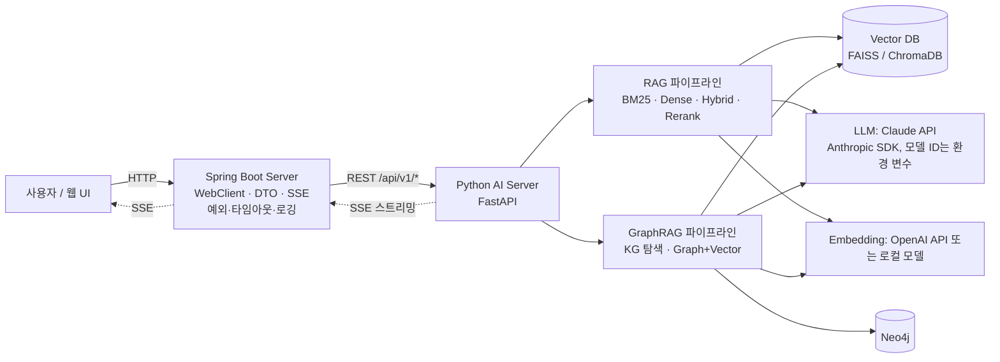

# 아키텍처 (ARCHITECTURE)

> 2026-11-16 학습 방식 전환: 정해진 실습(starter/solution/tests) 방식은 폐지했습니다. 이 문서는 **최종 서비스가 어떤 구조인지**와, 직접 구현한 코드를 **어디에 두면 좋은지(제안)**를 설명합니다. 이전 방식의 규약(starter/solution/테스트 전환, 힌트 주석)은 커밋 `aa46d2f`의 이 문서에 있습니다.

## 1. 최종 서비스 구조

만들고 싶은 기능을 고를 때는 "이것이 아래 그림의 어디에 들어가는가"를 먼저 확인하세요.



한 줄 흐름: **사용자 → Spring Boot → Python AI 서버 → RAG/GraphRAG → 벡터DB/Neo4j → LLM**.

### 1-1. Python AI Server 엔드포인트(계획)

| 메서드 | 경로 | 역할 |
|---|---|---|
| POST | `/api/v1/documents` | 문서 업로드·청킹·인덱싱 |
| POST | `/api/v1/embeddings` | 텍스트 임베딩 |
| POST | `/api/v1/search` | BM25 / Dense / Hybrid / Hybrid+Rerank 검색 |
| POST | `/api/v1/rag/query` | RAG 답변 생성(스트리밍 옵션) |
| POST | `/api/v1/graphrag/query` | GraphRAG 답변 생성(스트리밍 옵션) |
| GET | `/api/v1/health` | 상태·모델 로딩 여부 |

- 통신은 **REST 먼저**, gRPC는 확장 과제.
- LLM은 Claude API, 임베딩은 OpenAI API가 기본이고 로컬 모델로 바꿀 수 있게 공급자를 분리한다(개념: [P2-01B](../part2_llm/local_llm_serving/README.md), [P1-02](../part1_ai_fundamentals/embedding/README.md)). 키는 `.env`에만 두고, 모든 호출의 토큰 사용량을 로그에 남겨 **요청별 비용을 추적**한다(Part 6 비용·로깅).
- 외부 API 호출에는 **타임아웃과 재시도**(지수 백오프)를 두고, 실패 시 사용자에게 줄 응답을 미리 설계한다.
- Spring Boot는 응답 시간·실패를 로깅하고, 타임아웃 시 사용자에게 명확한 오류를 돌려준다.

### 1-2. 개념이 서비스의 어디에 쓰이나

| 개념 문서 | 서비스에서 들어가는 곳 |
|---|---|
| [tokenizer](../part1_ai_fundamentals/tokenizer/README.md) | 청킹 단계의 청크 크기, 컨텍스트 창 예산, 비용 계산·추적 |
| [embedding](../part1_ai_fundamentals/embedding/README.md) | 임베딩 호출부, Dense 검색(벡터DB 질의), GraphRAG의 Vector 검색 |
| [transformer](../part1_ai_fundamentals/transformer/README.md) | 프롬프트에 넣을 청크 수·지연·캐싱 설계, Reranker 이해 |
| [next_token_prediction](../part2_llm/next_token_prediction/README.md) | 답변 생성 설정·일관성 |
| [local_llm_serving](../part2_llm/local_llm_serving/README.md) | LLM 어댑터(공급자 교체·타임아웃·폴백) |
| [llm_api/basics](../part2_llm/llm_api/basics/README.md) | Claude 호출부(응답 검사·구조화 출력·스트리밍) → 엔티티·관계 추출, SSE |
| [llm_api/cost_latency](../part2_llm/llm_api/cost_latency/README.md) | 프롬프트 캐싱, 색인·평가 배치, 비용 모니터링 |

## 2. 저장소 디렉터리

```text
ai-engineering-lab/
├── README.md, CLAUDE.md
├── docs/                    # 기획·로드맵·아키텍처·환경·기록
├── requirements/            # base.txt, dev.txt, part1.txt ~ part6.txt
├── part1_ai_fundamentals/   # 개념 README(pytorch, tokenizer, embedding, word2vec, transformer) + data/
├── part2_llm/               # 개념 README(next_token_prediction, local_llm_serving, llm_api, ...)
├── part3_rag/               # 주제 자리표시자(문서 로딩·청킹·Dense·Sparse·Hybrid·Rerank·평가)
├── part4_graphrag/          # 주제 자리표시자(KG·추출·검색·평가)
├── part5_finetuning/        # 주제 자리표시자(임베딩·Reranker·LLM LoRA)
├── part6_ai_service/        # python_ai_server/, spring_boot_server/ — 최종 서비스 코드의 자리
├── datasets/                # 데이터셋 설명 (대용량 원본은 커밋하지 않음)
└── experiments/             # 실험 기록(템플릿 README)
```

## 3. 개념 README의 구성

각 개념 폴더의 `README.md`는 목표 · 선수지식 · 핵심 개념 · 내부 원리 · 서비스 관점 · 수식 · 자주 나는 오류 · 과제(직접 만들어 볼 것) · 체크리스트 · 다음 단계 · REF로 구성하고, 맨 위에 "최종 서비스에서의 위치"를 둔다. 새 주제를 만들 때 같은 틀을 쓰되 필수는 아니다. 코드 주석은 `# 개념:` `# WHY:` `# 서비스 관점:` `# REF:` 스타일을 권장한다.

## 4. 코드 권장 위치 (제안)

강제 규칙이 아니라 제안입니다. 바꿔도 되지만, 바꿨다면 [PROGRESS](PROGRESS.md)의 기록에 적어 두세요.

| 만드는 것 | 권장 위치 |
|---|---|
| Python AI 서버 코드 | `part6_ai_service/python_ai_server/` 안에서 **기능별 모듈** — 예: `llm/`(공급자 어댑터·Claude 호출), `embeddings/`, `chunking/`, `retrieval/`(dense·sparse·hybrid·rerank), `graph/`, `api/`(FastAPI 라우터), `observability/`(토큰·비용 로그) |
| Spring Boot 코드 | `part6_ai_service/spring_boot_server/` |
| 한 번 해 보는 실험·비교(측정 포함) | `experiments/<YYYYMMDD>-<짧은이름>/` — [템플릿](../experiments/README.md) |
| 재사용하지 않을 작은 연습 | `experiments/` 안의 스크립트 |
| 데이터셋 설명 | `datasets/` |
| 새로 필요한 라이브러리 | `requirements/partN.txt`에 이유 주석과 함께 |

- 실험에서 쓸모가 확인된 코드는 `part6_ai_service/python_ai_server/`의 모듈로 옮겨 가며 서비스를 키웁니다.
- API 키는 저장소 루트 `.env`에만, 모델 ID·임베딩 모델은 환경 변수(`LLM_MODEL`, `EMBEDDING_MODEL`)로 바꿉니다(코드에 박지 않음).
- 외부 API 호출은 비용이 들므로, 개발 중에는 가짜 응답으로 먼저 흐름을 확인한 뒤 실제 호출로 바꾸는 방식을 권장합니다(P2-01B의 `fake` 공급자 아이디어).
- 테스트는 필수가 아닙니다. 필요하면 `pytest`를 직접 설정하세요([requirements/dev.txt](../requirements/dev.txt)에 포함).

## 5. 실험 기록 구조

`experiments/<YYYYMMDD>-<짧은이름>/` 아래에 `README.md`(목적·데이터셋·모델·하이퍼파라미터·GPU 사용량·학습 시간·결과·비교·개선점)와 결과 CSV·그림을 둔다.
대용량 산출물(`artifacts/`, 가중치)은 커밋하지 않는다. 템플릿: [experiments/README.md](../experiments/README.md). 측정하지 않은 값은 지어내지 않고 "측정 필요"로 비워 둔다.
