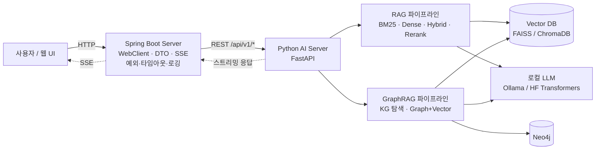

# 아키텍처 (ARCHITECTURE)

## 1. 디렉터리 구조

```text
ai-engineering-lab/
├── README.md
├── docs/
│   ├── PROJECT_PLAN.md
│   ├── REPOSITORY_ANALYSIS.md
│   ├── LEARNING_ROADMAP.md
│   ├── ARCHITECTURE.md
│   ├── ENVIRONMENT.md
│   └── PROGRESS.md
├── requirements/            # base.txt, dev.txt, part1.txt ~ part6.txt
├── part1_ai_fundamentals/
│   ├── tokenizer/           # P1-01
│   ├── embedding/           # P1-02
│   ├── word2vec/            # P1-03
│   ├── pytorch/             # P1-04
│   └── transformer/         # P1-05
├── part2_llm/
│   ├── next_token_prediction/  # P2-01
│   ├── loss/                   # P2-02
│   ├── backpropagation/        # P2-03
│   ├── training/               # P2-04
│   └── finetuning/             # P2-05
├── part3_rag/
│   ├── document_loader/     # P3-01
│   ├── chunking/            # P3-02
│   ├── dense_retrieval/     # P3-03
│   ├── sparse_retrieval/    # P3-04
│   ├── hybrid_search/       # P3-05
│   ├── reranking/           # P3-06
│   └── evaluation/          # P3-07
├── part4_graphrag/
│   ├── knowledge_graph/          # P4-01
│   ├── entity_extraction/        # P4-02
│   ├── relationship_extraction/  # P4-03
│   ├── graph_traversal/          # P4-04
│   ├── graph_retrieval/          # P4-05
│   └── evaluation/               # P4-06
├── part5_finetuning/
│   ├── embedding/           # P5-01
│   ├── reranker/            # P5-02
│   └── llm_lora/            # P5-03
├── part6_ai_service/
│   ├── python_ai_server/    # P6-01 FastAPI
│   └── spring_boot_server/  # P6-02 Spring Boot
├── datasets/                # 데이터셋 설명·다운로드 방법 (원본은 커밋하지 않음)
├── experiments/             # 실험 기록
└── tests/                   # 여러 Part에 걸친 공통 테스트
```

각 실습 디렉터리는 내용이 채워지면 다음 형태가 된다.

```text
part1_ai_fundamentals/transformer/
├── README.md            # 12항목 README
├── starter.py           # TODO + HINT/WHY/REF
├── solution.py          # 정답 + "왜"·shape 주석
└── test_transformer.py  # pytest: starter/solution 공통 검증
```

## 2. 서비스 아키텍처 (Part 6)



### 2-1. Python AI Server 엔드포인트(계획)

| 메서드 | 경로 | 역할 |
|---|---|---|
| POST | `/api/v1/documents` | 문서 업로드·청킹·인덱싱 |
| POST | `/api/v1/embeddings` | 텍스트 임베딩 |
| POST | `/api/v1/search` | BM25 / Dense / Hybrid / Hybrid+Rerank 검색 |
| POST | `/api/v1/rag/query` | RAG 답변 생성(스트리밍 옵션) |
| POST | `/api/v1/graphrag/query` | GraphRAG 답변 생성(스트리밍 옵션) |
| GET | `/api/v1/health` | 상태·모델 로딩 여부 |

- 통신은 **REST 먼저**, gRPC는 확장 과제.
- Spring Boot는 응답 시간·실패를 로깅하고, 타임아웃 시 사용자에게 명확한 오류를 돌려준다.

## 3. 실습 파일 규약 (starter/solution/test)

| 파일 | 규칙 |
|---|---|
| `starter.py` | 구현할 부분은 `TODO <번호>:`로 표시하고 `raise NotImplementedError`로 남긴다. 각 TODO 아래 힌트 주석(§4) |
| `solution.py` | starter와 **같은 함수 시그니처, 같은 TODO 번호, 같은 REF**. "왜" 주석과 shape 주석 |
| `test_*.py` | `pytest`. 기본은 `solution`을 검증하고, 환경 변수로 `starter`를 검증할 수 있게 한다 |
| `README.md` | 12항목 README ([PROJECT_PLAN §6-2](PROJECT_PLAN.md#6-2-디렉터리-readme-12항목)) |

- TODO 번호는 **디렉터리 안에서 연속**으로 매긴다(여러 파일이어도 겹치지 않게).
- Windows에서 DataLoader(`num_workers > 0`)를 쓰는 스크립트는 반드시 `if __name__ == "__main__":` 아래에서 실행한다.
- 난이도 표시: `starter.py`/`solution.py` 상단 docstring에 Level별 TODO 범위를 적는다. 예([transformer/solution.py](../part1_ai_fundamentals/transformer/solution.py)):

  ```text
  Level 1: Q/K/V 선형 층, 스케일드 닷-프로덕트 어텐션, causal·padding 마스크 (TODO 1~10, SelfAttention)
  Level 2: Multi-Head Attention(헤드 분할·합치기), Feed Forward, 위치 인코딩(sinusoidal),
           Residual + LayerNorm 으로 Encoder 블록 조립 (TODO 11~19)
  Level 3: 문자 단위 미니 언어모델 조립·학습·생성 (TODO 20~23)
  ```

- `starter.py`는 단독 실행(`python <실습>/starter.py`)하면 `[미구현] TODO n` 목록을 출력한다.
- 테스트 파일명은 실습별로 고유하게 짓는다: `tests/test_p1_05_transformer.py`. 여러 실습에 같은 이름(`test_model.py` 등)이 있으면 루트에서 `pytest`를 실행할 때 충돌한다.

### 테스트 전환 방식 (starter ↔ solution)

실습마다 `starter.py`/`solution.py`라는 **같은 파일 이름**을 쓰므로 `import solution`으로 불러오면 안 됩니다.
그렇게 하면 루트에서 `pytest`를 실행할 때 `sys.modules` 캐시 때문에 **다른 실습의 solution이 불려올 수 있습니다.**
그래서 두 가지로 이 문제를 막습니다.
- `part1_ai_fundamentals/conftest.py`의 `impl` 픽스처가 **파일 경로 기준**으로, **고유한 모듈 이름**(`part1_<실습 디렉터리>_<impl>`)을 붙여 불러옵니다.
- 루트 `pytest.ini`가 `--import-mode=importlib`를 켭니다.

```ini
# pytest.ini (저장소 루트)
[pytest]
addopts = --import-mode=importlib -q
testpaths = part1_ai_fundamentals tests
```

```python
# part1_ai_fundamentals/conftest.py (요지)
import importlib.util, os, sys
from pathlib import Path
import pytest


def load_module(path: Path, module_name: str):
    if module_name in sys.modules:
        return sys.modules[module_name]
    spec = importlib.util.spec_from_file_location(module_name, path)
    module = importlib.util.module_from_spec(spec)
    sys.modules[module_name] = module  # dataclass 등이 모듈을 찾을 수 있게 먼저 등록
    spec.loader.exec_module(module)
    return module


@pytest.fixture(scope="module")
def impl(request):
    name = os.environ.get("IMPL", "solution")                      # IMPL=starter pytest ...
    lab_dir = Path(request.path).resolve().parent.parent           # <실습>/tests/test_*.py → <실습>/
    return load_module(lab_dir / f"{name}.py", f"part1_{lab_dir.name}_{name}")
```

```python
# <실습>/tests/test_p1_05_transformer.py — 테스트는 impl 픽스처만 받는다
def test_qkv_projections_shapes(impl):
    sa = impl.SelfAttention(8, d_k=4)
    ...
```

- 실행:
  - bash: `IMPL=starter pytest part1_ai_fundamentals/transformer`
  - PowerShell: `$env:IMPL="starter"; pytest part1_ai_fundamentals/transformer; Remove-Item Env:IMPL`
- `conftest.py`는 starter에서 `NotImplementedError`가 나면 실패 대신 **`skipped`(TODO 미구현: TODO n)** 로 보고합니다(`pytest_runtest_makereport` hook).

## 4. 힌트 주석 규약과 예시

| 태그 | 내용 |
|---|---|
| `# HINT 1:` | 방향(무엇을 하는가) |
| `# HINT 2:` | shape·API(어떤 함수, 어떤 차원) |
| `# WHY:` | 왜 필요한가 / 빠지면 무슨 문제가 생기는가 |
| `# REF:` | 실존 논문(저자·연도·절) 또는 공식 문서 URL만. **불확실하면 생략, 지어내기 금지** |

- 힌트에 정답 코드를 넣지 않는다.
- solution에는 같은 TODO 번호와 REF를 유지하고 shape 주석을 단다.

### 예시: Scaled Dot-Product Self-Attention (TODO 7~9)

[part1_ai_fundamentals/transformer](../part1_ai_fundamentals/transformer/README.md)의 `SelfAttention.forward`에서 발췌한 것입니다.
마스크 규약은 bool이며 **True(1) = 볼 수 있음, False(0) = 가림**입니다(`padding_mask`는 1 = 실제 토큰, 0 = 패딩).
한 query 행의 key가 전부 가려지면 softmax(−∞, …) = NaN이 됩니다. 이 문제와 해결법은 transformer README 9절에 있고, 테스트 `test_fully_masked_row_gives_nan`이 재현합니다.

`starter.py`

```python
        # TODO 7: 어텐션 점수 scores (B, T, T) 를 계산하세요.
        # HINT 1: 각 query 와 모든 key 의 유사도를 내적으로 구하고 크기를 보정합니다.
        # HINT 2: k 의 마지막 두 차원을 바꾼 뒤 행렬곱 → (B, T, T). math.sqrt, Tensor.transpose
        # WHY: d_k 가 크면 내적 값의 분산이 커져 softmax 가 한쪽으로 포화되고 기울기가 매우 작아집니다.
        # REF: Vaswani et al., 2017, "Attention Is All You Need", §3.2.1
        raise NotImplementedError("TODO 7")  # ← 이 줄을 지우고 scores 를 만드세요

        # TODO 8: mask 가 있으면 가려야 할 위치(False)의 점수를 -inf 로 바꾸세요.
        # HINT 1: softmax 이후 그 위치의 가중치가 정확히 0 이 되어야 합니다.
        # HINT 2: Tensor.masked_fill(조건, 값) — 조건은 "가릴 위치" 이므로 mask 를 뒤집어야 합니다(~).
        # WHY: 한 query 행 전체가 가려지면 softmax(-inf, …) = NaN 이 됩니다(README 9절). 마스크 설계 때 이 경우를 피해야 합니다.
        # REF: Vaswani et al., 2017, §3.2.3
        if mask is not None:
            raise NotImplementedError("TODO 8")

        # TODO 9: softmax 로 가중치 weights (B, T, T) 를 만들고 dropout 을 적용한 뒤, value 의 가중합 context (B, T, d_k) 를 구하세요.
        # HINT 1: 마지막 차원(key 축)에 대해 확률 분포가 되어야 합니다.
        # HINT 2: torch.softmax(..., dim=-1), self.dropout, 행렬곱 (B, T, T) @ (B, T, d_k)
        # WHY: 잘못된 dim 으로 softmax 를 하면 각 query 의 가중치 합이 1 이 되지 않아 출력 스케일이 깨집니다.
        # REF: Vaswani et al., 2017, §3.2.1
        raise NotImplementedError("TODO 9")  # ← 이 줄을 지우고 weights, context 를 만드세요
```

`solution.py`

```python
        # TODO 7  REF: Vaswani et al., 2017, "Attention Is All You Need", §3.2.1
        # (B, T, d_k) @ (B, d_k, T) -> (B, T, T)
        # 왜 sqrt(d_k) 로 나누나: q, k 의 각 성분이 평균 0·분산 1 이면 내적의 분산은 d_k 이다.
        # d_k 가 크면 점수 차이가 너무 커져 softmax 가 one-hot 에 가깝게 포화되고 기울기가 거의 0 이 된다.
        scores = q @ k.transpose(-2, -1) / math.sqrt(self.d_k)

        # TODO 8  REF: Vaswani et al., 2017, §3.2.3
        # -inf 는 softmax 후 정확히 0 → 가려진 위치는 가중합에 전혀 기여하지 않는다.
        if mask is not None:
            scores = scores.masked_fill(~mask, float("-inf"))

        # TODO 9  REF: Vaswani et al., 2017, §3.2.1
        # softmax 의 역할: 점수를 "합이 1 인 양수 가중치"로 바꿔, 출력이 value 들의 볼록 결합(가중 평균)이 되게 한다.
        # dim=-1 (key 축): 각 query 행마다 확률 분포. dim 을 틀리면 행 합이 1 이 아니다.
        weights = torch.softmax(scores, dim=-1)  # (B, T, T)
        weights = self.dropout(weights)
        context = weights @ v  # (B, T, T) @ (B, T, d_k) -> (B, T, d_k)
```

## 5. 실험 기록 구조

`experiments/<part>-<실습ID>-<YYYYMMDD>-<짧은이름>/` 아래에 `README.md`(목적·데이터셋·모델·하이퍼파라미터·GPU 사용량·학습 시간·결과·비교·개선점)와 결과 CSV·그림을 둔다.
대용량 산출물(`artifacts/`, 가중치)은 커밋하지 않는다. 템플릿: [experiments/README.md](../experiments/README.md).
