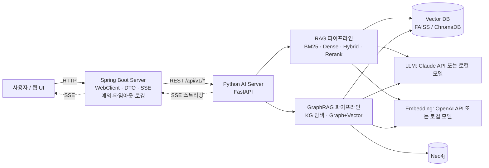

# 기획서 — AI Engineering Learning Lab

> 이 저장소에 남긴 유일한 기획 문서입니다. 방향과 판단 기준만 담고, 정해진 실습 순서는 두지 않습니다.
> 이전 자료 복구: 실습 코드가 있던 상태는 커밋 `aa46d2f`, 개념 README가 있던 상태는 커밋 `26f20bd`
> (`git checkout <커밋>`으로 볼 수 있습니다).

## 1. 목적

- **AI 서비스 개발자로서 RAG·GraphRAG 서비스를 설계하고 판단하는 능력**을 기른다.
  - 예: 어떤 검색 방식을 쓸지, 언제 GraphRAG가 필요한지, 언제 fine-tuning이 값어치가 있는지, 비용·지연·품질을 어떻게 맞출지
- 원리는 **깊게 이해**하고, 구현은 **라이브러리·API로 얕게** 한다. LLM을 처음부터 만드는 연구자 역할은 목표가 아니다.
- 최종적으로 **Java/Spring Boot가 Python AI 서버를 호출하는 서비스**로 마무리해, 기존 Java 경력과 결합한 포트폴리오를 만든다.

## 2. 학습 방식

1. **만들고 싶은 기능을 고른다.** (예: 로컬 LLM 대화, 문서 청킹, Dense 검색, LLM 어댑터, 엔티티 추출, FastAPI 엔드포인트)
2. **최종 서비스(§3)의 어디에 들어가는지 확인한다.**
3. **필요한 개념을 묻고 이해한다.** VS Code의 Claude Code 또는 총괄 세션에 질문한다.
4. **직접 구현한다.** 정답 코드는 요청할 때만 받는다. 기본은 방향 → API 이름 → 예시 순의 힌트.
5. **만든 것을 키워 간다.** 연습으로 만든 코드라도 쓸모가 확인되면 서비스 모듈(§3-2)로 옮긴다.

순서는 자유다. 단, **RAG(§4 Part 3)를 만들기 전에는 임베딩·코사인 유사도 개념**을 알고 있어야 한다.

## 3. 최종 서비스 구조



한 줄 흐름: **사용자 → Spring Boot → Python AI 서버 → RAG/GraphRAG → 벡터DB/Neo4j → LLM**

### 3-1. Python AI 서버 엔드포인트 (계획)

| 메서드 | 경로 | 역할 |
|---|---|---|
| POST | `/api/v1/documents` | 문서 업로드·청킹·인덱싱 |
| POST | `/api/v1/embeddings` | 텍스트 임베딩 |
| POST | `/api/v1/search` | BM25 / Dense / Hybrid / Hybrid+Rerank 검색 |
| POST | `/api/v1/rag/query` | RAG 답변 생성(스트리밍 옵션) |
| POST | `/api/v1/graphrag/query` | GraphRAG 답변 생성(스트리밍 옵션) |
| GET | `/api/v1/health` | 상태·모델 로딩 여부 |

- REST 먼저, gRPC는 확장 과제.
- LLM·임베딩은 **공급자를 분리**해 설정(환경 변수)으로 Claude ↔ 로컬, OpenAI ↔ 로컬을 바꿀 수 있게 한다.
- 외부 호출에는 타임아웃·재시도를 두고, 모든 호출의 토큰 사용량을 기록해 요청별 비용을 추적한다.

### 3-2. 코드 위치 (제안, 강제 아님)

| 만드는 것 | 위치 |
|---|---|
| Python AI 서버 | `python_ai_server/` 안에서 기능별 모듈 — `llm/`, `embeddings/`, `chunking/`, `retrieval/`, `graph/`, `api/`, `observability/` |
| Spring Boot 서버 | `spring_boot_server/` |
| 한 번 해 보는 연습·실험 | `experiments/<YYYYMMDD>-<짧은이름>/` (목적·모델·설정·토큰/비용·결과를 README에) |

## 4. 주제 지도 (기획서 Part)

| Part | 주제 | 서비스에서의 위치 | 만들 때 확인할 질문 |
|---|---|---|---|
| 1 | AI 원리: 토큰·임베딩·Transformer | 청크 크기·비용 계산, Dense 검색, 컨텍스트 비용 | 토큰 수는 비용·청크 크기에 어떻게 연결되나? 코사인 유사도는 왜 정규화가 필요한가? 컨텍스트가 길면 왜 느리고 비싼가? |
| 2 | LLM 활용: 로컬 모델 + Claude API | LLM 어댑터, 구조화 출력, 스트리밍, 캐싱·배치 | 공급자를 바꾸면 무엇이 달라지나? 대화 기록은 왜 매번 다시 보내나? 캐시는 언제 깨지나? |
| 3 | RAG | RAG 파이프라인, `/search`·`/rag/query` | 어떤 청킹이 좋은가? BM25 vs Dense vs Hybrid vs Rerank 중 무엇이 나은가(같은 평가 세트의 수치로)? |
| 4 | GraphRAG | GraphRAG 파이프라인, Neo4j, `/graphrag/query` | 언제 GraphRAG가 필요한가? 멀티홉 질문에서 Vector RAG보다 나은가? |
| 5 | Fine-tuning (임베딩·Reranker) | 임베딩·Reranker 교체 | fine-tuning이 기준선(OpenAI 임베딩)보다 값어치가 있나(품질·비용·지연·운영 부담)? |
| 6 | AI 서비스 | FastAPI + Spring Boot 전체 | 타임아웃·재시도·폴백은? 비용은 어떻게 추적하나? SSE는 어떻게 중계하나? |

- **평가 지표(Part 3~5):** Precision/Recall/HitRate@K, MRR, NDCG, 질의당 지연(p50/p95), 토큰 비용.
- **완료의 기준:** "더 좋다"는 항상 **같은 데이터셋·같은 평가 세트의 수치**로 말한다.

## 5. 사용자 강조 사항

### 5-1. Hybrid Search는 직접 구현한 뒤 프레임워크와 비교
- 직접 구현: BM25 + Dense + 결합(RRF `score(d) = Σ 1/(k + rank_i(d))`, 또는 점수 정규화 후 가중합)
- 비교 대상: LangChain `EnsembleRetriever`, LlamaIndex `QueryFusionRetriever`, Haystack `DocumentJoiner`, neo4j-graphrag `HybridRetriever` (결합 방식은 버전별로 확인)
- 공정성: 같은 청크·같은 임베딩 모델·같은 K. 기본값 실행과 설정을 맞춘 실행을 둘 다 기록.

### 5-2. RTX 3070(8GB)에서 가능한 것과 불가능한 것

> 일반적인 경험치다. 실제 사용량은 측정해서 기록한다.

| 작업 | 판정 | 비고 |
|---|---|---|
| 0.5~1.5B LLM 추론 | 가능 | fp16/bf16 |
| 3B LLM 4bit 추론 | 가능 | |
| 7~8B LLM 4bit 추론 | 조건부 | 여유 적음 |
| 0.5~1.5B LoRA, 3B QLoRA | 가능(선택) | 1.5B LoRA는 gradient checkpointing |
| 7~8B QLoRA | 조건부(선택) | OOM 위험 |
| 임베딩(~0.6B)·Cross-Encoder fine-tuning | 가능 | Part 5의 기본 범위 |
| 13B 이상 학습 | 사실상 불가 | |
| **LLM 사전학습** | **목표에서 제외** | |

### 5-3. Spring Boot가 Python AI 서버를 호출하는 구조로 마무리
- 진행 과정(만든 것, 측정 수치, 회고)을 포트폴리오로 남긴다.

## 6. 기술 선택

- **LLM:** Claude API(Anthropic SDK) 또는 로컬 모델(Ollama). 모델 ID는 환경 변수(`LLM_MODEL`)로 바꾼다.
  - Claude 코드 규칙은 [CLAUDE.md](../CLAUDE.md) §5.
- **임베딩:** OpenAI API(`text-embedding-3-small`) 또는 로컬 임베딩 전용 모델(multilingual-e5, bge-m3). 채팅용 LLM은 임베딩 용도로 쓰지 않는다.
- **API 키:** 저장소 루트 `.env`에만 둔다(커밋 금지). 견본은 [.env.example](../.env.example).
- **실행 결과는 지어내지 않는다.** 측정하지 않은 숫자는 "측정 필요"로 둔다.

### 6-1. 모델과 라이선스 (사용 전에 모델 카드에서 다시 확인)

| 용도 | 모델 | 라이선스(계획 시점) | 메모 |
|---|---|---|---|
| LLM | Qwen2.5-0.5B / 1.5B / 7B Instruct | Apache-2.0 | 3070에는 1.5B가 무난한 시작점 |
| LLM | **Qwen2.5-3B** Instruct | **비상업(Qwen Research)** | 학습용만, 서비스 기본값 금지 |
| LLM | Qwen3 계열 | Apache-2.0 | |
| 임베딩 | intfloat/multilingual-e5 (small/base/large) | MIT | 입력 접두어 규칙은 모델 카드 확인 |
| 임베딩 | BAAI/bge-m3 | MIT | 다국어, 긴 입력 |
| Reranker | BAAI/bge-reranker-v2-m3 | Apache-2.0 | Cross-Encoder |
| 서빙 | Ollama | MIT(런타임) | 모델별 라이선스는 별도 |

### 6-2. 라이브러리 (필요할 때 설치)

| Part | 라이브러리 |
|---|---|
| 공통 | numpy, pandas, matplotlib, pytest, ruff |
| 1 | PyTorch, tokenizers, gensim |
| 2 | anthropic, requests/httpx, transformers |
| 3 | sentence-transformers, faiss-cpu, chromadb, rank-bm25, pypdf, (비교용) LangChain·LlamaIndex·Haystack |
| 4 | neo4j, neo4j-graphrag, networkx |
| 5 | sentence-transformers, peft, bitsandbytes |
| 6 | fastapi, uvicorn, sse-starlette / Java 21, Spring Boot 3.x, Gradle, Docker Desktop |

- Windows에서는 `faiss-cpu`를 쓴다. Neo4j는 Docker 또는 Neo4j Desktop.

## 7. 환경 (Windows · PowerShell)

| 항목 | 값 |
|---|---|
| OS | Windows |
| GPU | RTX 3070, VRAM 8GB |
| RAM | 32GB |
| Python | 3.12 권장 (일부 라이브러리의 3.14 지원 부족) |
| 패키지 관리 | uv |

```powershell
git clone https://github.com/TD-Kim/ai-engineering-lab
cd ai-engineering-lab
uv python install 3.12
uv venv --python 3.12 .venv
.\.venv\Scripts\Activate.ps1
$env:PYTHONUTF8 = "1"                      # 한글 출력 깨짐 방지

# PyTorch는 CUDA 인덱스에서 먼저 설치 (PyPI의 Windows용 torch는 CPU 전용)
uv pip install torch --index-url https://download.pytorch.org/whl/cu128

# 나머지는 필요할 때: uv pip install <패키지>

Copy-Item .env.example .env                # 키는 .env 에만
```

- `Activate.ps1`이 "스크립트를 실행할 수 없습니다"로 막히면 한 번만 `Set-ExecutionPolicy -Scope CurrentUser RemoteSigned`를 실행한다(현재 사용자에게만 적용).
- PyTorch 설치 명령은 [공식 선택기](https://pytorch.org/get-started/locally/)에서 최신 값을 확인한다.
- GPU 확인: `python -c "import torch; print(torch.cuda.is_available(), torch.cuda.get_device_name(0))"`
- 로컬 LLM: Ollama 설치(`irm https://ollama.com/install.ps1 | iex`) 후 `ollama pull qwen2.5:1.5b`, `ollama run qwen2.5:1.5b`로 확인.

## 8. 결정 이력

| 날짜 | 결정 |
|---|---|
| 2026-11-09 | 새 저장소 `ai-engineering-lab`에서 시작. 참고 저장소 `graphRAG_learning`은 읽기 전용 참고용(코드 복사 금지, 링크만) |
| 2026-11-09 | LLM은 Claude API, 임베딩은 OpenAI API 기본. 로컬 모델도 쓸 수 있게 공급자 분리 |
| 2026-11-09 | 서비스 설계 중심: 개념은 깊게, 구현은 얕게. LLM 사전학습 제외 |
| 2026-11-16 | 정해진 실습(starter·solution·tests) 방식 폐지 → 만들고 싶은 것을 골라 직접 구현 |
| 2026-11-16 | 저장소 정리: 이 기획서와 필수 설정(`.gitignore`, `.env.example`, `CLAUDE.md`, `README.md`)만 남김. 이전 자료는 `aa46d2f`(실습 코드), `26f20bd`(개념 README) |
