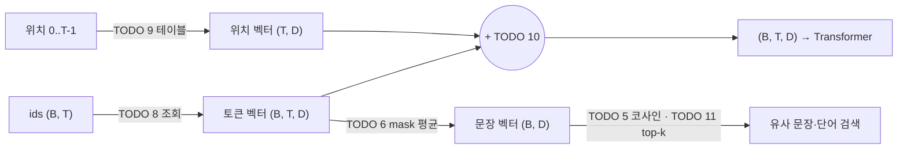

# P1-02 Embedding

| 항목 | 값 |
|---|---|
| 실습 ID | P1-02 |
| 난이도 | Level 1 → 2 → 3 |
| 주차 · 진행 순서 | W4 · Part 1의 세 번째 실습 (선수 pytorch → tokenizer → **embedding** → word2vec → transformer) |
| 예상 시간 | 3시간 |
| 필요 패키지 | torch(CPU판으로도 충분), matplotlib(그림, 없으면 건너뜀). 사전학습 비교만 `sentence-transformers` + 로컬 모델(선택) |
| 파일 | `starter.py`(직접 채우기), `solution.py`(정답), `tests/test_p1_02_embedding.py`, `run_demo.py`, `compare_pretrained.py` |

## 1. 목표

- 토큰 ID를 벡터로 바꾸는 **임베딩 테이블 조회**가 "one-hot × 행렬"과 같다는 것을 직접 확인한다.
- L2 정규화와 **코사인 유사도**를 직접 구현하고, 왜 내적이 아니라 코사인을 쓰는지 설명한다.
- 토큰 벡터 평균으로 **문장 벡터**를 만들고, 패딩을 평균에서 빼야 하는 이유를 이해한다.
- `nn.Embedding`을 직접 구현하고(`padding_idx` 포함) 공식 구현과 출력·기울기가 같은지 비교한다.
- **학습형 위치 임베딩**을 더해, 같은 토큰이라도 자리마다 다른 벡터가 되게 한다.
- 최근접 이웃(top-k)과 PCA 2차원 투영으로 벡터 공간을 들여다본다.

## 2. 선수지식

- [P1-04 PyTorch 기초](../pytorch/README.md): 텐서 인덱싱, broadcasting(`keepdim`), `nn.Parameter`, autograd
- [P1-01 Tokenizer](../tokenizer/README.md): 문장 → 토큰 → ID, `<pad>`와 attention mask
- 벡터의 내적과 노름: `a·b = |a||b|cos θ`

## 3. 핵심 개념

| 개념 | 한 줄 설명 |
|---|---|
| 임베딩 테이블 | (어휘 크기 V, 차원 D) 행렬. ID *i*의 벡터는 *i*번째 행 |
| 조회(lookup) | 행렬곱 없이 행을 고르는 연산. 비용이 V와 무관 |
| one-hot | 길이 V, 1이 하나뿐인 벡터. 모든 단어 쌍의 거리가 같아 "비슷함"을 표현하지 못함 |
| 분산 표현(dense) | 작은 D차원 실수 벡터에 의미를 나눠 담음. 학습으로 비슷한 쓰임이 가까워짐 |
| 코사인 유사도 | 길이를 지우고 방향만 비교. 범위 [-1, 1] |
| 문장 벡터(평균) | 토큰 벡터의 평균. 간단하지만 **순서를 모른다** |
| `padding_idx` | 패딩 ID의 벡터를 0으로 두고 학습하지 않음 |
| 위치 임베딩 | 위치 0, 1, 2, …에도 벡터를 하나씩 두고 토큰 벡터에 더함 |

## 4. 내부 원리

**왜 토큰 ID를 그대로 쓰지 않고 벡터로 바꾸나?**
ID는 이름표일 뿐이라 정수 사이의 거리에 의미가 없습니다. 예를 들어 "cat"=7, "dog"=8, "car"=300이라고 해서 cat이 car보다 dog에 가깝다는 뜻이 아닙니다.
신경망은 입력에 곱하고 더하므로, 정수를 그대로 넣으면 이런 **의미 없는 크기와 거리**를 학습 신호로 써 버립니다.
one-hot은 이 문제를 없애지만 모든 단어 사이 거리가 같아(√2) 비슷함을 표현할 수 없고, 어휘가 5만 개면 5만 차원이 됩니다.
그래서 ID마다 학습 가능한 D차원 벡터를 두고, 학습이 "비슷한 쓰임의 토큰을 가까운 곳에" 놓도록 합니다(Mikolov et al., 2013의 분산 표현).

**임베딩 층 = 입력이 one-hot인 Linear 층**
`one_hot(i) @ W`는 W의 i번째 행만 남깁니다. 결과는 `W[i]`와 같지만 V배 많은 곱셈과 메모리를 씁니다(TODO 1~3).
그래서 실제 구현은 인덱싱(조회)을 쓰고, 역전파에서도 **등장한 ID의 행에만** 기울기가 흐릅니다.

**왜 코사인 유사도인가?**
내적 `a·b = |a||b|cos θ`는 길이에 비례합니다. 자주 나오는 단어는 학습 중 자주 갱신되어 벡터 길이가 커지는 경향이 있고, 그러면 내적 기준으로는 "모든 단어와 비슷해 보이는" 단어가 되기 쉽습니다(과제 2에서 직접 확인).
코사인은 길이를 나눠 지우고 방향만 보므로 이런 왜곡이 없습니다. 테스트 `test_cosine_similarity_matrix_and_length_invariance`가 길이를 10배 해도 값이 같은지 확인합니다.

**위치 임베딩이 없으면 순서가 사라진다**
토큰 벡터만 쓰면 "개가 사람을 문다"의 "개"와 "사람이 개를 문다"의 "개"가 **완전히 같은 벡터**입니다.
어텐션(P1-05)은 위치를 보지 않는 연산이라, 입력 순서를 섞으면 출력도 똑같이 섞일 뿐 순서를 알 수 없습니다.
위치 벡터를 더하면 같은 토큰도 자리마다 다른 벡터가 되어 뒤의 층이 순서를 쓸 수 있습니다.
**단, 단순 평균은 위치를 더해도 순서를 모릅니다.** `평균(tok + pos) = 평균(tok) + 평균(pos)`이고, 같은 길이의 문장이면 `평균(pos)`가 같기 때문입니다(테스트에서 확인).



**초기화 분포**
`EmbeddingLayer`는 `nn.Embedding`과 같은 N(0, 1)로 초기화합니다. 0으로 초기화하면 처음엔 모든 토큰이 같은 벡터라 구별이 안 되고, 뒤 층 가중치도 0이면 임베딩으로 오는 기울기까지 0이라 학습으로도 이 상태가 깨지지 않습니다.
위치 임베딩은 std 0.02로 작게 시작해 처음에는 토큰 벡터를 크게 흔들지 않게 했습니다. 이 값은 설계 선택이며 모델마다 다릅니다.
P1-05 Transformer에서는 고정된 사인/코사인 위치 인코딩도 다룹니다.

## 5. 수식

임베딩 조회와 one-hot의 동치 (TODO 1~3), `E ∈ ℝ^{V×D}`:

$$
\text{lookup}(i) = E_{i,:} = \mathbf{e}_i^\top E,\qquad \mathbf{e}_i = \text{one\_hot}(i) \in \{0,1\}^V
$$

L2 정규화와 코사인 유사도 (TODO 4, 5):

$$
\hat{\mathbf{a}} = \frac{\mathbf{a}}{\lVert \mathbf{a} \rVert_2 + \epsilon},\qquad
\cos(\mathbf{a}, \mathbf{b}) = \hat{\mathbf{a}} \cdot \hat{\mathbf{b}} \in [-1, 1]
$$

패딩을 뺀 문장 벡터 (TODO 6), `m_t ∈ {0, 1}`:

$$
\mathbf{s} = \frac{\sum_{t=1}^{T} m_t\, E_{x_t}}{\max\!\left(1, \sum_t m_t\right)}
$$

위치 임베딩 (TODO 10), `P ∈ ℝ^{L_max×D}`: `h_t = E_{x_t} + P_t`

PCA (TODO 12): `X̄ = X − mean(X) = U S Vᵀ`이면 2차원 좌표는 `X̄ V[:, :2]`입니다.

shape 흐름:

```text
ids (B, T) ──lookup──▶ (B, T, D) ──+ pos (T, D)──▶ (B, T, D)
                          │
                          └─ × mask (B, T, 1) ─ sum(dim=1) / 토큰 수 ─▶ 문장 벡터 (B, D)
```

## 6. 실행법

저장소 루트에서 실행합니다.

**Windows PowerShell**

```powershell
.\.venv\Scripts\Activate.ps1
$env:PYTHONUTF8 = "1"

# 1) 남은 TODO 확인
python part1_ai_fundamentals/embedding/starter.py

# 2) 직접 구현 검사 (TODO가 남은 테스트는 skip으로 표시)
$env:IMPL = "starter"; pytest part1_ai_fundamentals/embedding -rs; Remove-Item Env:IMPL

# 3) 정답 코드 검사
pytest part1_ai_fundamentals/embedding -rs

# 4) 데모: 학습 전후 최근접 이웃 + PCA 그림 (outputs/ 에 PNG 저장)
python part1_ai_fundamentals/embedding/run_demo.py --impl starter

# 5) (선택) 사전학습 임베딩 비교 — sentence-transformers 와 로컬 모델이 있을 때만
$env:LOCAL_EMBEDDING_MODEL = "intfloat/multilingual-e5-small"
python part1_ai_fundamentals/embedding/compare_pretrained.py --impl starter
```

**bash (Linux/macOS)**

```bash
source .venv/bin/activate
python part1_ai_fundamentals/embedding/starter.py
IMPL=starter pytest part1_ai_fundamentals/embedding -rs
pytest part1_ai_fundamentals/embedding -rs
python part1_ai_fundamentals/embedding/run_demo.py --impl solution
python part1_ai_fundamentals/embedding/compare_pretrained.py --impl solution
```

- 테스트는 `IMPL` 환경 변수로 `starter.py`/`solution.py`를 **파일 경로 기준**으로 불러옵니다(`part1_ai_fundamentals/conftest.py`).
- TODO가 남아 있으면 해당 테스트는 실패가 아니라 **`skipped`(TODO 미구현: TODO n)** 로 나옵니다. 번호는 그 테스트가 처음 부딪힌 TODO입니다. 예를 들어 `nn.Embedding` 비교 테스트는 먼저 TODO 7을 부릅니다.
- `compare_pretrained.py`는 multilingual-e5 계열이면 양쪽 문장에 `query: ` 접두어를 붙여 측정합니다. 문장 유사도 같은 대칭 작업에 모델 카드가 권장하는 방식입니다. 작성 환경에서 huggingface.co 접속이 막혀 원문은 재확인하지 못했으니(미확인) 사용 전에 모델 카드를 확인하세요. 접두어 없이 재려면 `--prefix ""`를 씁니다.
- `compare_pretrained.py`는 **다운로드하지 않습니다**(`local_files_only`). `sentence-transformers`가 없거나 모델이 로컬에 없으면 `[건너뜀]`을 출력하고, 해당 테스트도 skip됩니다.
- GPU가 있으면 `run_demo.py`가 자동으로 cuda를 씁니다. 전체 실행은 CPU에서 수 초면 끝납니다.

## 7. TODO 목록

| TODO | Level | 위치 | 내용 |
|---|---|---|---|
| 1 | 1 | `lookup` | ID로 테이블 행 조회 (임의 shape) |
| 2 | 1 | `one_hot` | one-hot 행렬 직접 만들기 |
| 3 | 1 | `embedding_via_one_hot` | one-hot × 행렬 = 조회 확인 |
| 4 | 1 | `l2_normalize` | L2 정규화 (`keepdim`, eps) |
| 5 | 1 | `cosine_similarity` | (N, M) 코사인 유사도 행렬 |
| 6 | 1 | `sentence_vector` | 패딩을 뺀 토큰 벡터 평균 |
| 7 | 2 | `EmbeddingLayer.__init__` | `nn.Parameter`, N(0,1) 초기화, `padding_idx` (0 벡터 + 기울기 차단) |
| 8 | 2 | `EmbeddingLayer.forward` | 인덱싱 조회 |
| 9 | 2 | `PositionalEmbedding.__init__` | 학습형 위치 테이블 (max_len, D) |
| 10 | 2 | `TokenAndPositionEmbedding.forward` | 토큰 + 위치 (broadcasting) |
| 11 | 2 | `most_similar` | 코사인 top-k (자기 자신 제외) |
| 12 | 3 | `pca_2d` | 중심화 + SVD로 2차원 투영 |
| — | 3 | tests / `run_demo.py` / `compare_pretrained.py` | `nn.Embedding` 비교, 벡터 공간 시각화, 사전학습 비교(선택) |

각 TODO 아래의 주석 규약: `HINT 1`(방향) · `HINT 2`(shape·API) · `WHY`(왜 필요한가) · `REF`(출처).
REF는 다음 두 가지만 씁니다. 이 저장소의 작성 환경에서는 pytorch.org 접속이 막혀 있어 **URL이 열리는지는 확인하지 못했습니다**(미확인).
- PyTorch 공식 문서 `https://pytorch.org/docs/stable/generated/torch.nn.Embedding.html`
- Vaswani et al., 2017, §3.5 (학습형 위치 임베딩 언급)

## 8. 예상 결과

아래는 이 저장소의 클라우드 환경(**CPU**, Python 3.12.13, torch 2.15.0, matplotlib 3.11.2, sentence-transformers 미설치)에서 실제로 실행한 출력입니다.

`python part1_ai_fundamentals/embedding/starter.py` (아무것도 채우지 않은 상태, 마지막 줄들)

```text
[미구현] TODO 11 most_similar (Level 2)
[미구현] TODO 12 pca_2d (Level 3)

남은 TODO 12개 — 위에서부터 순서대로 채우세요(뒤 TODO 는 앞 TODO 를 사용합니다). 채운 뒤 검사:
  (bash)       IMPL=starter pytest part1_ai_fundamentals/embedding
  (PowerShell) $env:IMPL="starter"; pytest part1_ai_fundamentals/embedding; Remove-Item Env:IMPL
```

`pytest part1_ai_fundamentals/embedding -rs` (solution)

```text
SKIPPED [1] part1_ai_fundamentals/embedding/tests/test_p1_02_embedding.py:142: sentence-transformers 미설치 — 사전학습 비교 건너뜀
12 passed, 1 skipped in 1.55s
```

`IMPL=starter pytest part1_ai_fundamentals/embedding -rs` (아무것도 채우지 않은 상태, 앞부분)

```text
sssssssssssss                                                            [100%]
SKIPPED [1] part1_ai_fundamentals/embedding/tests/test_p1_02_embedding.py:17: TODO 미구현: TODO 1
SKIPPED [1] part1_ai_fundamentals/embedding/tests/test_p1_02_embedding.py:25: TODO 미구현: TODO 2
...
13 skipped in 1.35s
```

`python part1_ai_fundamentals/embedding/run_demo.py --impl solution`

```text
[device] cpu
[data] vocab=365 pairs=456 dim=16
[before] neighbors: {'cat': [('각', 0.723), ('training', 0.678), ('check', 0.599)], 'dog': [('Mixing', 0.657), ('tiny', 0.643), ('A', 0.634)], 'the': [('help', 0.647), ('training,', 0.584), ('설정으로', 0.546)], 'loss': [('different', 0.633), ('walk', 0.565), ('설정으로', 0.527)], 'model': [('gradients', 0.689), ('글자들을', 0.678), ('does', 0.634)]}
[train] loss 6.0347 -> 0.5645 (300 steps, 0.20s)
[after] neighbors: {'cat': [('dog', 0.77), ('읽는다.', 0.64), ('각', 0.615)], 'dog': [('cat', 0.77), ('나중에', 0.698), ('읽는다.', 0.578)], 'the': [('training,', 0.61), ('yourself.', 0.593), ('words.', 0.592)], 'loss': [('설정으로', 0.613), ('value', 0.6), ('different', 0.579)], 'model': [('turns', 0.598), ('much', 0.588), ('time.', 0.582)]}
[pca] after coords (PC1, PC2): {'cat': (-2.57, 0.46), 'dog': (-1.14, 0.61), 'the': (2.13, 1.64), 'loss': (-1.54, 0.23), 'model': (-2.22, -1.27)}
[pca] images: before=part1_ai_fundamentals/embedding/outputs/pca_before.png, after=part1_ai_fundamentals/embedding/outputs/pca_after.png
```

`python part1_ai_fundamentals/embedding/compare_pretrained.py`

```text
[건너뜀] 사전학습 임베딩 비교: sentence-transformers 미설치. 모델: intfloat/multilingual-e5-small
```

사전학습 비교 결과는 이 환경에서 실행하지 않았습니다. 사용자 PC에서 실행해 [experiments 기록](../../experiments/P1-02-20261109-embedding/README.md)에 남기세요(지어낸 수치 없음).

**해석**
- **학습 전** 이웃은 무작위입니다. 무작위 16차원 벡터 365개 중 가장 가까운 것을 골랐기 때문에 유사도가 0.6~0.7이어도 아무 의미가 없습니다. "유사도 값 자체"보다 "학습 전후 비교"가 중요한 이유입니다.
- **학습 후** `cat`과 `dog`가 서로의 1순위 이웃(0.77)이 됩니다. 말뭉치에서 둘 다 `the` 뒤에 오고 `sat`, `likes` 앞에 오기 때문입니다. 이 모델은 "다음 단어 맞히기"만 학습했는데, **같은 자리에 오는 단어끼리 벡터가 가까워졌습니다.** 분산 표현의 핵심 아이디어입니다.
- `loss`, `model`의 이웃은 여전히 의미가 없습니다. 말뭉치가 504단어뿐이고 각 단어가 2~4번만 나와서입니다. 실제 단어 벡터는 P1-03 Word2Vec에서 더 큰(생성한) 말뭉치로 학습합니다.
- loss 6.03은 `ln(365) ≈ 5.90` 근처(무작위 예측)에서 시작합니다. 0.56까지 내려간 것은 작은 말뭉치를 거의 외웠다는 뜻입니다(과적합). 일반화 성능을 뜻하지 않습니다.
- PCA 그림(`outputs/pca_after.png`)에서 `cat`·`dog`·`loss`·`model`은 PC1 음수 쪽, `the`는 양수 쪽에 있습니다. 2차원은 16차원 정보의 일부만 보여 주므로, 그림에서 가까워도 실제 코사인은 다를 수 있습니다. 그림은 커밋하지 않습니다(`.gitignore`의 `**/outputs/`).

## 9. 자주 나는 오류

| 증상 | 원인 | 해결 |
|---|---|---|
| `IndexError: index out of range in self` | 어휘 크기 이상의 ID | `max(ids) < V` 확인, 토크나이저와 어휘 크기 일치 |
| `scatter_` 에서 shape 오류 | index가 (N,) | `ids.unsqueeze(1)` → (N, 1) |
| 정규화 결과가 정사각 행렬에서만 틀림 | `keepdim=True` 누락 | `norm(dim=-1, keepdim=True)` |
| 코사인 결과에 `nan` | 0 벡터(패딩 행)를 0으로 나눔 | 분모에 eps |
| 문장 벡터가 배치마다 달라짐 | 패딩까지 평균 | mask를 곱하고 실제 토큰 수로 나눔 |
| 패딩 벡터가 학습 중 0이 아니게 됨 | 초기값만 0으로 두고 기울기를 막지 않음 | `register_hook`으로 패딩 행 기울기 0 (`nn.Embedding(padding_idx=...)`와 같은 동작) |
| `most_similar` 1등이 항상 자기 자신 | 자기 자신 제외 누락 | 자기 위치를 `-inf`로 |
| `RuntimeError: ... does not require grad` / 검색 중 그래프 생성 | 학습 파라미터로 검색 | `.detach()` |
| 위치 임베딩 shape 오류 `(B,T,D)+(L,D)` | `[:T]`로 자르지 않음 | `pos(seq_len)` → (T, D) |
| PCA 첫 번째 축이 데이터 평균 방향으로 치우침 | 중심화 누락 | 평균을 빼고 SVD |
| 저장했다 불러온 모델에서 패딩 행이 다시 학습됨 (오류 없음) | `torch.save(model)`로 모듈 전체를 저장하면 파라미터에 건 기울기 차단 hook이 사라짐 (torch 2.15에서 확인) | `torch.save(model.state_dict(), path)`로 저장하고, 같은 클래스(`padding_idx` 포함)로 만든 뒤 `load_state_dict` |
| Windows에서 한글 깨짐 | 기본 인코딩 cp949 | `$env:PYTHONUTF8 = "1"` |
| `compare_pretrained.py`가 항상 건너뜀 | 패키지·로컬 모델 없음 | `uv pip install sentence-transformers` 후 모델을 한 번 내려받아 캐시에 둠 (라이선스 확인) |

## 10. 과제

1. **D 바꾸기:** `run_demo.py --dim 2`, `8`, `64`로 실행해 학습 후 `cat`의 이웃과 최종 loss를 비교하세요. 차원이 너무 작거나 클 때 각각 무엇이 문제인가요?
2. **내적 vs 코사인:** `most_similar`를 코사인 대신 내적으로 바꿔 학습 후 이웃을 비교하세요. 벡터 길이가 가장 긴 단어들은 무엇이고, 그 단어들이 이웃 목록을 차지하나요?
3. **padding_idx 끄기:** `padding_idx`의 기울기 차단을 빼고 패딩이 많은 배치로 학습할 때 패딩 행이 어떻게 변하는지 기록하세요.
4. **순서 구별:** 평균 대신 "위치별 가중 평균" 또는 "첫 토큰 벡터"를 문장 벡터로 쓰면 `[1,2,3]`과 `[3,2,1]`이 구별되는지 확인하세요.
5. **(Level 3+) 사전학습 비교:** 사용자 PC에서 `compare_pretrained.py`를 실행하세요. 비슷한 문장 쌍과 다른 문장 쌍의 코사인 차이를 무작위 임베딩 평균과 비교해 기록하세요. 기본(`query: ` 접두어)과 `--prefix ""`의 결과도 비교해 보세요.

## 11. 체크리스트

- [ ] `python part1_ai_fundamentals/embedding/starter.py`가 "모든 TODO가 구현되었습니다"를 출력한다
- [ ] `IMPL=starter pytest part1_ai_fundamentals/embedding`이 TODO 미구현 skip 없이 통과한다 (사전학습 비교 skip은 무관)
- [ ] 정수 ID를 그대로 입력으로 쓰면 안 되는 이유를 설명할 수 있다
- [ ] "임베딩 층 = one-hot 입력 Linear"를 shape으로 설명할 수 있다
- [ ] 내적 대신 코사인 유사도를 쓰는 이유를 설명할 수 있다
- [ ] 위치 임베딩이 없으면 무엇이 사라지는지, 그리고 평균은 위치를 더해도 왜 순서를 모르는지 설명할 수 있다
- [ ] 실행 결과를 [experiments 기록](../../experiments/P1-02-20261109-embedding/README.md)에 남겼다

## 12. 다음 단계 연결

- **P1-03 Word2Vec:** 이번 데모는 "다음 단어"만 맞혔습니다. Word2Vec은 주변 단어 전체를 맞히며, 음성 샘플링으로 큰 어휘에서도 빠르게 단어 벡터를 학습합니다. 이번 `most_similar`, `pca_2d`를 그대로 씁니다.
- **P1-05 Transformer:** `TokenAndPositionEmbedding`이 Transformer 입력층입니다. 어텐션은 TODO 5의 내적 유사도를 확률로 바꿔 벡터를 섞습니다.
- **Part 3 RAG:** 문장 벡터 + 코사인 top-k가 Dense 검색입니다. 평균 대신 사전학습 문장 임베딩 모델을 씁니다.
- 진행 상태: [docs/PROGRESS.md](../../docs/PROGRESS.md) — 직접 확인한 뒤 P1-02를 `COMPLETED`로 바꾸세요.
