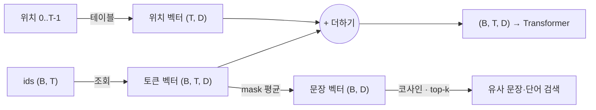

# P1-02 Embedding — 선택 과제

> **선택 과제 (P1-02A): 원리를 직접 구현해 보고 싶을 때.**
> 이 폴더는 임베딩 층(nn.Embedding)·위치 임베딩·PCA 를 직접 구현하고 nn.Embedding 과 비교하는 심화 개념 노트입니다(구현 코드는 삭제했고, 원리·수식·손계산·과제 아이디어만 남겼습니다). 메인 실습([../README.md](../README.md))은 라이브러리·API로 개념과 서비스 관점을 익히는 데 집중하고, 여기서는 같은 개념을 밑바닥부터 구현합니다. 메인 실습을 마친 뒤 시간이 있을 때 도전하세요.

> **최종 서비스에서의 위치:** 서비스 코드에서는 라이브러리·API를 쓰므로 이 노트는 필수가 아닙니다. 다만 임베딩 층·위치 임베딩을 직접 만들어 보면 Dense 검색의 임베딩이 "토큰 ID → 벡터 표 조회 + 평균"에서 시작한다는 것이 보입니다.

> 이 문서에 나오는 `함수·파일 이름`(예: `run_demo.py`)은 이전 실습 코드(커밋 `aa46d2f`)의 이름입니다. 그 코드는 지웠고 개념만 남겼습니다. 옛 코드가 필요하면 `git checkout aa46d2f`(복구 방법은 [루트 README](../../../README.md#지금-어디를-보면-되나-학습-방식)).

| 항목 | 값 |
|---|---|
| 실습 ID | P1-02 |
| 필요 패키지 | torch(CPU판으로도 충분), matplotlib(그림, 없으면 건너뜀). 사전학습 비교만 `sentence-transformers` + 로컬 모델(선택) |

## 1. 목표

- 토큰 ID를 벡터로 바꾸는 **임베딩 테이블 조회**가 "one-hot × 행렬"과 같다는 것을 직접 확인한다.
- L2 정규화와 **코사인 유사도**를 직접 구현하고, 왜 내적이 아니라 코사인을 쓰는지 설명한다.
- 토큰 벡터 평균으로 **문장 벡터**를 만들고, 패딩을 평균에서 빼야 하는 이유를 이해한다.
- `nn.Embedding`을 직접 구현하고(`padding_idx` 포함) 공식 구현과 출력·기울기가 같은지 비교한다.
- **학습형 위치 임베딩**을 더해, 같은 토큰이라도 자리마다 다른 벡터가 되게 한다.
- 최근접 이웃(top-k)과 PCA 2차원 투영으로 벡터 공간을 들여다본다.

## 2. 선수지식

- [P1-04 PyTorch 기초](../../pytorch/README.md): 텐서 인덱싱, broadcasting(`keepdim`), `nn.Parameter`, autograd
- [P1-01 Tokenizer](../../tokenizer/README.md): 문장 → 토큰 → ID, `<pad>`와 attention mask
- 벡터의 내적과 노름: `a·b = |a||b|cos θ`

## 3. 핵심 개념

| 개념 | 한 줄 설명 |
|---|---|
| 임베딩 테이블 | (어휘 크기 V, 차원 D) 행렬. ID *i*의 벡터는 *i*번째 행 |
| 조회(lookup) | 행렬곱 없이 행을 고르는 연산. 비용이 V와 무관 |
| one-hot | 길이 V, 1이 하나뿐인 벡터. 모든 단어 쌍의 거리가 같아 "비슷함"을 표현하지 못함 |
| 분산 표현(dense) | 작은 D차원 실수 벡터에 의미를 나눠 담음. 학습으로 비슷한 쓰임이 가까워짐 |
| 코사인 유사도 | 길이를 지우고 방향만 비교. 범위 [-1, 1] |
| 문장 벡터(평균) | 토큰 벡터의 평균. 간단하지만 **순서를 모른다** |
| `padding_idx` | 패딩 ID의 벡터를 0으로 두고 학습하지 않음 |
| 위치 임베딩 | 위치 0, 1, 2, …에도 벡터를 하나씩 두고 토큰 벡터에 더함 |

## 4. 내부 원리

**왜 토큰 ID를 그대로 쓰지 않고 벡터로 바꾸나?**
ID는 이름표일 뿐이라 정수 사이의 거리에 의미가 없습니다. 예를 들어 "cat"=7, "dog"=8, "car"=300이라고 해서 cat이 car보다 dog에 가깝다는 뜻이 아닙니다.
신경망은 입력에 곱하고 더하므로, 정수를 그대로 넣으면 이런 **의미 없는 크기와 거리**를 학습 신호로 써 버립니다.
one-hot은 이 문제를 없애지만 모든 단어 사이 거리가 같아(√2) 비슷함을 표현할 수 없고, 어휘가 5만 개면 5만 차원이 됩니다.
그래서 ID마다 학습 가능한 D차원 벡터를 두고, 학습이 "비슷한 쓰임의 토큰을 가까운 곳에" 놓도록 합니다(Mikolov et al., 2013의 분산 표현).

**임베딩 층 = 입력이 one-hot인 Linear 층**
`one_hot(i) @ W`는 W의 i번째 행만 남깁니다. 결과는 `W[i]`와 같지만 V배 많은 곱셈과 메모리를 씁니다.
그래서 실제 구현은 인덱싱(조회)을 쓰고, 역전파에서도 **등장한 ID의 행에만** 기울기가 흐릅니다.

**왜 코사인 유사도인가?**
내적 `a·b = |a||b|cos θ`는 길이에 비례합니다. 자주 나오는 단어는 학습 중 자주 갱신되어 벡터 길이가 커지는 경향이 있고, 그러면 내적 기준으로는 "모든 단어와 비슷해 보이는" 단어가 되기 쉽습니다(과제 2에서 직접 확인).
코사인은 길이를 나눠 지우고 방향만 보므로 이런 왜곡이 없습니다. 테스트 `test_cosine_similarity_matrix_and_length_invariance`가 길이를 10배 해도 값이 같은지 확인합니다.

**위치 임베딩이 없으면 순서가 사라진다**
토큰 벡터만 쓰면 "개가 사람을 문다"의 "개"와 "사람이 개를 문다"의 "개"가 **완전히 같은 벡터**입니다.
어텐션(P1-05)은 위치를 보지 않는 연산이라, 입력 순서를 섞으면 출력도 똑같이 섞일 뿐 순서를 알 수 없습니다.
위치 벡터를 더하면 같은 토큰도 자리마다 다른 벡터가 되어 뒤의 층이 순서를 쓸 수 있습니다.
**단, 단순 평균은 위치를 더해도 순서를 모릅니다.** `평균(tok + pos) = 평균(tok) + 평균(pos)`이고, 같은 길이의 문장이면 `평균(pos)`가 같기 때문입니다(테스트에서 확인).



**초기화 분포**
`EmbeddingLayer`는 `nn.Embedding`과 같은 N(0, 1)로 초기화합니다. 0으로 초기화하면 처음엔 모든 토큰이 같은 벡터라 구별이 안 되고, 뒤 층 가중치도 0이면 임베딩으로 오는 기울기까지 0이라 학습으로도 이 상태가 깨지지 않습니다.
위치 임베딩은 std 0.02로 작게 시작해 처음에는 토큰 벡터를 크게 흔들지 않게 했습니다. 이 값은 설계 선택이며 모델마다 다릅니다.
P1-05 Transformer에서는 고정된 사인/코사인 위치 인코딩도 다룹니다.

## 5. 수식

임베딩 조회와 one-hot의 동치, `E ∈ ℝ^{V×D}`:

$$
\text{lookup}(i) = E_{i,:} = \mathbf{e}_i^\top E,\qquad \mathbf{e}_i = \text{one\_hot}(i) \in \{0,1\}^V
$$

L2 정규화와 코사인 유사도:

$$
\hat{\mathbf{a}} = \frac{\mathbf{a}}{\lVert \mathbf{a} \rVert_2 + \epsilon},\qquad
\cos(\mathbf{a}, \mathbf{b}) = \hat{\mathbf{a}} \cdot \hat{\mathbf{b}} \in [-1, 1]
$$

패딩을 뺀 문장 벡터, `m_t ∈ {0, 1}`:

$$
\mathbf{s} = \frac{\sum_{t=1}^{T} m_t\, E_{x_t}}{\max\!\left(1, \sum_t m_t\right)}
$$

위치 임베딩, `P ∈ ℝ^{L_max×D}`: `h_t = E_{x_t} + P_t`

PCA: `X̄ = X − mean(X) = U S Vᵀ`이면 2차원 좌표는 `X̄ V[:, :2]`입니다.

shape 흐름:

```text
ids (B, T) ──lookup──▶ (B, T, D) ──+ pos (T, D)──▶ (B, T, D)
                          │
                          └─ × mask (B, T, 1) ─ sum(dim=1) / 토큰 수 ─▶ 문장 벡터 (B, D)
```

## 6. 자주 나는 오류

| 증상 | 원인 | 해결 |
|---|---|---|
| `IndexError: index out of range in self` | 어휘 크기 이상의 ID | `max(ids) < V` 확인, 토크나이저와 어휘 크기 일치 |
| `scatter_` 에서 shape 오류 | index가 (N,) | `ids.unsqueeze(1)` → (N, 1) |
| 정규화 결과가 정사각 행렬에서만 틀림 | `keepdim=True` 누락 | `norm(dim=-1, keepdim=True)` |
| 코사인 결과에 `nan` | 0 벡터(패딩 행)를 0으로 나눔 | 분모에 eps |
| 문장 벡터가 배치마다 달라짐 | 패딩까지 평균 | mask를 곱하고 실제 토큰 수로 나눔 |
| 패딩 벡터가 학습 중 0이 아니게 됨 | 초기값만 0으로 두고 기울기를 막지 않음 | `register_hook`으로 패딩 행 기울기 0 (`nn.Embedding(padding_idx=...)`와 같은 동작) |
| `most_similar` 1등이 항상 자기 자신 | 자기 자신 제외 누락 | 자기 위치를 `-inf`로 |
| `RuntimeError: ... does not require grad` / 검색 중 그래프 생성 | 학습 파라미터로 검색 | `.detach` |
| 위치 임베딩 shape 오류 `(B,T,D)+(L,D)` | `[:T]`로 자르지 않음 | `pos(seq_len)` → (T, D) |
| PCA 첫 번째 축이 데이터 평균 방향으로 치우침 | 중심화 누락 | 평균을 빼고 SVD |
| 저장했다 불러온 모델에서 패딩 행이 다시 학습됨 (오류 없음) | `torch.save(model)`로 모듈 전체를 저장하면 파라미터에 건 기울기 차단 hook이 사라짐 (torch 2.15에서 확인) | `torch.save(model.state_dict, path)`로 저장하고, 같은 클래스(`padding_idx` 포함)로 만든 뒤 `load_state_dict` |
| Windows에서 한글 깨짐 | 기본 인코딩 cp949 | `$env:PYTHONUTF8 = "1"` |

## 7. 과제

1. **D 바꾸기:** 직접 만든 학습 코드에서 차원을 2, 8, 64로 바꿔 학습 후 `cat`의 이웃과 최종 loss를 비교하세요. 차원이 너무 작거나 클 때 각각 무엇이 문제인가요?
2. **내적 vs 코사인:** `most_similar`를 코사인 대신 내적으로 바꿔 학습 후 이웃을 비교하세요. 벡터 길이가 가장 긴 단어들은 무엇이고, 그 단어들이 이웃 목록을 차지하나요?
3. **padding_idx 끄기:** `padding_idx`의 기울기 차단을 빼고 패딩이 많은 배치로 학습할 때 패딩 행이 어떻게 변하는지 기록하세요.
4. **순서 구별:** 평균 대신 "위치별 가중 평균" 또는 "첫 토큰 벡터"를 문장 벡터로 쓰면 `[1,2,3]`과 `[3,2,1]`이 구별되는지 확인하세요.
5. **(Level 3+) 사전학습 비교:** sentence-transformers의 사전학습 임베딩으로, 비슷한 문장 쌍과 다른 문장 쌍의 코사인 차이를 무작위 임베딩 평균과 비교해 기록하세요. e5 계열이면 접두어(`query: `)를 붙였을 때와 뺐을 때의 결과도 비교해 보세요(접두어 규칙은 모델 카드 확인 — 미확인).

## 8. 체크리스트

- [ ] 정수 ID를 그대로 입력으로 쓰면 안 되는 이유를 설명할 수 있다
- [ ] "임베딩 층 = one-hot 입력 Linear"를 shape으로 설명할 수 있다
- [ ] 내적 대신 코사인 유사도를 쓰는 이유를 설명할 수 있다
- [ ] 위치 임베딩이 없으면 무엇이 사라지는지, 그리고 평균은 위치를 더해도 왜 순서를 모르는지 설명할 수 있다

## 9. 다음 단계 연결

- **P1-03 Word2Vec:** 이번 데모는 "다음 단어"만 맞혔습니다. Word2Vec은 주변 단어 전체를 맞히며, 음성 샘플링으로 큰 어휘에서도 빠르게 단어 벡터를 학습합니다. 이번 `most_similar`, `pca_2d`를 그대로 씁니다.
- **P1-05 Transformer:** `TokenAndPositionEmbedding`이 Transformer 입력층입니다. 어텐션은 의 내적 유사도를 확률로 바꿔 벡터를 섞습니다.
- **Part 3 RAG:** 문장 벡터 + 코사인 top-k가 Dense 검색입니다. 평균 대신 사전학습 문장 임베딩 모델을 씁니다.
- 내가 만든 것은 [docs/PROGRESS.md](../../../docs/PROGRESS.md)에 기록합니다.
