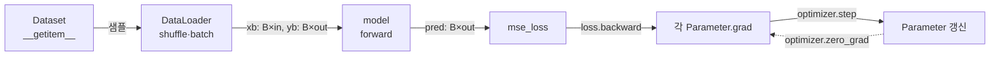

# P1-04 PyTorch 기초

| 항목 | 값 |
|---|---|
| 실습 ID | P1-04 |
| 난이도 | Level 1 → 2 → 3 |
| 주차 | W4 (Part 1의 첫 실습. 이후 모든 실습의 선수지식) |
| 예상 시간 | 3~4시간 |
| 파일 | `starter.py`(직접 채우기), `solution.py`(정답), `tests/test_p1_04_pytorch.py`, `run_demo.py` |

## 1. 목표

- Tensor의 shape과 broadcasting을 정확히 다룬다.
- autograd가 연쇄 법칙(chain rule)을 자동으로 적용한 것임을 **손으로 구한 기울기와 비교해** 확인한다.
- optimizer 없이 경사하강법을 직접 짜 보고, 그다음 `nn.Module`·`Dataset`·`DataLoader`·`optimizer`로 이루어진 **표준 학습 루프**를 만든다.
- 직접 만든 `MyLinear`가 `nn.Linear`와 같은 결과를 내는지 비교한다.

## 2. 선수지식

- Python 클래스, 리스트 컴프리헨션
- 행렬곱과 전치(행렬 A가 (m, n)이면 Aᵀ는 (n, m))
- 미분의 연쇄 법칙: `d f(g(x))/dx = f'(g(x)) · g'(x)`
- 환경 구성: [docs/ENVIRONMENT.md](../../docs/ENVIRONMENT.md) (torch 설치)

## 3. 핵심 개념

| 개념 | 한 줄 설명 |
|---|---|
| Tensor | GPU에서도 계산되는 다차원 배열. `shape`·`dtype`·`device`를 항상 확인한다 |
| Broadcasting | 크기가 1인 차원을 늘려 shape이 다른 텐서끼리 연산하는 규칙 |
| device | 텐서와 모델이 있는 장치(cpu/cuda). **연산하는 텐서는 모두 같은 device**에 있어야 한다 |
| autograd | 연산을 기록해 두었다가 `backward()`에서 연쇄 법칙으로 기울기를 계산 |
| `.grad` 누적 | `backward()`는 기울기를 덮어쓰지 않고 **더한다** → 매 step 초기화 필요 |
| `nn.Parameter` | `model.parameters()`에 등록되는 텐서. optimizer가 이것만 갱신한다 |
| Dataset / DataLoader | 샘플 하나를 꺼내는 규칙(`__len__`, `__getitem__`)과, 그것을 섞고 배치로 묶는 도구 |

## 4. 내부 원리

**왜 `.grad`를 매번 0으로 만드나?**
PyTorch는 여러 loss의 기울기를 더하는 경우(예: gradient accumulation)를 위해 `.grad`를 누적합니다.
초기화하지 않으면 step t의 기울기가 step 1~t의 합이 되어 갱신 폭이 점점 커지고 발산합니다.

**왜 파라미터 갱신을 `torch.no_grad()` 안에서 하나?**
`w -= lr * w.grad`도 연산이므로, 그대로 두면 autograd가 "갱신 자체"를 계산 그래프에 기록하려 합니다.
`requires_grad=True`인 leaf 텐서에 in-place 연산을 하면 오류가 나고, 오류가 안 나더라도 그래프가 계속 커집니다.

**왜 `nn.Parameter`인가?**
`nn.Module`은 속성으로 대입된 `nn.Parameter`만 자동으로 등록합니다. 일반 텐서로 두면 `optimizer`가 그 값을 모르므로
**오류 없이 학습이 전혀 되지 않는** 가장 찾기 어려운 버그가 됩니다.

**학습 루프의 데이터 흐름**



## 5. 수식

선형 변환 (`nn.Linear`와 같은 규약, `W`의 shape은 `(out, in)`):

$$
Y = X W^\top + b,\qquad X \in \mathbb{R}^{N\times \text{in}},\; W \in \mathbb{R}^{\text{out}\times \text{in}},\; b \in \mathbb{R}^{\text{out}}
$$

평균 제곱 오차와 1차원 선형회귀 `ŷᵢ = w xᵢ + b`의 기울기 (TODO 5):

$$
L = \frac{1}{N}\sum_{i=1}^{N} (w x_i + b - y_i)^2,\qquad
\frac{\partial L}{\partial w} = \frac{2}{N}\sum_i (w x_i + b - y_i)\,x_i,\qquad
\frac{\partial L}{\partial b} = \frac{2}{N}\sum_i (w x_i + b - y_i)
$$

경사하강법 (TODO 6): `θ ← θ − η · ∂L/∂θ`

Broadcasting 예 (TODO 2):

```text
x     : (N, D)
norm  : (N, 1)   ← keepdim=True
x/norm: (N, D)   ← 크기 1인 열 차원이 D로 늘어남 (행마다 자기 노름으로 나눔)

keepdim 없이 norm: (N,) 이면 → (1, N)으로 취급되어 "열" 방향으로 나눔 (N==D면 오류 없이 틀림)
```

## 6. 실행법

저장소 루트에서 실행합니다.

**Windows PowerShell**

```powershell
.\.venv\Scripts\Activate.ps1
$env:PYTHONUTF8 = "1"

# 1) 남은 TODO 확인
python part1_ai_fundamentals/pytorch/starter.py

# 2) 직접 구현 검사 (NotImplementedError 가 남은 테스트는 skip 으로 표시됨)
$env:IMPL = "starter"; pytest part1_ai_fundamentals/pytorch; Remove-Item Env:IMPL

# 3) 정답 코드 검사
pytest part1_ai_fundamentals/pytorch

# 4) 데모 실행
python part1_ai_fundamentals/pytorch/run_demo.py --impl starter
```

**bash (Linux/macOS)**

```bash
source .venv/bin/activate
python part1_ai_fundamentals/pytorch/starter.py
IMPL=starter pytest part1_ai_fundamentals/pytorch
pytest part1_ai_fundamentals/pytorch          # 기본값 IMPL=solution
python part1_ai_fundamentals/pytorch/run_demo.py --impl solution
```

- 테스트는 `IMPL` 환경 변수로 `starter.py`/`solution.py` 중 하나를 **파일 경로 기준**으로 불러옵니다(`part1_ai_fundamentals/conftest.py`).
- starter에 TODO가 남아 있으면 해당 테스트는 **실패가 아니라 `skipped`(TODO 미구현)** 로 나옵니다. 정상입니다.
- GPU가 있으면 자동으로 cuda를, 없으면 cpu를 씁니다. 전체 실행은 CPU에서도 수 초면 끝납니다.

## 7. TODO 목록

| TODO | Level | 위치 | 내용 |
|---|---|---|---|
| 1 | 1 | `get_device` | cuda/cpu 자동 선택 |
| 2 | 1 | `normalize_rows` | 행 단위 L2 정규화 (broadcasting, `keepdim`) |
| 3 | 1 | `linear_forward` | `x Wᵀ + b` (nn.Linear 규약) |
| 4 | 2 | `mse_loss` | 평균 제곱 오차 |
| 5 | 2 | `manual_mse_grads` | 기울기를 손으로 유도 → autograd와 비교 |
| 6 | 2 | `train_linear_regression_gd` | backward → no_grad 갱신 → grad 초기화 |
| 7 | 3 | `MyLinear.__init__` | `nn.Parameter` 등록과 초기화 |
| 8 | 3 | `MyLinear.forward` | 순전파 |
| 9 | 3 | `ToyRegressionDataset` | `__len__`, `__getitem__` |
| 10 | 3 | `train_model` | 표준 학습 루프 (zero_grad → forward → backward → step) |

각 TODO 아래의 주석 규약: `HINT 1`(방향) · `HINT 2`(shape·API) · `WHY`(왜 필요한가) · `REF`(공식 문서).

## 8. 예상 결과

아래는 이 저장소의 클라우드 환경(**CPU**, Python 3.12.13, torch 2.15.0+cu132)에서 `solution`으로 실제 실행한 출력입니다.
학습 시간·GPU 수치는 사용자 PC(RTX 3070)에서 측정해 [experiments 기록](../../experiments/P1-04-20261109-pytorch-basics/README.md)에 채웁니다.

`python part1_ai_fundamentals/pytorch/run_demo.py --impl solution`

```text
[device] cpu
[GD] w=2.0000 (정답 2.0), b=-1.0000 (정답 -1.0), loss 2.3878 -> 0.000000
[MyLinear]  loss 0.6794 -> 0.000106
[nn.Linear] loss 0.6794 -> 0.000106
[weight] learned=
tensor([[ 0.6610,  0.2675,  0.0621],
        [ 0.6208, -0.4519, -0.1656]])
 true=
tensor([[ 0.6614,  0.2669,  0.0617],
        [ 0.6213, -0.4519, -0.1661]])
[time] 1.71s
```

`pytest part1_ai_fundamentals/pytorch`

```text
..........                                                               [100%]
10 passed in 2.72s
```

`python part1_ai_fundamentals/pytorch/starter.py` (아무것도 채우지 않은 상태)

```text
[미구현] TODO 1  get_device (Level 1)
[미구현] TODO 2  normalize_rows (Level 1)
[미구현] TODO 3  linear_forward (Level 1)
[미구현] TODO 4  mse_loss (Level 2)
[미구현] TODO 5  manual_mse_grads (Level 2)
[미구현] TODO 6  train_linear_regression_gd (Level 2)
[미구현] TODO 7  MyLinear.__init__ (Level 3)
[미구현] TODO 8  MyLinear.forward (Level 3)
[미구현] TODO 9  ToyRegressionDataset (Level 3)
[미구현] TODO 10 train_model (Level 3)

남은 TODO 10개 — 위에서부터 순서대로 채우세요. 채운 뒤 검사:
  (bash)       IMPL=starter pytest part1_ai_fundamentals/pytorch
  (PowerShell) $env:IMPL="starter"; pytest part1_ai_fundamentals/pytorch; Remove-Item Env:IMPL
```

`IMPL=starter pytest part1_ai_fundamentals/pytorch -rs` (아무것도 채우지 않은 상태)

```text
ssssssssss                                                               [100%]
...
SKIPPED [1] part1_ai_fundamentals/pytorch/tests/test_p1_04_pytorch.py:5: TODO 미구현: TODO 1
SKIPPED [1] part1_ai_fundamentals/pytorch/tests/test_p1_04_pytorch.py:11: TODO 미구현: TODO 2
SKIPPED [1] part1_ai_fundamentals/pytorch/tests/test_p1_04_pytorch.py:20: TODO 미구현: TODO 2
... (SKIPPED 10개)
10 skipped in 1.62s
```

**해석**
- GD 결과 `w ≈ 2`, `b ≈ -1`: 데이터를 만든 식 `y = 2x − 1`을 그대로 복원했습니다.
- `MyLinear`와 `nn.Linear`의 loss 기록이 같은 이유: 같은 초기값·같은 셔플 순서(seed)·같은 연산이기 때문입니다.
- `[time]`은 CPU에서 30 epoch × 2개 모델을 학습한 시간입니다. 실행할 때마다 조금씩 다릅니다.
- `starter.py`의 상태 표시는 앞 TODO에 의존합니다(예: TODO 6은 TODO 4의 `mse_loss`를 씀). 위에서부터 채우세요.
- 학습된 `weight`가 `true_weight`와 거의 같고 오차는 잡음(표준편차 0.01) 수준입니다.

## 9. 자주 나는 오류

| 증상 | 원인 | 해결 |
|---|---|---|
| `RuntimeError: mat1 and mat2 shapes cannot be multiplied` | `weight`를 전치하지 않음 | `nn.Linear`의 weight는 `(out, in)` → `x @ weight.T` |
| `normalize_rows` 결과가 정사각 행렬에서만 틀림 | `keepdim=True` 누락 | `norm(dim=-1, keepdim=True)` |
| loss가 점점 커지며 `nan` | `.grad` 초기화 누락 또는 학습률 과대 | 매 step `zero_()` / `optimizer.zero_grad()`, `lr` 축소 |
| `a leaf Variable that requires grad is being used in an in-place operation` | 갱신을 `no_grad` 밖에서 함 | `with torch.no_grad():` 안에서 갱신 |
| 학습이 전혀 안 되는데 오류도 없음 | 파라미터를 일반 텐서로 둠 | `nn.Parameter`로 감싸기, `list(model.parameters())`로 확인 |
| `Expected all tensors to be on the same device` | 모델은 cuda, 데이터는 cpu | 배치마다 `xb.to(device)` |
| Windows에서 DataLoader가 멈추거나 스크립트가 반복 실행됨 | `num_workers > 0`인데 메인 가드 없음 | `if __name__ == "__main__":` 아래에서 실행, 또는 `num_workers=0` |
| `UnicodeDecodeError` (Windows) | 기본 인코딩 cp949 | `$env:PYTHONUTF8 = "1"` |

## 10. 과제

1. **학습률 실험:** `train_linear_regression_gd`에서 `lr`을 0.01, 0.1, 0.5, 1.1로 바꿔 loss 기록을 그래프로 그리세요. 어느 값부터 발산하나요? 이 문제(MSE, x∈[-1,1])에서 발산 경계를 수식으로 설명해 보세요.
2. **`.grad` 누적 확인:** TODO 6에서 `zero_()`를 일부러 빼고 실행해 loss가 어떻게 변하는지 기록하세요.
3. **optimizer 교체:** `train_model`의 SGD를 `torch.optim.Adam`으로 바꾸고 같은 epoch에서 loss를 비교하세요.
4. **DataLoader:** `num_workers=2`로 바꾸고 `run_demo.py`의 메인 가드를 지웠을 때 Windows에서 어떤 일이 생기는지 확인한 뒤 되돌리세요.
5. **(Level 3+)** `MyLinear`의 초기화를 0으로 바꾸고, 은닉층이 있는 2층 MLP에서 학습이 어떻게 달라지는지(대칭성 문제) 관찰하세요.

## 11. 체크리스트

- [ ] `python part1_ai_fundamentals/pytorch/starter.py`가 "모든 TODO가 구현되었습니다"를 출력한다
- [ ] `IMPL=starter pytest part1_ai_fundamentals/pytorch`가 skip 없이 전부 통과한다
- [ ] `keepdim`이 왜 필요한지 shape으로 설명할 수 있다
- [ ] 손으로 구한 기울기와 autograd 결과가 같은 이유를 설명할 수 있다
- [ ] `.grad`를 초기화하지 않으면 무슨 일이 생기는지 설명할 수 있다
- [ ] 학습 루프 5단계(zero_grad → forward → loss → backward → step)를 보지 않고 쓸 수 있다
- [ ] 실행 결과를 [experiments 기록](../../experiments/P1-04-20261109-pytorch-basics/README.md)에 남겼다 (사용자 PC 수치 포함)

## 12. 다음 단계 연결

- **P1-01 Tokenizer:** 문장을 Token ID로 바꾸는 단계. 여기서 만든 텐서 다루기가 그대로 쓰입니다.
- **P1-02 Embedding:** `nn.Embedding`은 "입력이 one-hot인 `MyLinear`(bias 없음)"와 같다는 것을 확인합니다.
- **P1-05 Transformer:** Q/K/V 투영이 모두 `nn.Linear`이고, 학습 루프는 TODO 10과 같은 구조입니다.
- **Part 2:** `.grad`, optimizer, 학습률이 LLM 학습 원리의 출발점입니다.
- 진행 상태: [docs/PROGRESS.md](../../docs/PROGRESS.md) — 직접 확인한 뒤 P1-04를 `COMPLETED`로 바꾸세요.
