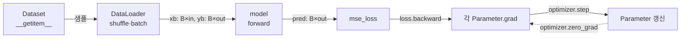

# P1-04 PyTorch 기초

| 항목 | 값 |
|---|---|
| 실습 ID | P1-04 |

> **최종 서비스에서의 위치:** Part 5 임베딩·Reranker fine-tuning과 Python AI 서버가 로컬 모델(Reranker·임베딩·소형 LLM)을 GPU에서 돌리는 바탕입니다. 서비스 코드에서는 텐서 shape·device 오류를 읽고 고치는 능력으로 쓰입니다.

> 이 문서에 나오는 `함수·파일 이름`(예: `run_demo.py`)은 이전 실습 코드(커밋 `aa46d2f`)의 이름입니다. 그 코드는 지웠고 개념만 남겼습니다. 옛 코드가 필요하면 `git checkout aa46d2f`(복구 방법은 [루트 README](../../README.md#지금-어디를-보면-되나-학습-방식)).

## 1. 목표

- Tensor의 shape과 broadcasting을 정확히 다룬다.
- autograd가 연쇄 법칙(chain rule)을 자동으로 적용한 것임을 **손으로 구한 기울기와 비교해** 확인한다.
- optimizer 없이 경사하강법을 직접 짜 보고, 그다음 `nn.Module`·`Dataset`·`DataLoader`·`optimizer`로 이루어진 **표준 학습 루프**를 만든다.
- 직접 만든 선형 층(`MyLinear`)이 `nn.Linear`와 같은 결과를 내는지 비교해 본다.

## 2. 선수지식

- Python 클래스, 리스트 컴프리헨션
- 행렬곱과 전치(행렬 A가 (m, n)이면 Aᵀ는 (n, m))
- 미분의 연쇄 법칙: `d f(g(x))/dx = f'(g(x)) · g'(x)`
- 환경 구성: [docs/ENVIRONMENT.md](../../docs/ENVIRONMENT.md) (torch 설치)

## 3. 핵심 개념

| 개념 | 한 줄 설명 |
|---|---|
| Tensor | GPU에서도 계산되는 다차원 배열. `shape`·`dtype`·`device`를 항상 확인한다 |
| Broadcasting | 크기가 1인 차원을 늘려 shape이 다른 텐서끼리 연산하는 규칙 |
| device | 텐서와 모델이 있는 장치(cpu/cuda). **연산하는 텐서는 모두 같은 device**에 있어야 한다 |
| autograd | 연산을 기록해 두었다가 `backward()`에서 연쇄 법칙으로 기울기를 계산 |
| `.grad` 누적 | `backward()`는 기울기를 덮어쓰지 않고 **더한다** → 매 step 초기화 필요 |
| `nn.Parameter` | `model.parameters()`에 등록되는 텐서. optimizer가 이것만 갱신한다 |
| Dataset / DataLoader | 샘플 하나를 꺼내는 규칙(`__len__`, `__getitem__`)과, 그것을 섞고 배치로 묶는 도구 |

## 4. 내부 원리

**왜 `.grad`를 매번 0으로 만드나?**
PyTorch는 여러 loss의 기울기를 더하는 경우(예: gradient accumulation)를 위해 `.grad`를 누적합니다.
초기화하지 않으면 step t의 기울기가 step 1~t의 합이 되어 갱신 폭이 점점 커지고 발산합니다.

**왜 파라미터 갱신을 `torch.no_grad()` 안에서 하나?**
`w -= lr * w.grad`도 연산이므로, 그대로 두면 autograd가 "갱신 자체"를 계산 그래프에 기록하려 합니다.
`requires_grad=True`인 leaf 텐서에 in-place 연산을 하면 오류가 나고, 오류가 안 나더라도 그래프가 계속 커집니다.

**왜 `nn.Parameter`인가?**
`nn.Module`은 속성으로 대입된 `nn.Parameter`만 자동으로 등록합니다. 일반 텐서로 두면 `optimizer`가 그 값을 모르므로
**오류 없이 학습이 전혀 되지 않는** 가장 찾기 어려운 버그가 됩니다.

**학습 루프의 데이터 흐름**



## 5. 수식

선형 변환 (`nn.Linear`와 같은 규약, `W`의 shape은 `(out, in)`):

$$
Y = X W^\top + b,\qquad X \in \mathbb{R}^{N\times \text{in}},\; W \in \mathbb{R}^{\text{out}\times \text{in}},\; b \in \mathbb{R}^{\text{out}}
$$

평균 제곱 오차와 1차원 선형회귀 `ŷᵢ = w xᵢ + b`의 기울기:

$$
L = \frac{1}{N}\sum_{i=1}^{N} (w x_i + b - y_i)^2,\qquad
\frac{\partial L}{\partial w} = \frac{2}{N}\sum_i (w x_i + b - y_i)\,x_i,\qquad
\frac{\partial L}{\partial b} = \frac{2}{N}\sum_i (w x_i + b - y_i)
$$

경사하강법: `θ ← θ − η · ∂L/∂θ`

Broadcasting 예:

```text
x     : (N, D)
norm  : (N, 1)   ← keepdim=True
x/norm: (N, D)   ← 크기 1인 열 차원이 D로 늘어남 (행마다 자기 노름으로 나눔)

keepdim 없이 norm: (N,) 이면 → (1, N)으로 취급되어 "열" 방향으로 나눔 (N==D면 오류 없이 틀림)
```

## 6. 자주 나는 오류

| 증상 | 원인 | 해결 |
|---|---|---|
| `RuntimeError: mat1 and mat2 shapes cannot be multiplied` | `weight`를 전치하지 않음 | `nn.Linear`의 weight는 `(out, in)` → `x @ weight.T` |
| `normalize_rows` 결과가 정사각 행렬에서만 틀림 | `keepdim=True` 누락 | `norm(dim=-1, keepdim=True)` |
| loss가 점점 커지며 `nan` | `.grad` 초기화 누락 또는 학습률 과대 | 매 step `zero_()` / `optimizer.zero_grad()`, `lr` 축소 |
| `a leaf Variable that requires grad is being used in an in-place operation` | 갱신을 `no_grad` 밖에서 함 | `with torch.no_grad():` 안에서 갱신 |
| 학습이 전혀 안 되는데 오류도 없음 | 파라미터를 일반 텐서로 둠 | `nn.Parameter`로 감싸기, `list(model.parameters())`로 확인 |
| `Expected all tensors to be on the same device` | 모델은 cuda, 데이터는 cpu | 배치마다 `xb.to(device)` |
| Windows에서 DataLoader가 멈추거나 스크립트가 반복 실행됨 | `num_workers > 0`인데 메인 가드 없음 | `if __name__ == "__main__":` 아래에서 실행, 또는 `num_workers=0` |
| `UnicodeDecodeError` (Windows) | 기본 인코딩 cp949 | `$env:PYTHONUTF8 = "1"` |

## 7. 과제

1. **학습률 실험:** `train_linear_regression_gd`에서 `lr`을 0.01, 0.1, 0.5, 1.1로 바꿔 loss 기록을 그래프로 그리세요. 어느 값부터 발산하나요? 이 문제(MSE, x∈[-1,1])에서 발산 경계를 수식으로 설명해 보세요.
2. **`.grad` 누적 확인:** 직접 짠 경사하강법에서 `zero_()`를 일부러 빼고 실행해 loss가 어떻게 변하는지 기록하세요.
3. **optimizer 교체:** `train_model`의 SGD를 `torch.optim.Adam`으로 바꾸고 같은 epoch에서 loss를 비교하세요.
4. **DataLoader:** `num_workers=2`로 바꾸고 `if __name__ == "__main__":` 메인 가드를 지웠을 때 Windows에서 어떤 일이 생기는지 확인한 뒤 되돌리세요.
5. **(Level 3+)** `MyLinear`의 초기화를 0으로 바꾸고, 은닉층이 있는 2층 MLP에서 학습이 어떻게 달라지는지(대칭성 문제) 관찰하세요.

## 8. 체크리스트

- [ ] `keepdim`이 왜 필요한지 shape으로 설명할 수 있다
- [ ] 손으로 구한 기울기와 autograd 결과가 같은 이유를 설명할 수 있다
- [ ] `.grad`를 초기화하지 않으면 무슨 일이 생기는지 설명할 수 있다
- [ ] 학습 루프 5단계(zero_grad → forward → loss → backward → step)를 보지 않고 쓸 수 있다

## 9. 다음 단계 연결

- **P1-01 Tokenizer:** 문장을 Token ID로 바꾸는 단계. 여기서 만든 텐서 다루기가 그대로 쓰입니다.
- **P1-02 Embedding:** `nn.Embedding`은 "입력이 one-hot인 `MyLinear`(bias 없음)"와 같다는 것을 확인합니다.
- **P1-05 Transformer:** Q/K/V 투영이 모두 `nn.Linear`이고, 학습 루프는 이 실습의 표준 학습 루프(zero_grad → forward → loss → backward → step)와 같은 구조입니다.
- **Part 2:** `.grad`, optimizer, 학습률이 LLM 학습 원리의 출발점입니다.
- 내가 만든 것은 [docs/PROGRESS.md](../../docs/PROGRESS.md)에 기록합니다.
