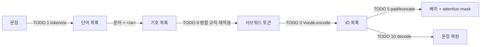

# P1-01 Tokenizer · BPE

| 항목 | 값 |
|---|---|
| 실습 ID | P1-01 |
| 난이도 | Level 1 → 2 → 3 |
| 주차 · 진행 순서 | W3 · Part 1의 두 번째 실습 (선수 pytorch → **tokenizer** → embedding → word2vec → transformer) |
| 예상 시간 | 3~4시간 |
| 필요 패키지 | 순수 Python(torch 불필요). Level 3만 `tokenizers` ([requirements/part1.txt](../../requirements/part1.txt)) |
| 파일 | `starter.py`(직접 채우기), `solution.py`(정답), `tests/test_p1_01_tokenizer.py`, `compare_with_hf.py` |

## 1. 목표

- 문장을 토큰으로 나누고, 토큰을 ID로 바꾸고, 다시 문장으로 되돌리는 **토크나이저의 전체 흐름**을 직접 만든다.
- Vocabulary와 특수 토큰(`<pad>`, `<unk>`, `<bos>`, `<eos>`), padding/truncation이 **왜 필요한지** 설명할 수 있다.
- **BPE(Byte Pair Encoding)** 학습(병합 규칙 만들기)과 인코딩(병합 규칙 다시 적용하기)을 직접 구현한다.
- 같은 말뭉치에서 직접 만든 BPE와 Hugging Face `tokenizers`의 BPE를 비교하고, 결과가 다른 이유를 설명한다.

## 2. 선수지식

- Python의 `dict`, `list`, `tuple`, `collections.Counter`, `sorted(key=...)`
- [P1-04 PyTorch 기초](../pytorch/README.md)는 이 실습 자체에는 필요 없지만, 다음 실습(embedding)에서 ID 리스트가 텐서로 바뀝니다.

## 3. 핵심 개념

| 개념 | 한 줄 설명 |
|---|---|
| 토큰(token) | 모델이 한 번에 다루는 최소 단위. 단어·문자·서브워드(단어 조각) 중 무엇으로 할지가 토크나이저 설계다 |
| Vocabulary | 토큰 ↔ 정수 ID 사전. 모델은 문자열이 아니라 ID만 본다 |
| `<unk>` | 사전에 없는 토큰. 많을수록 정보가 사라진다 |
| `<pad>` | 길이를 맞추려고 채우는 자리. attention mask로 "없는 셈" 친다 |
| `<bos>` / `<eos>` | 문장 시작·끝 표시. 생성 모델은 `<eos>`를 내면 멈춘다 |
| truncation | 최대 길이를 넘는 부분을 자른다 |
| 서브워드 | 자주 나오는 단어는 통째로, 드문 단어는 조각으로 나눈다 → `<unk>` 없이 어휘 크기를 조절 |
| BPE 병합 규칙 | "어떤 두 기호를 어떤 순서로 합칠지"의 목록. 학습 결과물은 이 목록이다 |

## 4. 내부 원리

**왜 단어 단위만으로는 부족한가?**
단어 단위 사전은 학습 때 못 본 단어(새 단어, 활용형, 오타)를 모두 `<unk>`로 만듭니다.
한국어처럼 조사·어미가 붙어 형태가 다양한 언어에서는 특히 심합니다(예: "모델", "모델이", "모델을"이 모두 다른 단어).

**왜 문자 단위만으로는 부족한가?**
`<unk>`는 거의 없지만 시퀀스가 길어집니다. 이 저장소의 말뭉치는 단어 504개, 문자 1,988개라서 문자 단위면 시퀀스가 약 4배 길어집니다.
Transformer의 어텐션 비용은 길이의 제곱에 비례합니다(P1-05).

**BPE는 그 사이를 학습으로 정한다**
1. 모든 단어를 문자로 쪼개고 끝에 단어 경계 표시 `</w>`를 붙입니다.
2. 말뭉치 전체에서 **가장 자주 붙어 나오는 기호 쌍**을 찾아 하나의 기호로 합칩니다.
3. 이것을 원하는 횟수(= 어휘 크기 조절)만큼 반복하고, 합친 순서를 **병합 규칙**으로 저장합니다.
4. 새 문장을 인코딩할 때는 같은 규칙을 **같은 순서(rank)로** 다시 적용합니다.



**왜 `</w>`가 필요한가?**
`</w>`가 없으면 "low" + "est"(한 단어 lowest)와 "low" "est"(두 단어)를 구별할 수 없어 decode할 때 공백 위치를 복원할 수 없습니다.
또 단어 끝에 오는 "est</w>"와 단어 중간의 "est"는 쓰임이 다르므로 다른 토큰으로 학습하는 편이 낫습니다.

**바이트 단위 BPE와의 차이**
이 실습은 **문자 단위**에서 시작합니다(한글 한 글자 = 기본 기호 하나). GPT-2 등은 UTF-8 **바이트 단위**에서 시작해 기본 어휘가 256개로 고정되고 `<unk>`가 원리적으로 생기지 않습니다.
대신 한글 한 글자가 3바이트라서 병합 전에는 시퀀스가 더 깁니다(이 말뭉치는 2,492자, 3,518바이트). → 과제 4.

## 5. 수식 · 손으로 따라가는 BPE

학습 단계에서 매 반복마다 고르는 쌍:

$$
(a^*, b^*) = \arg\max_{(a,b)} \sum_{w \in V} \text{freq}(w)\cdot \text{count}_w(a, b)
$$

동점이면 사전순으로 가장 앞선 쌍을 고릅니다(TODO 8). 압축률은 `문자 수 / 토큰 수`로 정의합니다.

**예시 말뭉치** (Sennrich et al., 2016, §3.2 예시): `low` ×5, `lower` ×2, `newest` ×6, `widest` ×3

| 단계 | 빈도 상위 쌍 (빈도) | 선택 | 병합 후 단어 상태 |
|---|---|---|---|
| 0 | — | — | `l o w </w>` ×5 · `l o w e r </w>` ×2 · `n e w e s t </w>` ×6 · `w i d e s t </w>` ×3 |
| 1 | (e,s) 9 · (s,t) 9 · (t,`</w>`) 9 · (w,e) 8 | **e + s** (동점 중 사전순) | `n e w es t </w>` · `w i d es t </w>` |
| 2 | (es,t) 9 · (t,`</w>`) 9 · (l,o) 7 | **es + t** | `n e w est </w>` · `w i d est </w>` |
| 3 | (est,`</w>`) 9 · (l,o) 7 · (o,w) 7 | **est + `</w>`** | `n e w est</w>` · `w i d est</w>` |
| 4 | (l,o) 7 · (o,w) 7 · (e,w) 6 | **l + o** | `lo w </w>` · `lo w e r </w>` |
| 5 | (lo,w) 7 · (e,w) 6 · (n,e) 6 | **lo + w** | `low </w>` · `low e r </w>` |
| 6 | (e,w) 6 · (n,e) 6 · (w,est`</w>`) 6 | **e + w** | `n ew est</w>` |

학습 때 없던 단어 `lowest`를 인코딩하면 규칙을 rank 순서대로 적용해 `l o w e s t </w>` → `l o w es t </w>` → `l o w est </w>` → `l o w est</w>` → `lo w est</w>` → **`low` `est</w>`** 가 됩니다.
`<unk>` 없이 처음 보는 단어를 표현한 것입니다(테스트 `test_bpe_tokenize_uses_merges`).

## 6. 실행법

저장소 루트에서 실행합니다.

**Windows PowerShell**

```powershell
.\.venv\Scripts\Activate.ps1
$env:PYTHONUTF8 = "1"          # 한글 입출력 (cp949 문제 방지)

# 1) 남은 TODO 확인
python part1_ai_fundamentals/tokenizer/starter.py

# 2) 직접 구현 검사 (TODO가 남은 테스트는 skip으로 표시)
$env:IMPL = "starter"; pytest part1_ai_fundamentals/tokenizer -rs; Remove-Item Env:IMPL

# 3) 정답 코드 검사
pytest part1_ai_fundamentals/tokenizer

# 4) Level 3: HF tokenizers와 비교 (tokenizers가 없으면 "건너뜀" 출력)
python part1_ai_fundamentals/tokenizer/compare_with_hf.py --impl starter --merges 200
```

**bash (Linux/macOS)**

```bash
source .venv/bin/activate
python part1_ai_fundamentals/tokenizer/starter.py
IMPL=starter pytest part1_ai_fundamentals/tokenizer -rs
pytest part1_ai_fundamentals/tokenizer
python part1_ai_fundamentals/tokenizer/compare_with_hf.py --impl solution --merges 200
```

- 테스트는 `IMPL` 환경 변수로 `starter.py`/`solution.py`를 **파일 경로 기준**으로 불러옵니다(`part1_ai_fundamentals/conftest.py`).
- TODO가 남아 있으면 해당 테스트는 **실패가 아니라 `skipped`(TODO 미구현: TODO n)** 로 나옵니다. 정상입니다.
- skip 사유의 TODO 번호는 **그 테스트가 처음 부딪힌 TODO**입니다. 예를 들어 BPE 인코딩 테스트는 `fit()` 안에서 `train_bpe`(TODO 8)를 먼저 부르므로 "TODO 8"로 표시됩니다. 위에서부터 순서대로 채우세요.
- `tokenizers`가 없으면 HF 비교 테스트는 "tokenizers 미설치 — HF 비교 건너뜀"으로 skip됩니다.
- 말뭉치는 저장소에 들어 있는 [data/corpus_ko_en.txt](../data/corpus_ko_en.txt)(직접 작성한 한국어·영어 문장 48줄)이며 다운로드가 필요 없습니다.

## 7. TODO 목록

| TODO | Level | 위치 | 내용 |
|---|---|---|---|
| 1 | 1 | `tokenize` | 공백 단위 / 문자 단위 토큰화 |
| 2 | 1 | `Vocab.build` | 특수 토큰 고정 ID + 빈도순 어휘, `min_freq` |
| 3 | 1 | `Vocab.encode` | 토큰 → ID, `<unk>` 처리, `<bos>`/`<eos>` 추가 |
| 4 | 1 | `Vocab.decode` | ID → 토큰, 특수 토큰 숨기기 |
| 5 | 1 | `pad_and_truncate` | 길이 맞추기 + attention mask |
| 6 | 2 | `get_pair_counts` | 인접 기호 쌍 빈도(단어 빈도 가중) |
| 7 | 2 | `merge_pair` | 쌍을 하나의 기호로 병합(왼쪽부터, 겹치지 않게) |
| 8 | 2 | `train_bpe` | 최빈 쌍 선택(동점은 사전순) → 병합 → 규칙 저장 |
| 9 | 2 | `BPETokenizer.tokenize_word` | 병합 규칙을 rank 순서로 재적용 |
| 10 | 2 | `BPETokenizer.decode` | `</w>` → 공백, 문장 복원 |
| — | 3 | `compare_with_hf.py` | HF `tokenizers`와 비교 (구현할 TODO 없음, 실행·해석) |

각 TODO 아래의 주석 규약: `HINT 1`(방향) · `HINT 2`(API·자료구조) · `WHY`(왜 필요한가) · `REF`(출처).
REF는 Sennrich et al., 2016, "Neural Machine Translation of Rare Words with Subword Units", §3.2(BPE 알고리즘과 Algorithm 1)입니다.

## 8. 예상 결과

아래는 이 저장소의 클라우드 환경(CPU, Python 3.12.13, `tokenizers` 0.23.3)에서 실제로 실행한 출력입니다.

`python part1_ai_fundamentals/tokenizer/starter.py` (아무것도 채우지 않은 상태)

```text
[미구현] TODO 1  tokenize (Level 1)
[미구현] TODO 2  Vocab.build (Level 1)
[미구현] TODO 3  Vocab.encode (Level 1)
[미구현] TODO 4  Vocab.decode (Level 1)
[미구현] TODO 5  pad_and_truncate (Level 1)
[미구현] TODO 6  get_pair_counts (Level 2)
[미구현] TODO 7  merge_pair (Level 2)
[미구현] TODO 8  train_bpe (Level 2)
[미구현] TODO 9  BPETokenizer.tokenize_word (Level 2)
[미구현] TODO 10 BPETokenizer.decode (Level 2)

남은 TODO 10개 — 위에서부터 순서대로 채우세요(뒤 TODO 는 앞 TODO 를 사용합니다). 채운 뒤 검사:
  (bash)       IMPL=starter pytest part1_ai_fundamentals/tokenizer
  (PowerShell) $env:IMPL="starter"; pytest part1_ai_fundamentals/tokenizer; Remove-Item Env:IMPL
```

`pytest part1_ai_fundamentals/tokenizer` (solution)

```text
.............                                                            [100%]
13 passed in 0.34s
```

`IMPL=starter pytest part1_ai_fundamentals/tokenizer -rs` (아무것도 채우지 않은 상태, 앞부분만)

```text
sssssssssssss                                                            [100%]
SKIPPED [1] part1_ai_fundamentals/tokenizer/tests/test_p1_01_tokenizer.py:18: TODO 미구현: TODO 1
SKIPPED [1] part1_ai_fundamentals/tokenizer/tests/test_p1_01_tokenizer.py:25: TODO 미구현: TODO 2
...
13 skipped in 0.08s
```

`python part1_ai_fundamentals/tokenizer/compare_with_hf.py --impl solution --merges 200`

```text
         my_vocab_size: 428
         hf_vocab_size: 428
  first_merges_overlap: 0.52
        my_token_count: 1257
        hf_token_count: 1291
     token_count_ratio: 0.9736638264910922
             my_tokens: ['작은</w>', '모델', '이', '라', '도', '</w>', '직', '접', '</w>', '학습', '해', '</w>', '보', '면</w>', '원', '리', '가</w>', '잘</w>', '보', '인다.</w>', 'the</w>', 'new', 'e', 's', 't</w>', 'model</w>']
             hf_tokens: ['작은</w>', '모델', '이', '라', '도</w>', '직', '접</w>', '학습', '해</w>', '보', '면</w>', '원', '리', '가</w>', '잘</w>', '보', '인다.</w>', 'the</w>', 'ne', 'we', 's', 't</w>', 'model</w>']
                sample: 작은 모델이라도 직접 학습해 보면 원리가 잘 보인다. the newest model
          my_decode_ok: True
          hf_decode_ok: True
            hf_decoded: 작은 모델이라도 직접 학습해 보면 원리가 잘 보인다. the newest model
```

병합 횟수에 따른 어휘 크기와 압축률(같은 말뭉치, 문자 1,988개·단어 504개, 공백 제외):

| 병합 횟수 | vocab 크기 | 토큰 수 | 압축률(문자/토큰) |
|---|---|---|---|
| 0 | 228 | 2,492 | 0.80 |
| 100 | 328 | 1,500 | 1.33 |
| 200 | 428 | 1,257 | 1.58 |
| 300 | 528 | 1,061 | 1.87 |
| 500 | 728 | 861 | 2.31 |
| 857 (더 병합할 쌍 없음) | 1,085 | 504 | 3.94 |

자세한 기록: [experiments/P1-01-20261109-bpe](../../experiments/P1-01-20261109-bpe/README.md)

**해석**
- 병합 0회의 압축률이 1보다 작은 이유: 단어마다 `</w>` 토큰이 하나씩 더 붙기 때문입니다(1,988자 + 504개 = 2,492토큰).
- 병합을 857번 하면 모든 단어가 통째로 하나의 토큰이 되어 **단어 단위 토크나이저와 같아집니다**(토큰 수 504 = 단어 수). BPE의 병합 횟수는 "문자 단위 ↔ 단어 단위" 사이의 다이얼입니다.
- **HF와 결과가 다른 이유**
  1. **단어 끝 표시 방식:** HF는 `end_of_word_suffix`를 처음부터 마지막 글자에 붙인 `도</w>`를 **기본 기호 하나**로 시작합니다. 직접 구현은 `도`와 `</w>`를 별개 기호로 두고 병합으로 붙입니다. 그래서 위 예시에서 직접 구현은 `'도', '</w>'`, HF는 `'도</w>'`가 됩니다. 기본 기호 집합 자체가 다르므로 병합 규칙 겹침이 52%에 그칩니다.
  2. **동점 처리:** 직접 구현은 동점이면 사전순, HF는 자체 구현 규칙을 따릅니다. 1번의 기본 기호 차이와 겹쳐 같은 단어도 다르게 쪼개집니다. 예: `newest`가 직접 구현은 `new e s t</w>`, HF는 `ne we s t</w>`.
  3. **정규화·공백 처리:** 이 비교는 두 쪽 모두 정규화(소문자화, 유니코드 정규화)를 하지 않고 공백으로만 나누도록(`WhitespaceSplit`) 맞췄습니다. HF 기본 사전학습 토크나이저(예: `Whitespace`, `ByteLevel`)를 쓰면 구두점 분리·공백 기호(`Ġ`) 등으로 차이가 더 커집니다. 디코딩은 HF에 `BPEDecoder(suffix="</w>")`를 지정해야 원문과 같아집니다. 지정하지 않으면 토큰 사이에 공백이 들어갑니다.
- 그래도 어휘 크기가 같을 때 토큰 수 차이는 3% 이내이고 둘 다 원문으로 정확히 복원됩니다. 같은 알고리즘의 다른 구현이라는 뜻입니다.

## 9. 자주 나는 오류

| 증상 | 원인 | 해결 |
|---|---|---|
| 토큰 목록에 빈 문자열 `''`이 섞임 | `split(" ")` 사용 | 인자 없는 `split()` |
| decode 결과에서 띄어쓰기가 사라짐 | 문자 단위에서 공백을 버렸거나, BPE에서 `</w>`를 공백으로 바꾸지 않음 | 공백도 토큰으로 유지 / `replace("</w>", " ")` |
| 실행할 때마다 ID나 병합 결과가 다름 | 정렬 없이 `set` 순서나 `max()` 동점 순서에 의존 | 정렬 키를 (빈도의 음수, 토큰)으로 고정 |
| 특수 토큰 ID가 0~3이 아님 / 중복 | 입력에 `<unk>` 등이 들어 있는데 그대로 추가 | 특수 토큰은 따로 앞에 두고 일반 토큰에서 제외 |
| `KeyError` (encode 중) | 사전에 없는 토큰 | `dict.get(token, unk_id)` |
| `aaa`가 `aa a`가 아니라 이상하게 병합됨 | 겹치는 위치까지 병합하거나 문자열 `replace` 사용 | 인덱스를 2칸 건너뛰며 기호 단위로 비교 |
| 학습 때 본 단어인데 다르게 분절됨 | 병합 규칙을 학습 순서(rank)가 아닌 순서로 적용 | 항상 rank가 가장 낮은 쌍부터 |
| Windows에서 `UnicodeDecodeError: 'cp949'` | 기본 인코딩 | `$env:PYTHONUTF8 = "1"`, `open(..., encoding="utf-8")` |
| HF 비교에서 `ModuleNotFoundError: tokenizers` | 패키지 미설치 | `uv pip install -r requirements/part1.txt` (스크립트는 "건너뜀" 출력) |

## 10. 과제

1. **어휘 크기 실험:** 병합 횟수를 50~800 사이에서 바꿔 `vocab 크기 – 압축률` 그래프를 그리세요. 어디서부터 압축률 증가가 둔해지나요?
2. **한국어 분절 관찰:** "모델이", "모델을", "모델의"를 인코딩해 보세요. 공통 조각 "모델"이 생기나요? 생기지 않는다면 말뭉치에 무엇을 더해야 할까요?
3. **`</w>` 없애 보기:** `END_OF_WORD`를 붙이지 않는 버전을 만들고 decode가 왜 실패하는지 예시로 보이세요.
4. **(Level 3+) 바이트 단위 BPE:** 기본 기호를 `text.encode("utf-8")`의 바이트로 바꾸세요. 기본 어휘 크기, 병합 0회 토큰 수, 처음 보는 문자(예: 이모지)의 `<unk>` 여부를 문자 단위와 비교하세요.
5. **HF 맞추기:** `compare_with_hf.py`에서 직접 구현이 HF처럼 `</w>`를 마지막 글자에 처음부터 붙이도록 바꾸면 병합 겹침 비율이 얼마나 올라가는지 측정하세요.

## 11. 체크리스트

- [ ] `python part1_ai_fundamentals/tokenizer/starter.py`가 "모든 TODO가 구현되었습니다"를 출력한다
- [ ] `IMPL=starter pytest part1_ai_fundamentals/tokenizer`가 skip 없이 전부 통과한다
- [ ] 단어 단위·문자 단위·서브워드의 장단점을 시퀀스 길이와 `<unk>`로 설명할 수 있다
- [ ] 특수 토큰 4개 각각이 왜 필요한지 설명할 수 있다
- [ ] 5절의 BPE 표를 보지 않고 3단계까지 손으로 따라갈 수 있다
- [ ] 직접 구현과 HF 결과가 다른 이유 세 가지를 설명할 수 있다
- [ ] 실행 결과를 [experiments 기록](../../experiments/P1-01-20261109-bpe/README.md)에 남겼다

## 12. 다음 단계 연결

- **P1-02 Embedding:** 여기서 만든 **ID**를 벡터로 바꿉니다. ID는 크기 비교가 의미 없는 "이름표"라서, 모델이 쓰려면 학습 가능한 벡터가 필요합니다.
- **P1-05 Transformer:** TODO 5의 `attention_mask`가 어텐션의 padding mask로, `<bos>`/`<eos>`가 문장 생성의 시작·종료 신호로 쓰입니다.
- **Part 3 RAG:** BM25 같은 sparse 검색의 품질은 토큰화(특히 한국어 조사 처리)에 크게 좌우됩니다.
- 진행 상태: [docs/PROGRESS.md](../../docs/PROGRESS.md) — 직접 확인한 뒤 P1-01을 `COMPLETED`로 바꾸세요.
