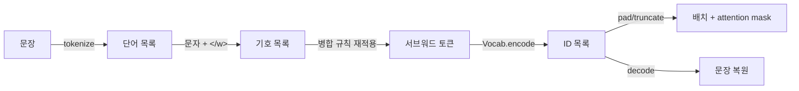

# P1-01 Tokenizer · BPE — 선택 과제

> **선택 과제 (P1-01A): 원리를 직접 구현해 보고 싶을 때.**
> 이 폴더는 BPE(Byte Pair Encoding) 학습·인코딩을 직접 구현하고 HF tokenizers 와 비교하는 심화 개념 노트입니다(구현 코드는 삭제했고, 원리·수식·손계산·과제 아이디어만 남겼습니다). 메인 실습([../README.md](../README.md))은 라이브러리·API로 개념과 서비스 관점을 익히는 데 집중하고, 여기서는 같은 개념을 밑바닥부터 구현합니다. 메인 실습을 마친 뒤 시간이 있을 때 도전하세요.

> **최종 서비스에서의 위치:** 서비스 코드에서는 라이브러리·API를 쓰므로 이 노트는 필수가 아닙니다. 다만 BPE를 직접 만들어 보면 토큰 수가 왜 한국어에서 늘어나는지, 청크·비용 계산이 어디서 틀어지는지 감이 잡힙니다.

> 이 문서에 나오는 `함수·파일 이름`(예: `run_demo.py`)은 이전 실습 코드(커밋 `aa46d2f`)의 이름입니다. 그 코드는 지웠고 개념만 남겼습니다. 옛 코드가 필요하면 `git checkout aa46d2f`(복구 방법은 [루트 README](../../../README.md#지금-어디를-보면-되나-학습-방식)).

| 항목 | 값 |
|---|---|
| 실습 ID | P1-01 |
| 필요 패키지 | 순수 Python(torch 불필요). Level 3만 `tokenizers` ([requirements/part1.txt](../../../requirements/part1.txt)) |

## 1. 목표

- 문장을 토큰으로 나누고, 토큰을 ID로 바꾸고, 다시 문장으로 되돌리는 **토크나이저의 전체 흐름**을 직접 만든다.
- Vocabulary와 특수 토큰(`<pad>`, `<unk>`, `<bos>`, `<eos>`), padding/truncation이 **왜 필요한지** 설명할 수 있다.
- **BPE(Byte Pair Encoding)** 학습(병합 규칙 만들기)과 인코딩(병합 규칙 다시 적용하기)을 직접 구현한다.
- 같은 말뭉치에서 직접 만든 BPE와 Hugging Face `tokenizers`의 BPE를 비교하고, 결과가 다른 이유를 설명한다.

## 2. 선수지식

- Python의 `dict`, `list`, `tuple`, `collections.Counter`, `sorted(key=...)`
- [P1-04 PyTorch 기초](../../pytorch/README.md)는 이 실습 자체에는 필요 없지만, 다음 실습(embedding)에서 ID 리스트가 텐서로 바뀝니다.

## 3. 핵심 개념

| 개념 | 한 줄 설명 |
|---|---|
| 토큰(token) | 모델이 한 번에 다루는 최소 단위. 단어·문자·서브워드(단어 조각) 중 무엇으로 할지가 토크나이저 설계다 |
| Vocabulary | 토큰 ↔ 정수 ID 사전. 모델은 문자열이 아니라 ID만 본다 |
| `<unk>` | 사전에 없는 토큰. 많을수록 정보가 사라진다 |
| `<pad>` | 길이를 맞추려고 채우는 자리. attention mask로 "없는 셈" 친다 |
| `<bos>` / `<eos>` | 문장 시작·끝 표시. 생성 모델은 `<eos>`를 내면 멈춘다 |
| truncation | 최대 길이를 넘는 부분을 자른다 |
| 서브워드 | 자주 나오는 단어는 통째로, 드문 단어는 조각으로 나눈다 → `<unk>` 없이 어휘 크기를 조절 |
| BPE 병합 규칙 | "어떤 두 기호를 어떤 순서로 합칠지"의 목록. 학습 결과물은 이 목록이다 |

## 4. 내부 원리

**왜 단어 단위만으로는 부족한가?**
단어 단위 사전은 학습 때 못 본 단어(새 단어, 활용형, 오타)를 모두 `<unk>`로 만듭니다.
한국어처럼 조사·어미가 붙어 형태가 다양한 언어에서는 특히 심합니다(예: "모델", "모델이", "모델을"이 모두 다른 단어).

**왜 문자 단위만으로는 부족한가?**
`<unk>`는 거의 없지만 시퀀스가 길어집니다. 이 저장소의 말뭉치는 단어 504개, 문자 1,988개라서 문자 단위면 시퀀스가 약 4배 길어집니다.
Transformer의 어텐션 비용은 길이의 제곱에 비례합니다(P1-05).

**BPE는 그 사이를 학습으로 정한다**
1. 모든 단어를 문자로 쪼개고 끝에 단어 경계 표시 `</w>`를 붙입니다.
2. 말뭉치 전체에서 **가장 자주 붙어 나오는 기호 쌍**을 찾아 하나의 기호로 합칩니다.
3. 이것을 원하는 횟수(= 어휘 크기 조절)만큼 반복하고, 합친 순서를 **병합 규칙**으로 저장합니다.
4. 새 문장을 인코딩할 때는 같은 규칙을 **같은 순서(rank)로** 다시 적용합니다.

**왜 `</w>`가 필요한가?**
`</w>`가 없으면 "low" + "est"(한 단어 lowest)와 "low" "est"(두 단어)를 구별할 수 없어 decode할 때 공백 위치를 복원할 수 없습니다.
또 단어 끝에 오는 "est</w>"와 단어 중간의 "est"는 쓰임이 다르므로 다른 토큰으로 학습하는 편이 낫습니다.

**바이트 단위 BPE와의 차이**
이 실습은 **문자 단위**에서 시작합니다(한글 한 글자 = 기본 기호 하나). GPT-2 등은 UTF-8 **바이트 단위**에서 시작해 기본 어휘가 256개로 고정되고 `<unk>`가 원리적으로 생기지 않습니다.
대신 한글 한 글자가 3바이트라서 병합 전에는 시퀀스가 더 깁니다(이 말뭉치의 단어들은 1,988자, 3,014바이트). → 과제 4.

## 5. 수식 · 손으로 따라가는 BPE

학습 단계에서 매 반복마다 고르는 쌍:

$$
(a^*, b^*) = \arg\max_{(a,b)} \sum_{w \in V} \text{freq}(w)\cdot \text{count}_w(a, b)
$$

동점이면 사전순으로 가장 앞선 쌍을 고릅니다. 압축률은 `문자 수 / 토큰 수`로 정의합니다.

**예시 말뭉치**: Sennrich et al., 2016, §3.2 Algorithm 1 의 예시 어휘(`low` ×5, `lower` ×2, `newest` ×6, `widest` ×3)로 **이 저장소의 구현을 실행한** 첫 병합들입니다. 논문 원문의 병합 목록과 일일이 대조하지는 않았습니다(미확인).

| 단계 | 빈도 상위 쌍 (빈도) | 선택 | 병합 후 단어 상태 |
|---|---|---|---|
| 0 | — | — | `l o w </w>` ×5 · `l o w e r </w>` ×2 · `n e w e s t </w>` ×6 · `w i d e s t </w>` ×3 |
| 1 | (e,s) 9 · (s,t) 9 · (t,`</w>`) 9 · (w,e) 8 | **e + s** (동점 중 사전순) | `n e w es t </w>` · `w i d es t </w>` |
| 2 | (es,t) 9 · (t,`</w>`) 9 · (l,o) 7 | **es + t** | `n e w est </w>` · `w i d est </w>` |
| 3 | (est,`</w>`) 9 · (l,o) 7 · (o,w) 7 | **est + `</w>`** | `n e w est</w>` · `w i d est</w>` |
| 4 | (l,o) 7 · (o,w) 7 · (e,w) 6 | **l + o** | `lo w </w>` · `lo w e r </w>` |
| 5 | (lo,w) 7 · (e,w) 6 · (n,e) 6 | **lo + w** | `low </w>` · `low e r </w>` |
| 6 | (e,w) 6 · (n,e) 6 · (w,est`</w>`) 6 | **e + w** | `n ew est</w>` |

학습 때 없던 단어 `lowest`를 인코딩하면 규칙을 rank 순서대로 적용해 `l o w e s t </w>` → `l o w es t </w>` → `l o w est </w>` → `l o w est</w>` → `lo w est</w>` → **`low` `est</w>`** 가 됩니다.
`<unk>` 없이 처음 보는 단어를 표현한 것입니다(테스트 `test_bpe_tokenize_uses_merges`).

## 6. 자주 나는 오류

| 증상 | 원인 | 해결 |
|---|---|---|
| 토큰 목록에 빈 문자열 `''`이 섞임 | `split(" ")` 사용 | 인자 없는 `split` |
| decode 결과에서 띄어쓰기가 사라짐 | 문자 단위에서 공백을 버렸거나, BPE에서 `</w>`를 공백으로 바꾸지 않음 | 공백도 토큰으로 유지 / `replace("</w>", " ")` |
| 실행할 때마다 ID나 병합 결과가 다름 | 정렬 없이 `set` 순서나 `max` 동점 순서에 의존 | 정렬 키를 (빈도의 음수, 토큰)으로 고정 |
| 특수 토큰 ID가 0~3이 아님 / 중복 | 입력에 `<unk>` 등이 들어 있는데 그대로 추가 | 특수 토큰은 따로 앞에 두고 일반 토큰에서 제외 |
| `KeyError` (encode 중) | 사전에 없는 토큰 | `dict.get(token, unk_id)` |
| `aaa`가 `aa a`가 아니라 이상하게 병합됨 | 겹치는 위치까지 병합하거나 문자열 `replace` 사용 | 인덱스를 2칸 건너뛰며 기호 단위로 비교 |
| 학습 때 본 단어인데 다르게 분절됨 | 병합 규칙을 학습 순서(rank)가 아닌 순서로 적용 | 항상 rank가 가장 낮은 쌍부터 |
| Windows에서 `UnicodeDecodeError: 'cp949'` | 기본 인코딩 | `$env:PYTHONUTF8 = "1"`, `open(..., encoding="utf-8")` |
| HF 비교에서 `ModuleNotFoundError: tokenizers` | 패키지 미설치 | `uv pip install -r requirements/part1.txt` (스크립트는 "건너뜀" 출력) |

## 7. 과제

1. **어휘 크기 실험:** 병합 횟수를 50~800 사이에서 바꿔 `vocab 크기 – 압축률` 그래프를 그리세요. 어디서부터 압축률 증가가 둔해지나요?
2. **한국어 분절 관찰:** "모델이", "모델을", "모델의"를 인코딩해 보세요. 공통 조각 "모델"이 생기나요? 생기지 않는다면 말뭉치에 무엇을 더해야 할까요?
3. **`</w>` 없애 보기:** `END_OF_WORD`를 붙이지 않는 버전을 만들고 decode가 왜 실패하는지 예시로 보이세요.
4. **(Level 3+) 바이트 단위 BPE:** 기본 기호를 `text.encode("utf-8")`의 바이트로 바꾸세요. 기본 어휘 크기, 병합 0회 토큰 수, 처음 보는 문자(예: 이모지)의 `<unk>` 여부를 문자 단위와 비교하세요.
5. **HF 맞추기:** HF tokenizers와 비교하는 코드에서 직접 구현이 HF처럼 `</w>`를 마지막 글자에 처음부터 붙이도록 바꾸면 병합 겹침 비율이 얼마나 올라가는지 측정하세요.

## 8. 체크리스트

- [ ] 단어 단위·문자 단위·서브워드의 장단점을 시퀀스 길이와 `<unk>`로 설명할 수 있다
- [ ] 특수 토큰 4개 각각이 왜 필요한지 설명할 수 있다
- [ ] 5절의 BPE 표를 보지 않고 3단계까지 손으로 따라갈 수 있다
- [ ] 직접 구현과 HF 결과가 다른 이유 세 가지를 설명할 수 있다

## 9. 다음 단계 연결

- **P1-02 Embedding:** 여기서 만든 **ID**를 벡터로 바꿉니다. ID는 크기 비교가 의미 없는 "이름표"라서, 모델이 쓰려면 학습 가능한 벡터가 필요합니다.
- **P1-05 Transformer:** 의 `attention_mask`가 어텐션의 padding mask로, `<bos>`/`<eos>`가 문장 생성의 시작·종료 신호로 쓰입니다.
- **Part 3 RAG:** BM25 같은 sparse 검색의 품질은 토큰화(특히 한국어 조사 처리)에 크게 좌우됩니다.
- 내가 만든 것은 [docs/PROGRESS.md](../../../docs/PROGRESS.md)에 기록합니다.
