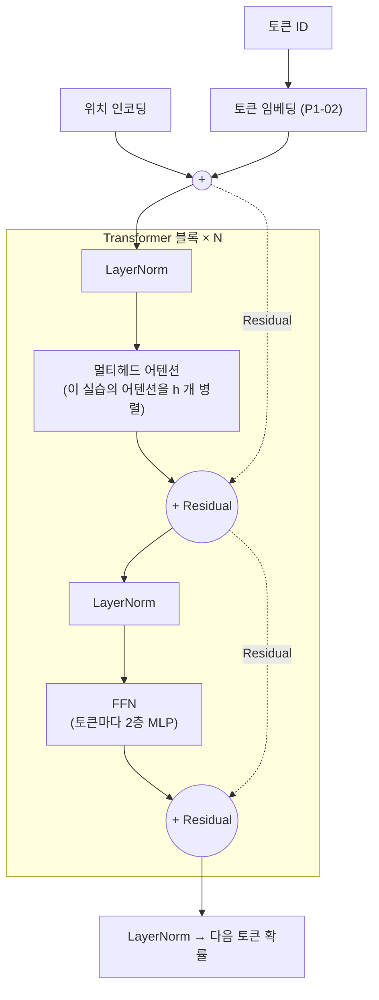

# P1-05 Transformer — 어텐션 한 번, 그리고 컨텍스트 길이의 비용

| 항목 | 값 |
|---|---|
| 실습 ID | P1-05 (메인) |
| 주차 · 진행 순서 | W4 · P1-03(Word2Vec) 다음, Part 1 마지막 |
| 예상 시간 | 3~4시간 |
| 파일 | `starter.py`(직접 채우기), `solution.py`(정답), `tests/test_p1_05_transformer.py`, `run_demo.py` |
| 소속 | [Part 1 — AI 원리](../README.md) |
| 선택 과제 | [advanced/](./advanced/README.md) — Self-Attention~미니 GPT 직접 구현·학습 (P1-05A) |

> 방향: **어텐션 개념은 깊게, 구현은 한 번만.** 스케일드 닷-프로덕트 어텐션을 한 번 직접 계산하고, 나머지 부품(멀티헤드·FFN·Residual·LayerNorm·위치 인코딩·블록 쌓기)은 구조 그림과 설명으로 이해합니다. 그 결과를 "컨텍스트가 길수록 왜 느리고 비싼가"라는 서비스 판단으로 연결합니다.

## 1. 목표

- Q·K·V가 무엇이고 왜 셋으로 나누는지 설명한다.
- 스케일드 닷-프로덕트 어텐션을 작은 숫자로 손계산하고, 코드 결과와 PyTorch(`F.scaled_dot_product_attention`)를 비교한다.
- causal 마스크의 이유와 마스크 규약(**True = 볼 수 있음**)을 정확히 쓴다.
- 시퀀스 길이 T에 따라 점수 행렬(T×T)과 시간이 늘어나는 것을 측정한다.
- (선택) KV 캐시가 생성 계산을 줄이는 것을 확인하고, API 프롬프트 캐싱과 연결한다.

## 2. 선수지식

- P1-04의 행렬곱 `@`, 전치, 브로드캐스팅, `torch.tensor`
- P1-02의 내적·코사인(어텐션 점수도 내적이다)
- P1-01의 컨텍스트 창·토큰 비용

## 3. 핵심 개념

| 개념 | 한 줄 설명 |
|---|---|
| Q (query) | "나는 무엇을 찾나" — 각 토큰이 던지는 질문 |
| K (key) | "나는 어떤 내용인가" — 각 토큰의 색인표 |
| V (value) | "나를 고르면 가져갈 내용" |
| 어텐션 점수 | Q와 K의 내적. 클수록 그 토큰을 많이 본다 |
| softmax | 한 행의 점수를 합이 1인 비율로 바꾼다 |
| √d_k 스케일 | 차원이 클수록 커지는 내적을 되돌려 softmax 포화를 막는다 |
| causal 마스크 | 미래 토큰을 가린다(다음 토큰 예측에서 정답 베끼기 방지) |
| KV 캐시 | 생성할 때 이전 토큰의 K·V를 저장해 재사용 |
| TTFT | Time To First Token. 요청 후 첫 출력 토큰까지의 시간 |

## 4. 내부 원리

### 4-1. 어텐션 4단계 (Vaswani et al., 2017, §3.2.1)

```
Attention(Q, K, V) = softmax( Q Kᵀ / √d_k ) V

 Q (T×d_k) ─┐
            ├─ @ ─▶ 점수 (T×T) ─▶ ÷√d_k ─▶ [마스크] ─▶ softmax(행마다) ─▶ 가중치 (T×T) ─┐
 Kᵀ(d_k×T) ─┘                                                                         ├─ @ ─▶ 출력 (T×d_v)
 V (T×d_v) ───────────────────────────────────────────────────────────────────────────┘
```

손계산 예시(§8 [1]과 같음): 토큰 `나는`, `커피를`, `마신다`를 x = [[1,0],[0,1],[1,1]]로 두고 가중치를 단위행렬로 하면 Q = K = V = x.

1. Q @ Kᵀ: `나는` 행 = [1·1+0·0, 1·0+0·1, 1·1+0·1] = **[1, 0, 1]**
2. ÷ √2: [0.707, 0, 0.707]
3. softmax: e^0.707 = 2.028 → [2.028, 1, 2.028] / 5.056 = **[0.401, 0.198, 0.401]**
4. @ V: 0.401·[1,0] + 0.198·[0,1] + 0.401·[1,1] = **[0.802, 0.599]**

`나는`은 자기와 `마신다`(둘 다 첫 성분이 1)를 많이 보고, 성분이 겹치지 않는 `커피를`은 적게 봅니다.

### 4-2. 왜 √d_k로 나누나 (§3.2.1 각주 4)

성분이 평균 0·분산 1인 d_k차원 벡터 두 개의 내적은 분산이 d_k입니다. d_k = 64면 점수 표준편차가 약 8이 되어 softmax가 한 칸에 거의 1을 줍니다(§8 [2]: 최대 가중치 평균 0.823). 그러면 나머지 칸의 기울기가 0에 가까워 학습이 멈춥니다. √d_k로 나누면 표준편차가 1 수준이 됩니다(최대 가중치 평균 0.232).

### 4-3. causal 마스크와 NaN

```
        j: 0 1 2 3          True = 볼 수 있음, False = 가림(-inf → softmax 0)
   i=0  [ T F F F ]
   i=1  [ T T F F ]         한 행이 전부 False 면 softmax(-inf,…,-inf) = 0/0 = NaN.
   i=2  [ T T T F ]         causal 마스크는 대각선(자기 자신)이 항상 True 라 안전하다.
   i=3  [ T T T T ]
```

**마스크 규약 주의**: 이 실습과 `F.scaled_dot_product_attention`의 bool `attn_mask`는 **True = 참여**입니다. `nn.MultiheadAttention`의 `key_padding_mask`는 **True = 무시**(반대)입니다. 한 행 전체를 가렸을 때 이 실습 코드는 NaN이지만, 이 환경의 torch 2.15 SDPA는 0을 돌려주었습니다(관찰값, 버전에 따라 다를 수 있음).

### 4-4. 나머지 부품 (코드 대신 구조)



위 그림은 GPT 계열에서 흔한 Pre-LN 배치입니다. 원 논문(Vaswani et al., 2017, §3.1)은 Residual 다음에 LayerNorm을 두는 Post-LN입니다.

- **멀티헤드 어텐션** (§3.2.2): 어텐션을 h개로 나눠 병렬로 합니다. 한 헤드는 "주어–동사", 다른 헤드는 "가까운 단어"처럼 서로 다른 관계를 동시에 볼 수 있습니다. 각 헤드는 d_k = D/h 차원이라 전체 계산량은 헤드 하나와 비슷합니다.
- **FFN** (§3.3): 어텐션이 "다른 토큰에서 정보를 모으기"라면, FFN은 토큰마다 따로 "모은 정보를 가공하기"입니다. 보통 D → 4D → D의 2층 MLP이며 파라미터의 큰 몫을 차지합니다.
- **Residual 연결**: 입력을 출력에 더합니다(x + f(x)). 층이 깊어도 정보와 기울기가 지름길로 흐릅니다. 블록이 "고칠 부분만" 학습하면 됩니다.
- **LayerNorm**: 토큰마다 벡터 값의 평균·크기를 맞춥니다. 층을 지날수록 값이 커지거나 작아져 학습이 불안정해지는 것을 막습니다.
- **위치 인코딩** (§3.5): 어텐션 자체는 순서를 모릅니다(토큰을 섞어도 점수가 같은 방식으로 계산됨). 위치 정보를 더해 줘야 "개가 사람을 물었다"와 "사람이 개를 물었다"를 구분합니다.
- **블록 쌓기**: 같은 구조의 블록을 N번 쌓아 표현을 점점 다듬습니다. 층이 많을수록 표현력이 커지지만 토큰당 계산·지연도 늘어납니다.

직접 구현(MHA, FFN, Pre-LN 블록, 사인·코사인 위치 인코딩, 문자 단위 미니 GPT 학습)은 [advanced/](./advanced/README.md)(P1-05A)에 있습니다.

## 서비스 관점

| 질문 | 판단 |
|---|---|
| 컨텍스트가 길면 왜 느리고 비싼가? | ① 어텐션 점수 행렬이 T×T라 프롬프트 처리 계산·메모리가 T²로 는다(§8 [3]). ② 출력은 한 토큰씩 순서대로 생성된다(P1-01: 출력 단가가 비싼 이유) |
| TTFT와 토큰당 생성 속도는? | TTFT ≈ 프롬프트 전체를 한 번에 처리하는 시간(prefill) → **입력이 길수록** 길어진다. 그 뒤 토큰당 생성 시간은 KV 캐시 덕분에 매 단계 새 토큰 1개만 계산 → **출력 길이**에 비례해 총 시간이 는다 |
| KV 캐시와 프롬프트 캐싱의 관계는? | KV 캐시는 한 요청 안에서 이전 토큰의 K·V를 재사용한다. 프롬프트 캐싱은 **같은 앞부분**(시스템 프롬프트·고정 문서)의 처리 결과를 **요청 사이**에 재사용하는 같은 발상 → 반복되는 앞부분의 비용·지연이 준다(Part 2 P2-03에서 Claude API로 측정) |
| 캐시를 잘 쓰려면? | 바뀌지 않는 내용(지시문·고정 문서)을 **앞에**, 바뀌는 내용(사용자 질문·검색 결과)을 **뒤에** 둔다. 앞부분이 한 글자라도 다르면 재사용되지 않는다 |
| RAG 청크를 많이 넣으면? | 비용(입력 토큰), 지연(TTFT), 품질의 트레이드오프. 관련 없는 청크가 섞이면 답이 흐려질 수 있다 → 상위 k를 늘리기 전에 Rerank로 고르고, k별 품질·지연·비용을 **측정**해서 정한다(Part 3) |
| KV 캐시는 공짜인가? | 아니다. 캐시 메모리가 토큰 수 × 층 수 × 차원에 비례해 쌓인다. 긴 대화·동시 요청이 많으면 GPU 메모리가 한계가 된다(서비스 동시 처리량의 제약) |

## 5. 수식

- Q = XW_Q, K = XW_K, V = XW_V (X: T×D, W: D×d_k)
- Attention(Q, K, V) = softmax(QKᵀ / √d_k) V  (Vaswani et al., 2017, 식 1)
- softmax(z)_j = e^{z_j} / Σ_i e^{z_i}
- 점수 행렬 메모리 = T² × 4바이트(float32, 헤드 하나·배치 하나 기준), QKᵀ 곱셈 수 = T² × d_k
- KV 캐시 없음: K·V 계산 행 Σ_{t=1..T} t = T(T+1)/2, 캐시 있음: T

## 6. 실행법

저장소 루트에서 실행합니다.

**Windows PowerShell**

```powershell
.\.venv\Scripts\Activate.ps1
$env:PYTHONUTF8 = "1"

# 1) 남은 TODO 확인
python part1_ai_fundamentals/transformer/starter.py

# 2) 직접 구현 검사 (TODO 가 남은 테스트는 skip)
$env:IMPL = "starter"; pytest part1_ai_fundamentals/transformer/tests; Remove-Item Env:IMPL

# 3) 정답 코드 검사
pytest part1_ai_fundamentals/transformer/tests

# 4) 데모 (CPU 수 초. GPU 불필요)
python part1_ai_fundamentals/transformer/run_demo.py --impl starter
python part1_ai_fundamentals/transformer/run_demo.py --max-t 4096   # 더 긴 T 까지(점수 행렬 하나 약 67MB)
```

**bash (Linux/macOS)**

```bash
source .venv/bin/activate
python part1_ai_fundamentals/transformer/starter.py
IMPL=starter pytest part1_ai_fundamentals/transformer/tests
pytest part1_ai_fundamentals/transformer/tests
python part1_ai_fundamentals/transformer/run_demo.py --impl solution
```

- 테스트는 시간 값이 아니라 모양(T×T)·원소 수처럼 결정적인 값만 검사합니다. 반복은 길이가 정해진 `for`이고 텐서는 작습니다.
- 데모는 시간 비교가 덜 흔들리도록 `torch.set_num_threads(1)`로 스레드 하나를 씁니다. 시간 수치는 PC·실행마다 다릅니다.

## 7. TODO 목록

| TODO | 함수 | 내용 |
|---|---|---|
| 1 | `make_qkv` | `x @ W_Q`, `x @ W_K`, `x @ W_V` |
| 2 | `scaled_dot_product_attention` | `Q @ Kᵀ / √d_k` → 마스크(False → -inf) → softmax → `@ V`, (출력, 가중치) 반환 |
| 3 | `causal_mask` | `torch.tril` 로 아래 삼각형(대각선 포함) True |
| 4 | `measure_attention_cost` | T별 점수 행렬 모양·원소 수·MB·시간(중앙값) |
| 5 (선택) | `decode_with_kv_cache` | 한 토큰씩 생성 흉내, 캐시 있음/없음 비교, 계산 행 수 반환 |

## 8. 예상 결과

아래는 클라우드 작업 환경(CPU 4코어, 스레드 1로 측정, Python 3.12.13, torch 2.15.0+cu132 CPU 실행)에서 `run_demo.py --impl solution`을 **실제로 실행한 출력**입니다. GPU(RTX 3070) 수치는 **사용자 PC에서 측정 필요**합니다.

```
[1] 손계산 예시: 토큰 3개, D = d_k = 2, 가중치 = 단위행렬 → Q = K = V = x
    x = [[1.0, 0.0], [0.0, 1.0], [1.0, 1.0]]
    Q @ Kᵀ (원점수)
            나는     커피를     마신다
      나는       1.000   0.000   1.000
      커피를      0.000   1.000   1.000
      마신다      1.000   1.000   2.000
    / √2
            나는     커피를     마신다
      나는       0.707   0.000   0.707
      커피를      0.000   0.707   0.707
      마신다      0.707   0.707   1.414
    softmax → 가중치 (행 합 = 1)
            나는     커피를     마신다
      나는       0.401   0.198   0.401
      커피를      0.198   0.401   0.401
      마신다      0.248   0.248   0.503
    출력 = 가중치 @ V = [[0.802, 0.599], [0.599, 0.802], [0.752, 0.752]]
    causal 마스크 적용 가중치 (미래 = 0)
            나는     커피를     마신다
      나는       1.000   0.000   0.000
      커피를      0.330   0.670   0.000
      마신다      0.248   0.248   0.503
    출력(causal) = [[1.0, 0.0], [0.33, 0.67], [0.752, 0.752]]
[2] √d_k 로 나누는 효과: d_k = 64, 무작위 q·k 16개 (행마다 가장 큰 가중치의 평균)
    나누지 않음: 점수 표준편차 8.66, 최대 가중치 평균 0.823
    / √64 = /8 : 점수 표준편차 1.08, 최대 가중치 평균 0.232
[3] 길이 T 별 causal 어텐션 1회 (d_k = 64, float32, 스레드 1, 5회 중앙값)
         T   점수 행렬 모양   원소 수       MB       ms   ms 비율(앞 T 대비)
       128   (128, 128)         16,384      0.1     0.26        —
       256   (256, 256)         65,536      0.3     0.56      2.2배
       512   (512, 512)        262,144      1.0     3.04      5.4배
      1024   (1024, 1024)    1,048,576      4.2    10.12      3.3배
      2048   (2048, 2048)    4,194,304     16.8    31.61      3.1배
[4] KV 캐시: 토큰 256개를 한 개씩 생성하는 흉내 (D = d_k = 512)
    use_cache=False: K·V 계산 행 32,896,   310.7 ms
    use_cache=True : K·V 계산 행    256,    65.4 ms
    한 번에 계산한 causal 어텐션과 최대 차이: 2.03e-06
```

**해석**
- [1] causal을 적용하면 `나는`(첫 토큰)은 자기 자신만 보므로 가중치 1, 출력 = 자기 V. `커피를`은 `나는`과 자기만 봅니다. 마지막 토큰 `마신다`는 원래 모두를 볼 수 있어 마스크 전후가 같습니다.
- [2] √d_k로 나누지 않으면 softmax가 한 칸에 0.82를 몰아 줍니다. 나누면 0.23으로 고르게 퍼집니다.
- [3] **원소 수·메모리는 T가 2배일 때 정확히 4배**입니다(T²). 시간은 실행마다 흔들립니다. 같은 환경에서 네 번 실행했을 때 앞 T 대비 비율은 2.2~5.7배였습니다. 작은 T는 함수 호출 같은 고정 비용 비중이 크고, 큰 T는 연산 라이브러리 효율이 달라지기 때문입니다. 512 → 2048(T 4배)에서는 시간이 약 10배였습니다. 원소 수 16배보다 작지만 T에 비례(4배)보다는 훨씬 큽니다. 컨텍스트를 늘리는 비용은 "선형이 아니다"가 핵심입니다.
- [4] 캐시가 K·V 계산 행을 32,896 → 256으로 줄이고 시간은 약 1/5이 되었습니다. 결과는 한 번에 계산한 causal 어텐션과 같습니다(차이 2e-06, float32 반올림 수준). 처음에는 캐시를 목록에 붙이며 매번 `torch.cat` 했는데, 그 복사 비용 때문에 **캐시 쪽이 오히려 느렸습니다**(D=64에서 28.1ms vs 19.7ms). 그래서 미리 할당한 버퍼에 한 행씩 쓰도록 고쳤습니다. 최적화는 측정으로 확인해야 한다는 예입니다.

## 9. 자주 나는 오류

| 증상 | 원인 | 해결 |
|---|---|---|
| `mat1 and mat2 shapes cannot be multiplied` | `Q @ K` (전치 누락) | `k.transpose(-2, -1)` |
| 가중치에 `nan` | 한 행 전체가 False인 마스크 | 행마다 최소 하나 True(causal은 대각선 포함). 패딩 마스크와 합칠 때 주의 |
| 마스크가 반대로 동작 | 규약 혼동(True=볼 수 있음 vs True=무시) | 이 실습·SDPA bool 마스크는 True=참여, `key_padding_mask`는 True=무시 |
| softmax 축이 틀림 | `dim=0`으로 열마다 정규화 | `dim=-1`(행마다, 마지막 축) |
| 미래 가중치가 0이 아님 | `torch.triu` 사용 또는 대각선 제외 | `torch.tril(ones(t, t, dtype=torch.bool))` |
| KV 캐시가 더 느림 | 매 단계 `torch.cat`으로 전체 복사 | 미리 할당한 버퍼에 한 행씩 쓰기 |
| 시간이 매번 다름 | 다른 작업·스레드·캐시 상태 | 반복 측정 중앙값, 스레드 고정, 결론은 원소 수 같은 결정적 값과 함께 |

## 10. 과제

1. [3]을 `--max-t 4096`으로 실행해 4096의 시간과 메모리를 기록하고, 1024 → 4096(T 4배) 비율을 계산하세요.
2. d_k를 16 / 64 / 256으로 바꿔 [2]의 "최대 가중치 평균"이 나누기 전후로 어떻게 변하는지 표로 만드세요.
3. (GPU가 있으면) `measure_attention_cost`를 GPU 텐서로 실행하도록 바꿔 CPU와 비교하세요. GPU 시간 측정 전에는 `torch.cuda.synchronize()`가 필요합니다(이유를 찾아 적어 보세요).
4. 시스템 프롬프트 2,000토큰 + 고정 문서 6,000토큰 + 질문 100토큰인 요청을 하루 1만 번 보낸다면, 무엇을 앞에 두어야 프롬프트 캐싱의 이득이 커지는지 설계로 답하세요(실제 할인율은 Part 2에서 공식 문서로 확인).

## 11. 체크리스트

- [ ] `IMPL=starter pytest part1_ai_fundamentals/transformer/tests` 가 모두 통과한다
- [ ] Q·K·V를 비유로 설명하고, 셋으로 나누는 이유를 말할 수 있다
- [ ] 3×2 예시로 어텐션 가중치 한 행을 손으로 계산할 수 있다
- [ ] √d_k로 나누는 이유와, 한 행 전체를 가리면 NaN이 되는 이유를 안다
- [ ] 마스크 규약(True=볼 수 있음)과 `key_padding_mask`의 반대 규약을 구분한다
- [ ] 컨텍스트가 길수록 TTFT·비용이 커지는 이유와, KV 캐시·프롬프트 캐싱의 관계를 설명할 수 있다

## 12. 다음 단계 연결

- **Part 2 P2-01**: 로컬 소형 모델(Qwen2.5-0.5B)로 다음 토큰 확률과 샘플링(temperature·top-p)을 봅니다 — 이 실습 블록 출력의 마지막 단계입니다.
- **Part 2 P2-02/03**: Claude API의 토큰·스트리밍(첫 토큰 지연 체감)·프롬프트 캐싱을 실제로 측정합니다.
- **Part 3**: 청크 수(k)에 따른 품질·지연·비용을 비교합니다.
- 원리를 직접 구현하고 싶다면 선택 과제 [advanced/](./advanced/README.md) (MHA·FFN·블록·미니 GPT, P1-05A).

## REF

- Vaswani et al., 2017, "Attention Is All You Need" — §3.1(구조), §3.2.1(스케일드 닷-프로덕트 어텐션, 각주 4), §3.2.2(멀티헤드), §3.2.3(decoder 마스킹), §3.3(FFN), §3.5(위치 인코딩). https://arxiv.org/abs/1706.03762 (작성 환경 접속 불가 → 미확인)
- PyTorch `torch.nn.functional.scaled_dot_product_attention`, `torch.nn.MultiheadAttention`(`key_padding_mask` True=무시) — 설치된 torch 2.15.0의 docstring으로 확인. 온라인 문서 https://pytorch.org/docs/stable/generated/torch.nn.functional.scaled_dot_product_attention.html (미확인)
