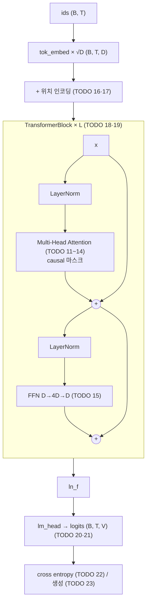

# P1-05 Transformer

| 항목 | 값 |
|---|---|
| 실습 ID | P1-05 (P1-05a 부품, P1-05b 미니 언어모델) |
| 난이도 | Level 1 → 2 → 3 |
| 주차 · 진행 순서 | W5–6 · Part 1의 마지막 실습 (선수 pytorch → tokenizer → embedding → word2vec → **transformer**) |
| 예상 시간 | 6~8시간 |
| 필요 패키지 | torch(CPU판으로도 충분), matplotlib(그림, 없으면 텍스트만) |
| 파일 | `starter.py`(직접 채우기), `solution.py`(정답), `tests/test_p1_05_transformer.py`, `train_tiny.py`, `visualize_attention.py`, `compare_with_torch.py` |

## 1. 목표

- **Self-Attention**을 Q/K/V 투영부터 직접 구현하고, `sqrt(d_k)` 스케일과 softmax의 역할을 설명한다.
- causal 마스크와 padding 마스크를 직접 만들고, **한 행이 전부 가려지면 NaN**이 되는 문제를 재현한다.
- **Multi-Head Attention**(헤드 분할·합치기), Feed Forward, 사인/코사인 위치 인코딩, **Residual + LayerNorm**으로 Encoder 블록을 조립한다.
- 작은 Transformer로 **문자 단위 언어모델**을 학습해 loss가 줄어드는 것을 확인하고, 어텐션 가중치를 그림으로 본다.
- 직접 구현이 `nn.MultiheadAttention`, `F.scaled_dot_product_attention`과 **같은 가중치에서 같은 출력**을 내는지 확인한다.

## 2. 선수지식

- [P1-04 PyTorch 기초](../pytorch/README.md): `nn.Linear`, 학습 루프, broadcasting
- [P1-01 Tokenizer](../tokenizer/README.md): 토큰 ID, `attention_mask`(1 = 실제, 0 = 패딩)
- [P1-02 Embedding](../embedding/README.md): 토큰 임베딩, 위치 임베딩, 코사인(내적) 유사도
- [P1-03 Word2Vec](../word2vec/README.md): 내적 점수로 "어떤 단어가 문맥인가"를 학습하는 아이디어

## 3. 핵심 개념

| 개념 | 한 줄 설명 |
|---|---|
| Query / Key / Value | 같은 토큰을 세 역할로 투영: 찾는 것(Q), 찾게 하는 표시(K), 건네줄 내용(V) |
| 어텐션 점수 | `q_i · k_j / √d_k` — i가 j를 얼마나 참고할지 |
| softmax | 점수를 합이 1인 양수 가중치로 → 출력 = value들의 가중 평균 |
| causal 마스크 | i번째 query는 j ≤ i인 key만 본다 (미래 차단) |
| padding 마스크 | 패딩 key는 누구에게도 참고되지 않는다 |
| Multi-Head | D를 H개로 나눠 head마다 다른 관계를 보고 다시 합친다 |
| FFN | 위치마다 같은 2층 MLP (D → 4D → D) |
| 위치 인코딩 | 순서를 모르는 어텐션에 위치 정보를 더함 (사인/코사인, 학습 안 함) |
| Residual + LayerNorm | `x + f(LN(x))` — 깊어져도 기울기가 흐르고 값 크기가 안정적 |

## 4. 내부 원리

**왜 Q/K/V를 분리하나?**
한 벡터로 점수를 내면 `q_i · q_j = q_j · q_i`라서 "i가 j를 참고하는 정도"와 "j가 i를 참고하는 정도"가 항상 같아집니다.
예를 들어 "그것"은 앞의 명사를 찾아야 하지만, 명사가 "그것"을 똑같이 찾을 이유는 없습니다.
Q와 K를 다른 투영으로 만들면 이런 비대칭 관계를 표현할 수 있습니다. V를 따로 두면 "점수를 내는 표현"과 "실제로 건네줄 내용"도 분리됩니다.

**왜 √d_k로 나누나?**
q, k의 각 성분이 평균 0·분산 1이면 내적 `q·k = Σ q_i k_i`의 분산은 **d_k**입니다. d_k = 64면 점수의 표준편차가 8이라, softmax가 거의 one-hot이 되고(가장 큰 하나만 1) 나머지 위치의 기울기가 0에 가까워집니다.
√d_k로 나누면 분산이 1로 돌아와 softmax가 적당히 퍼진 상태에서 학습이 시작됩니다(Vaswani et al., 2017, §3.2.1). 테스트 `test_scores_are_scaled_by_sqrt_dk`가 확인합니다.

**softmax의 역할**
점수를 "합이 1인 양수"로 바꿔 출력이 value들의 **가중 평균**이 되게 합니다. 그래서 출력 크기가 입력 개수에 따라 커지지 않고, 마스크로 −∞를 넣은 위치는 정확히 0이 됩니다.

**마스크 규약과 NaN 문제**
이 저장소의 마스크는 bool이며 **True(1) = 볼 수 있음, False(0) = 가림**입니다(`padding_mask`: 1 = 실제 토큰, 0 = 패딩). 가릴 위치의 점수를 −∞로 바꾼 뒤 softmax합니다.
한 query 행의 key가 **전부** 가려지면 `softmax(−∞, …, −∞) = 0/0 = NaN`이 됩니다. 예를 들어 패딩만 있는 문장이나, 왼쪽 패딩과 causal이 겹친 첫 행에서 생깁니다. 테스트 `test_fully_masked_row_gives_nan`이 이를 재현합니다(해결법은 9절).
PyTorch의 `nn.MultiheadAttention`은 반대로 **True = 가림**입니다. 비교할 때 `~`로 뒤집어 넘깁니다(`compare_with_torch.py`).

**Multi-Head: 같은 파라미터 수로 여러 관계를**
D = 64, H = 4이면 head마다 d_k = 16차원에서 따로 어텐션을 계산하고, 결과 4개를 이어 붙여 다시 64차원으로 만듭니다.
Q/K/V 투영 파라미터 수는 3·D·D로 단일 헤드와 **같지만**, head마다 서로 다른 관계(바로 앞 글자, 단어 시작 등)를 볼 수 있습니다.

**Pre-LN을 고른 이유**
원 논문은 `LN(x + f(x))`(Post-LN)입니다. 이 실습은 `x + f(LN(x))`(**Pre-LN**)를 씁니다.
Pre-LN은 잔차 경로에 LayerNorm이 없어 기울기가 그대로 흐르고, 작은 모델·짧은 학습에서 학습률 warmup 없이도 안정적이라는 분석이 있습니다(Xiong et al., 2020). GPT-2 이후 많은 LLM이 Pre-LN을 씁니다.
대신 마지막 블록 출력이 정규화되지 않으므로 출력층 앞에 `ln_f`를 한 번 더 둡니다. Post-LN과의 비교는 과제 3입니다.

**어텐션은 순서를 모른다 → 위치 인코딩**
위치 정보가 없으면 입력 순서를 섞어도 출력이 똑같이 섞일 뿐입니다(테스트 `test_attention_without_position_is_permutation_equivariant`).
사인/코사인 위치 인코딩은 위치마다 다른 주파수의 파형을 더해 순서를 알려 줍니다(Vaswani et al., 2017, §3.5). 학습하지 않는 buffer라 파라미터 수에 포함되지 않습니다.
P1-02의 학습형 위치 임베딩과 달리 학습이 필요 없고 모든 위치에 같은 공식을 씁니다.

**Encoder 블록 = 이 실습의 블록**
`TransformerBlock`(별칭 `EncoderBlock`)은 Self-Attention + FFN에 각각 Residual + LayerNorm을 붙인 구조입니다. `causal=False`면 인코더(BERT 계열), `causal=True`면 GPT 같은 디코더 전용 언어모델의 블록이 됩니다. 미니 언어모델은 `causal=True`로 씁니다.



## 5. 수식

Scaled dot-product attention (TODO 7~9), `M`은 마스크(볼 수 있음 0, 가림 −∞):

$$
\text{Attention}(Q, K, V) = \text{softmax}\!\left(\frac{QK^\top}{\sqrt{d_k}} + M\right) V
$$

Multi-Head (TODO 11~14), `h`개 head, `d_k = d_v = d_model / h`:

$$
\text{head}_i = \text{Attention}(XW_i^Q, XW_i^K, XW_i^V),\qquad
\text{MultiHead}(X) = \text{Concat}(\text{head}_1, \dots, \text{head}_h)\,W^O
$$

$$
W_i^Q, W_i^K, W_i^V \in \mathbb{R}^{d_{\text{model}} \times d_k},\quad W^O \in \mathbb{R}^{h d_k \times d_{\text{model}}},\quad h \cdot d_k = d_{\text{model}}
$$

FFN (TODO 15): `FFN(x) = W_2 · GELU(W_1 x + b_1) + b_2`, `W_1 ∈ ℝ^{4D×D}`

사인/코사인 위치 인코딩 (TODO 16):

$$
PE_{(pos,\,2i)} = \sin\!\left(\frac{pos}{10000^{2i/d_{\text{model}}}}\right),\qquad
PE_{(pos,\,2i+1)} = \cos\!\left(\frac{pos}{10000^{2i/d_{\text{model}}}}\right)
$$

Pre-LN 블록 (TODO 19): `x ← x + MHA(LN(x))`, `x ← x + FFN(LN(x))`

shape 흐름 (B = 배치, T = 길이, D = d_model, H = head 수, d_k = D/H):

```text
x (B, T, D) ─qkv─▶ (B, T, 3D) ─chunk─▶ q, k, v (B, T, D) ─split_heads─▶ (B, H, T, d_k)
q @ kᵀ / √d_k ─▶ scores (B, H, T, T) ─mask·softmax─▶ weights (B, H, T, T)
weights @ v ─▶ (B, H, T, d_k) ─transpose·view─▶ (B, T, D) ─out_proj─▶ (B, T, D)
```

## 6. 실행법

저장소 루트에서 실행합니다.

**Windows PowerShell**

```powershell
.\.venv\Scripts\Activate.ps1
$env:PYTHONUTF8 = "1"

# 1) 남은 TODO 확인
python part1_ai_fundamentals/transformer/starter.py

# 2) 직접 구현 검사 (TODO가 남은 테스트는 skip으로 표시)
$env:IMPL = "starter"; pytest part1_ai_fundamentals/transformer -rs; Remove-Item Env:IMPL

# 3) 정답 코드 검사
pytest part1_ai_fundamentals/transformer -rs

# 4) PyTorch 내장 구현과 비교 (같은 가중치)
python part1_ai_fundamentals/transformer/compare_with_torch.py --impl starter

# 5) 미니 언어모델 학습 → outputs/tiny_lm.pt 저장
python part1_ai_fundamentals/transformer/train_tiny.py --impl starter

# 6) 어텐션 가중치 시각화 → outputs/attention_layer{0,1}.png
python part1_ai_fundamentals/transformer/visualize_attention.py --impl starter --text "the cat sat on the mat"
```

**bash (Linux/macOS)**

```bash
source .venv/bin/activate
python part1_ai_fundamentals/transformer/starter.py
IMPL=starter pytest part1_ai_fundamentals/transformer -rs
pytest part1_ai_fundamentals/transformer -rs
python part1_ai_fundamentals/transformer/compare_with_torch.py --impl solution
python part1_ai_fundamentals/transformer/train_tiny.py --impl solution
python part1_ai_fundamentals/transformer/visualize_attention.py --impl solution
```

- 테스트는 `IMPL` 환경 변수로 `starter.py`/`solution.py`를 **파일 경로 기준**으로 불러옵니다(`part1_ai_fundamentals/conftest.py`).
- TODO가 남아 있으면 해당 테스트는 실패가 아니라 **`skipped`(TODO 미구현: TODO n)** 로 나옵니다. 번호는 그 테스트가 처음 부딪힌 TODO입니다. 예를 들어 Multi-Head 테스트도 `__init__`의 TODO 11에서 먼저 멈춥니다.
- `starter.py`의 `forward`에서는 TODO마다 `raise NotImplementedError` 줄을 지우고 그 자리에 구현합니다. 아직 TODO가 남은 상태로 실행하면 **처음 만난 TODO에서 멈춥니다.**
- 학습 테스트·스크립트는 시드 0입니다. 테스트는 CPU로 고정이고, 스크립트는 GPU가 있으면 cuda를 씁니다. 이 경우 수치가 이 README와 조금 다를 수 있습니다.
- `outputs/`(체크포인트, 그림)는 커밋하지 않습니다(`.gitignore`의 `**/outputs/`).

## 7. TODO 목록

| TODO | Level | 위치 | 내용 |
|---|---|---|---|
| 1 | 1 | `SelfAttention.__init__` | Q/K/V 투영 `W_q`, `W_k`, `W_v` (D → d_k, bias 없음) |
| 2 | 1 | 〃 | 출력 투영 `W_o` (d_k → D) |
| 3 | 1 | 〃 | attention dropout |
| 4 | 1 | `SelfAttention.forward` | x → q, k, v (B, T, d_k) |
| 5 | 1 | 〃 | causal 마스크 `tril` (1, T, T) |
| 6 | 1 | 〃 | padding 마스크를 key 축에 (B, 1, T) |
| 7 | 1 | 〃 | 점수 `q kᵀ / √d_k` |
| 8 | 1 | 〃 | 가린 위치 −∞ (`masked_fill(~mask)`) |
| 9 | 1 | 〃 | softmax(dim=−1) + dropout + value 가중합 |
| 10 | 1 | 〃 | 출력 투영, 가중치 저장(detach), 반환 |
| 11 | 2 | `MultiHeadAttention.__init__` | 나누어떨어짐 확인, `qkv`(D → 3D), `out_proj` |
| 12 | 2 | `_split_heads` | (B, T, D) → (B, H, T, d_k) |
| 13 | 2 | `MultiHeadAttention.forward` | head별 점수·마스크·softmax·가중합 |
| 14 | 2 | 〃 | head 합치기 (B, T, D) + `out_proj` |
| 15 | 2 | `FeedForward` | D → 4D → GELU → D → Dropout |
| 16 | 2 | `PositionalEncoding.__init__` | 사인/코사인 표, `register_buffer` |
| 17 | 2 | `PositionalEncoding.forward` | x + pe[:T] |
| 18 | 2 | `TransformerBlock.__init__` | LN, MHA, LN, FFN |
| 19 | 2 | `TransformerBlock.forward` | Pre-LN 잔차 연결 두 번 |
| 20 | 3 | `MiniTransformerLM.__init__` | 임베딩, 위치 인코딩, `ModuleList` 블록, `ln_f`, `lm_head` |
| 21 | 3 | `MiniTransformerLM.forward` | ×√D, 위치, 블록(causal), `ln_f`, logits |
| 22 | 3 | `MiniTransformerLM.loss` | (B·T, V) cross entropy |
| 23 | 3 | `MiniTransformerLM.generate` | 최근 max_len 문맥, temperature 샘플링 |
| — | 3 | `train_tiny.py`, `visualize_attention.py`, `compare_with_torch.py` | 학습·시각화·내장 구현 비교 (구현할 TODO 없음, 실행·해석) |

각 TODO 아래의 주석 규약: `HINT 1`(방향) · `HINT 2`(shape·API) · `WHY`(왜 필요한가) · `REF`(출처).
REF는 다음 출처만 씁니다.
- Vaswani et al., 2017, "Attention Is All You Need": §3.1 구조, §3.2.1 scaled dot-product, §3.2.2 multi-head, §3.2.3 마스크, §3.3 FFN, §3.4 임베딩 ×√d_model, §3.5 위치 인코딩
- Ba et al., 2016, "Layer Normalization"
- He et al., 2016, "Deep Residual Learning for Image Recognition"
- Xiong et al., 2020, "On Layer Normalization in the Transformer Architecture"
- PyTorch 공식 문서 URL(`compare_with_torch.py`). 작성 환경에서 pytorch.org 접속이 막혀 **미확인**입니다.

## 8. 예상 결과

아래는 이 저장소의 클라우드 환경(**CPU**, Python 3.12.13, torch 2.15.0, matplotlib 3.11.2)에서 실제로 실행한 출력입니다.

`python part1_ai_fundamentals/transformer/starter.py` (아무것도 채우지 않은 상태)

```text
[미구현] TODO 1~3   SelfAttention.__init__ — Q/K/V·출력 투영, dropout (Level 1)  ← 처음 막힌 곳: TODO 1
[미구현] TODO 4~10  SelfAttention.forward — 투영·마스크·점수·softmax·가중합 (Level 1)  ← 처음 막힌 곳: TODO 1
[미구현] TODO 11    MultiHeadAttention.__init__ (Level 2)  ← 처음 막힌 곳: TODO 11
...
[미구현] TODO 23    MiniTransformerLM.generate (Level 3)  ← 처음 막힌 곳: TODO 20

남은 항목 13개 — 위에서부터 순서대로 채우세요(뒤 TODO 는 앞 TODO 를 사용합니다). 채운 뒤 검사:
  (bash)       IMPL=starter pytest part1_ai_fundamentals/transformer
  (PowerShell) $env:IMPL="starter"; pytest part1_ai_fundamentals/transformer; Remove-Item Env:IMPL
```

`pytest part1_ai_fundamentals/transformer -rs` (solution)

```text
...................                                                      [100%]
19 passed in 2.62s
```

`IMPL=starter pytest part1_ai_fundamentals/transformer -rs` (아무것도 채우지 않은 상태, 앞부분)

```text
sssssssssssssssssss                                                      [100%]
SKIPPED [1] part1_ai_fundamentals/transformer/tests/test_p1_05_transformer.py:26: TODO 미구현: TODO 1
SKIPPED [2] part1_ai_fundamentals/transformer/tests/test_p1_05_transformer.py:38: TODO 미구현: TODO 1
...
19 skipped in 1.20s
```

`python part1_ai_fundamentals/transformer/compare_with_torch.py --impl solution`

```text
[torch] 2.15.0+cu132
  self_attention_vs_sdpa           최대 절대 오차 4.47e-08  일치
  self_attention_vs_sdpa_causal    최대 절대 오차 4.47e-08  일치
  mha_output_none                  최대 절대 오차 0.00e+00  일치
  mha_weights_none                 최대 절대 오차 0.00e+00  일치
  mha_output_causal                최대 절대 오차 0.00e+00  일치
  mha_weights_causal               최대 절대 오차 0.00e+00  일치
  mha_output_causal_padding        최대 절대 오차 0.00e+00  일치
  mha_weights_causal_padding       최대 절대 오차 0.00e+00  일치
```

`python part1_ai_fundamentals/transformer/train_tiny.py --impl solution`

```text
[device] cpu
[data] chars=2492 vocab=225 (문자 단위)
[model] d_model=64 heads=4 layers=2 block=64 params=128,384
[train] 300 steps, 5.31s
  step   train_loss   val_loss
     0       5.5856     5.5983
    50       2.4571     2.4659
   100       2.0545     2.4568
   150       1.8206     2.5139
   200       1.6163     2.6141
   250       1.4533     2.6836
   300       1.3197     2.7377
[val] 최저 검증 손실 2.4568 @ step 100 (이후 증가하면 과적합)
[sample] 'the ttaler ny.\nWes s deend dand landang a s anday theelano veani'
[saved] part1_ai_fundamentals/transformer/outputs/tiny_lm.pt
```

`python part1_ai_fundamentals/transformer/visualize_attention.py --impl solution`

```text
[text] 'the cat sat on the mat' (T=22)
[layer 0] heads=4 미래 위치 가중치 합=0.0e+00 행 합 평균=1.000
  head 0: 바로 앞 글자를 가장 많이 본 비율 0.14, 자기 자신 0.09
  head 1: 바로 앞 글자를 가장 많이 본 비율 0.14, 자기 자신 0.18
  head 2: 바로 앞 글자를 가장 많이 본 비율 0.10, 자기 자신 0.14
  head 3: 바로 앞 글자를 가장 많이 본 비율 0.24, 자기 자신 0.09
[layer 1] heads=4 미래 위치 가중치 합=0.0e+00 행 합 평균=1.000
  head 0: 바로 앞 글자를 가장 많이 본 비율 0.24, 자기 자신 0.18
  head 1: 바로 앞 글자를 가장 많이 본 비율 0.29, 자기 자신 0.14
  head 2: 바로 앞 글자를 가장 많이 본 비율 0.14, 자기 자신 0.14
  head 3: 바로 앞 글자를 가장 많이 본 비율 0.14, 자기 자신 0.18
[images] ['part1_ai_fundamentals/transformer/outputs/attention_layer0.png', 'part1_ai_fundamentals/transformer/outputs/attention_layer1.png']
```

자세한 기록: [experiments/P1-05-20261109-transformer](../../experiments/P1-05-20261109-transformer/README.md)

**해석**
- **내장 구현과 일치:**
  - `F.scaled_dot_product_attention`과의 차이는 4.5e−8입니다. 부동소수점 계산 순서 차이 수준입니다.
  - `nn.MultiheadAttention`과는 마스크 없음 / causal / causal + padding 모두 출력과 head별 가중치가 정확히 같았습니다.
  - 직접 구현이 같은 수식이라는 뜻이며, 마스크 규약만 반대(True = 가림)입니다.
- **학습 손실은 줄었습니다:** 5.59 → 1.32(300 step, CPU 5.3초). 시작값은 무작위 예측 수준인 `ln 225 ≈ 5.42` 근처입니다.
- **검증 손실은 step 100(2.46)에서 가장 낮고 이후 오릅니다(2.74).** 말뭉치가 2,492자뿐이라 모델(12.8만 파라미터)이 학습 부분을 외우기 시작한 **과적합**입니다. 게다가 검증 구간(뒤 10%, 250자)은 말뭉치 마지막 영어 문장들(`the cat likes ...`, `a new word ...`, `the lower ...`)이라 학습 구간에 같은 문장이 없습니다. Part 2에서 과적합·조기 종료·데이터 크기를 다룹니다.
- **생성 예시**는 영어 철자 비슷한 글자 조합(`dand`, `landang`, `anday` 같은 조각)을 만들지만 의미 있는 문장은 아닙니다. 이 크기와 데이터로는 정상입니다.
- **어텐션 가중치:**
  - 모든 층에서 미래 위치 가중치 합이 0이고 행 합이 1입니다. causal 마스크와 softmax가 맞게 동작한다는 뜻입니다.
  - `outputs/attention_layer1.png`를 보면 head 2는 거의 모든 query가 첫 단어의 `e` 한 곳을 강하게 보고, 다른 head들은 공백·단어 경계 근처를 봅니다.
  - "바로 앞 글자" 비율(0.10~0.29)이 높지 않아, 이 작은 모델에서 "앞 글자 head"가 뚜렷하게 생기지는 않았습니다. 특정 위치에 몰리는 패턴이 무엇을 뜻하는지는 이 실험만으로 단정할 수 없습니다(과제 5).

## 9. 자주 나는 오류

| 증상 | 원인 | 해결 |
|---|---|---|
| **출력·가중치에 `nan`** (한 행 전체) | 한 query 행의 key가 전부 가려짐 → softmax(−∞, …) = NaN. 패딩만 있는 문장, 왼쪽 패딩 + causal의 첫 행 등 (테스트 `test_fully_masked_row_gives_nan`) | ① 그런 행이 생기지 않게 마스크 설계(오른쪽 패딩, 빈 문장 제거) ② −∞ 대신 큰 음수(예: `torch.finfo(dtype).min`)로 채우기 — 그 행은 균등 분포가 되어 NaN이 아님 ③ softmax 후 `torch.nan_to_num(weights, nan=0.0)`. 어떤 방법이든 그 위치의 출력은 loss에서 빼야 합니다 |
| 학습 loss가 거의 0까지 떨어지는데 생성이 엉망 | causal 마스크 누락 → 정답(다음 글자)을 보고 맞힘 | `tril` 마스크, 언어모델은 모든 블록에서 `causal=True` |
| 가중치 행 합이 1이 아님 | softmax `dim`을 −2로 | key 축 `dim=-1` |
| 학습 초반 loss가 잘 안 줄고 가중치가 one-hot에 가까움 | `√d_k` 스케일 누락 | `/ math.sqrt(d_k)` (MHA에서는 D가 아니라 head의 d_k) |
| 패딩이 있는 문장의 실제 토큰 출력이 패딩 내용에 따라 변함 | padding 마스크를 query 축에 적용 (B, T, 1) | key 축 (B, 1, T) — MHA는 (B, 1, 1, T) |
| `RuntimeError: view size is not compatible ...` | `transpose` 후 바로 `view` | `.contiguous().view(...)` 또는 `.reshape(...)` |
| `RuntimeError: shape '[B, T, H, d_k]' is invalid` | `d_model % num_heads != 0` | 나누어떨어지는 조합 사용 (`ValueError`로 먼저 막음) |
| 위치 인코딩이 `model.to("cuda")` 후 cpu에 남음 / `state_dict`에 위치 표가 학습 파라미터로 들어감 | 일반 속성·`nn.Parameter`로 저장 | `register_buffer` |
| 블록을 여러 개 만들었는데 학습되지 않음 | 파이썬 리스트로 보관 | `nn.ModuleList` |
| 깊게 쌓으면 학습이 불안정 | 잔차 연결 누락 / LayerNorm 위치 | `x + f(LN(x))` (Pre-LN), 마지막에 `ln_f` |
| `nn.MultiheadAttention`과 비교하면 가중치가 반대로 나옴 | 마스크 규약이 반대(PyTorch: True = 가림) | `~mask`로 뒤집어 전달 |
| 생성이 `max_len`을 넘으면 오류 | 위치 표 크기 초과 | 최근 `max_len`개만 문맥으로 사용(TODO 23) |
| Windows에서 한글 깨짐 / 그림에 □ | 기본 인코딩 cp949 / 한글 폰트 없음 | `$env:PYTHONUTF8 = "1"`, 그림은 영어 문장 또는 한글 폰트 지정(예: `Malgun Gothic`) |

## 10. 과제

1. **스케일 실험:** TODO 7에서 `√d_k`를 빼고 `d_model=256, heads=1`로 학습해 초기 어텐션 가중치의 최댓값(포화 정도)과 loss 곡선을 비교하세요.
2. **head 수:** `--heads 1, 2, 4, 8`로 `train_tiny.py`를 실행해 파라미터 수(같은지?), 최저 검증 손실, 시간을 표로 정리하세요.
3. **Post-LN:** `TransformerBlock`에 `pre_ln` 옵션을 추가해 `LN(x + f(x))`를 구현하고, `--layers 6`에서 두 방식의 학습 곡선을 비교하세요.
4. **과적합 다루기:** dropout 0.1, 더 짧은 학습(step 100에서 멈춤), 또는 더 큰 말뭉치(라이선스가 명확한 공개 텍스트)로 검증 손실이 어떻게 바뀌는지 기록하세요. Part 2로 이어집니다.
5. **(Level 3+) 어텐션 해석:** `visualize_attention.py`로 여러 문장을 보고, 특정 위치에 몰리는 head가 항상 같은 글자를 보는지 조사하세요. 결론은 실험 결과만으로 쓰세요.

## 11. 체크리스트

- [ ] `python part1_ai_fundamentals/transformer/starter.py`가 "모든 TODO가 구현되었습니다"를 출력한다
- [ ] `IMPL=starter pytest part1_ai_fundamentals/transformer`가 skip 없이 전부 통과한다
- [ ] Q/K/V를 나누는 이유를 대칭성으로 설명할 수 있다
- [ ] `√d_k`로 나누는 이유를 분산으로 설명할 수 있다
- [ ] 마스크 규약(True = 볼 수 있음)과 한 행이 전부 가려질 때 NaN이 되는 이유, 해결법을 설명할 수 있다
- [ ] 멀티헤드에서 `h · d_k = d_model`과 파라미터 수가 단일 헤드와 같은 이유를 설명할 수 있다
- [ ] Pre-LN과 Post-LN의 차이와 이 실습이 Pre-LN을 쓴 이유를 설명할 수 있다
- [ ] 위치 인코딩이 없으면 어텐션이 순서를 모르는 이유를 설명할 수 있다
- [ ] 실행 결과를 [experiments 기록](../../experiments/P1-05-20261109-transformer/README.md)에 남겼다 (사용자 PC GPU 수치 포함)

## 12. 다음 단계 연결

- **Part 2 LLM 학습 원리** ([part2_llm](../../part2_llm/README.md)): 이번 미니 언어모델이 출발점입니다.
  - TODO 22의 **next token prediction**과 cross entropy, 학습 루프의 역전파·optimizer
  - 이번에 본 **과적합**(검증 손실 상승)과 학습률 스케줄
  - 사전학습 vs 미세조정, LoRA를 Part 2에서 다룹니다.
- **Part 3 RAG:** 문장 임베딩 모델(Sentence Transformers)은 이 Encoder 블록을 쌓은 모델입니다. Cross-Encoder reranker는 질문과 문서를 한 시퀀스로 넣어 어텐션으로 비교합니다.
- **Part 5 Fine-tuning:** LoRA는 이번 Q/K/V·출력 투영(`nn.Linear`)에 작은 행렬을 덧붙이는 방식입니다.
- 진행 상태: [docs/PROGRESS.md](../../docs/PROGRESS.md) — 직접 확인한 뒤 P1-05를 `COMPLETED`로 바꾸세요.
