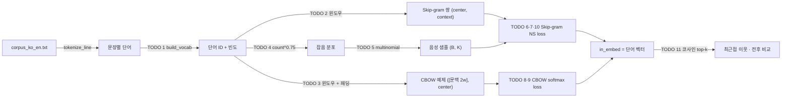

# P1-03 Word2Vec — 선택 과제

> **선택 과제 (P1-03A): 원리를 직접 구현해 보고 싶을 때.**
> 이 폴더는 Skip-gram·CBOW·Negative Sampling 을 PyTorch 로 직접 구현하고 gensim 과 비교하는 심화 실습입니다. 메인 실습([../README.md](../README.md))은 라이브러리·API로 개념과 서비스 관점을 익히는 데 집중하고, 여기서는 같은 개념을 밑바닥부터 구현합니다. 메인 실습을 마친 뒤 시간이 있을 때 도전하세요.
> 명령의 경로는 `part1_ai_fundamentals/word2vec/advanced/`이며, 테스트도 `IMPL=starter pytest part1_ai_fundamentals/word2vec/advanced`로 똑같이 동작합니다.

| 항목 | 값 |
|---|---|
| 실습 ID | P1-03 |
| 난이도 | Level 1 → 2 → 3 |
| 주차 · 진행 순서 | W4 · Part 1의 네 번째 실습 (선수 pytorch → tokenizer → embedding → **word2vec** → transformer) |
| 예상 시간 | 4시간 |
| 필요 패키지 | torch(CPU판으로 충분). Level 3 비교만 `gensim` ([requirements/part1.txt](../../../requirements/part1.txt), 없으면 건너뜀) |
| 파일 | `starter.py`(직접 채우기), `solution.py`(정답), `tests/test_p1_03_word2vec.py`, `run_demo.py`, `compare_with_gensim.py` |

## 1. 목표

- **분포 가설**을 학습 목표로 바꾸는 방법(윈도우 안의 주변 단어 맞히기)을 이해한다.
- 문장 → 단어 ID → (중심, 문맥) 쌍 / (문맥들, 중심) 예제로 이어지는 **데이터 흐름**을 직접 만든다.
- **Skip-gram + Negative Sampling**과 **CBOW**를 `nn.Module`로 직접 구현하고 학습한다.
- 음성 샘플링 분포가 왜 unigram 빈도의 **3/4 제곱**인지 설명한다.
- 학습 전후 단어 벡터를 비교하고, gensim Word2Vec과 **경향**이 같은지 확인한다.

## 2. 선수지식

- [P1-04 PyTorch 기초](../../pytorch/README.md): 학습 루프(zero_grad → forward → backward → step), `torch.bmm`
- [P1-01 Tokenizer](../../tokenizer/README.md): 단어 → ID, padding
- [P1-02 Embedding](../../embedding/README.md): `nn.Embedding`, `padding_idx`, 코사인 유사도, 최근접 이웃

## 3. 핵심 개념

| 개념 | 한 줄 설명 |
|---|---|
| 분포 가설 | 비슷한 문맥에 나오는 단어는 비슷한 뜻을 갖는다 |
| 윈도우 | 중심 단어 앞뒤 `window`개 단어 = 문맥 (같은 문장 안에서만) |
| Skip-gram | 중심 단어 → 문맥 단어 각각을 맞힘 (쌍 단위) |
| CBOW | 문맥 단어들의 평균 → 중심 단어를 맞힘 (순서를 버린 "단어 주머니") |
| 두 개의 테이블 | 중심 단어용 `v`(in_embed)와 문맥 단어용 `u`(out_embed). 최종 단어 벡터는 보통 `v` |
| Negative Sampling | 전체 어휘 softmax 대신 "진짜 문맥 1개 vs 무작위 단어 K개" 이진 분류 |
| 잡음 분포 `P_n` | 음성 단어를 뽑는 분포. `count^0.75`에 비례 |

## 4. 내부 원리

**왜 윈도우의 주변 단어로 의미를 학습하나?**
`the cat sat on the mat`과 `the dog sat on the log`에서 cat과 dog는 주변 단어(the, sat, on)가 같습니다.
"단어 벡터로 주변 단어를 맞혀라"를 학습 목표로 두면, 주변이 같은 두 단어는 같은 예측을 해야 하므로 **벡터가 비슷해질 수밖에 없습니다.**
의미를 직접 가르치지 않아도 분포 가설이 학습 목표 안에 들어가 있는 셈입니다.



**왜 Negative Sampling으로 softmax를 피하나?**
Skip-gram을 softmax로 학습하면 `P(o|c) = exp(u_o·v_c) / Σ_{w=1}^{V} exp(u_w·v_c)` 입니다. 분모 때문에 쌍 하나마다 어휘 **V개 전부**의 내적이 필요합니다(어휘 10만이면 10만 번).
Negative Sampling은 문제를 "이 쌍이 진짜 문맥인가?"라는 이진 분류로 바꿉니다. 진짜 문맥 1개는 1로, 잡음 분포에서 뽑은 단어 K개(5~20)는 0으로 맞히므로 계산량이 **O(V) → O(K)** 로 줄어듭니다.
이 실습의 CBOW는 어휘가 작아(345개) 일부러 full softmax를 쓰고, 그 비용을 Skip-gram과 비교해 볼 수 있게 했습니다.

**왜 3/4 제곱인가?**
음성 단어를 빈도 그대로(`count^1`) 뽑으면 "the" 같은 고빈도어가 음성 샘플을 거의 독차지합니다. 그러면 모델은 "the가 아니다"만 반복해서 배웁니다.
균등하게(`count^0`) 뽑으면 거의 나오지 않는 희귀어만 계속 밀어냅니다.
3/4 제곱은 그 사이의 절충입니다. 빈도 16과 1의 비율이 16:1에서 **8:1**로 줄어 고빈도어 과대표집이 완화됩니다(테스트 `test_noise_distribution_three_quarter_power`).
Mikolov et al.(2013b, §2.2)은 unigram 분포의 3/4 제곱이 실험에서 다른 선택보다 좋았다고 보고합니다. 이론에서 유도한 값이 아니라 **실험으로 고른 값**입니다.

**왜 테이블이 두 개인가?**
하나만 쓰면 단어 w가 자기 자신의 문맥이 되는 점수 `v_w·v_w = |v_w|²`가 항상 크게 나와, "단어는 자기 자신과 함께 나온다"라는 잘못된 신호가 섞입니다.
그래서 중심 역할(`v`)과 문맥 역할(`u`)을 분리합니다. 초기화도 원 구현(C 코드)처럼 `v`는 ±0.5/D 균등분포, `u`는 0입니다.

## 5. 수식

Skip-gram + Negative Sampling 손실 (TODO 7, Mikolov et al., 2013b, 식 4의 음수), 중심 `c`, 문맥 `o`, 음성 `w_1..w_K ~ P_n`:

$$
\mathcal{L} = -\log \sigma(\mathbf{u}_o^\top \mathbf{v}_c) - \sum_{k=1}^{K} \log \sigma(-\mathbf{u}_{w_k}^\top \mathbf{v}_c)
$$

잡음 분포 (TODO 4):

$$
P_n(w) = \frac{\text{count}(w)^{3/4}}{\sum_{w'} \text{count}(w')^{3/4}}
$$

CBOW (TODO 9), 패딩을 뺀 문맥 집합 `C` (|C| ≥ 1):

$$
\mathbf{h} = \frac{1}{|C|}\sum_{j \in C} \mathbf{e}_{x_j},\qquad
\mathcal{L} = -\log \frac{\exp(\mathbf{w}_{c}^\top \mathbf{h})}{\sum_{w=1}^{V} \exp(\mathbf{w}_{w}^\top \mathbf{h})}
$$

윈도우 예시 (`window=2`, 문장 `the cat sat on the mat`):

```text
위치:      0     1     2     3     4     5
단어:     the   cat   sat   on    the   mat
중심 = cat(1) → Skip-gram 쌍: (cat,the) (cat,sat) (cat,on)        ← 왼쪽은 문장 시작에서 잘림
             → CBOW 예제:   ([the, sat, on, <pad>], cat)         ← 모자란 자리는 <pad>, 평균에서 제외

shape:  Skip-gram  center (B,) · context (B,) · negatives (B, K) → v (B, D) · u_pos (B, D) · u_neg (B, K, D)
        CBOW       contexts (B, 2w) → embed (B, 2w, D) × mask (B, 2w, 1) → 평균 h (B, D) → logits (B, V)
```

## 6. 실행법

저장소 루트에서 실행합니다.

**Windows PowerShell**

```powershell
.\.venv\Scripts\Activate.ps1
$env:PYTHONUTF8 = "1"

# 1) 남은 TODO 확인
python part1_ai_fundamentals/word2vec/starter.py

# 2) 직접 구현 검사 (TODO가 남은 테스트는 skip으로 표시)
$env:IMPL = "starter"; pytest part1_ai_fundamentals/word2vec -rs; Remove-Item Env:IMPL

# 3) 정답 코드 검사
pytest part1_ai_fundamentals/word2vec -rs

# 4) 데모: 손실 곡선 요약 + 학습 전후 비교 (data/corpus_ko_en.txt)
python part1_ai_fundamentals/word2vec/run_demo.py --impl starter

# 5) Level 3: gensim과 비교 (gensim이 없으면 "건너뜀")
python part1_ai_fundamentals/word2vec/compare_with_gensim.py --impl starter
```

**bash (Linux/macOS)**

```bash
source .venv/bin/activate
python part1_ai_fundamentals/word2vec/starter.py
IMPL=starter pytest part1_ai_fundamentals/word2vec -rs
pytest part1_ai_fundamentals/word2vec -rs
python part1_ai_fundamentals/word2vec/run_demo.py --impl solution
python part1_ai_fundamentals/word2vec/compare_with_gensim.py --impl solution
```

- 테스트는 `IMPL` 환경 변수로 `starter.py`/`solution.py`를 **파일 경로 기준**으로 불러옵니다(`part1_ai_fundamentals/conftest.py`).
- TODO가 남아 있으면 해당 테스트는 실패가 아니라 **`skipped`(TODO 미구현: TODO n)** 로 나옵니다. 번호는 그 테스트가 처음 부딪힌 TODO입니다. 예를 들어 학습 테스트는 `train_word2vec` 안에서 먼저 TODO 1(`build_vocab`)을 부릅니다.
- 데이터는 두 가지이며, 둘 다 다운로드가 필요 없습니다.
  - **`data/corpus_ko_en.txt`(48문장, 504단어):** 데모, 전후 비교, gensim 비교에 씁니다. `tokenize_line`으로 소문자화하고 구두점을 제거합니다(예: `mat.` → `mat`).
  - **생성 말뭉치 `make_toy_corpus`:** 동물·탈것·과일 세 그룹이 분명한 짧은 영어 문장입니다. 저장소 말뭉치는 너무 작아 "같은 그룹끼리 모이는가"를 정량으로 검사하기 어렵기 때문에 테스트와 그룹 순도 측정에 씁니다.
- 학습 테스트는 결과 재현을 위해 seed 0, CPU로 고정합니다. 데모 스크립트는 GPU가 있으면 cuda를 씁니다. 이때 수치가 이 README와 조금 다를 수 있습니다.

## 7. TODO 목록

| TODO | Level | 위치 | 내용 |
|---|---|---|---|
| 1 | 1 | `build_vocab` | 단어 → ID (빈도순, 동점은 사전순), `min_count`, 빈도 목록 |
| 2 | 1 | `skipgram_pairs` | 윈도우 안 (center, context) 쌍, 문장 경계·자기 자신 제외 |
| 3 | 1 | `cbow_examples` | 모든 위치의 (문맥 2w개, center), 모자란 문맥은 `pad_id` |
| 4 | 2 | `noise_distribution` | `count^0.75` 정규화 |
| 5 | 2 | `sample_negatives` | (B, K) 복원 추출, generator로 재현성 |
| 6 | 2 | `SkipGramNegSampling.__init__` | in/out 두 테이블, 원 구현 초기화 |
| 7 | 2 | `SkipGramNegSampling.forward` | 양성·음성 점수, `logsigmoid` 손실 |
| 8 | 2 | `CBOWSoftmax.__init__` | 패딩 행 포함 임베딩(`padding_idx`), bias 없는 출력층 |
| 9 | 2 | `CBOWSoftmax.forward` | 패딩 제외 평균 → logits → cross entropy |
| 10 | 2 | `skipgram_batch_loss` | 배치 텐서화 + 음성 샘플 + loss (학습 루프의 핵심 단계) |
| 11 | 3 | `nearest` | 코사인 최근접 이웃 (학습 전후 비교에 사용) |
| — | 3 | `run_demo.py`, `compare_with_gensim.py` | 전후 비교, gensim 비교 (구현할 TODO 없음, 실행·해석) |

각 TODO 아래의 주석 규약: `HINT 1`(방향) · `HINT 2`(API·shape) · `WHY`(왜 필요한가) · `REF`(출처).
REF는 다음 두 논문입니다.
- Mikolov et al., 2013a, "Efficient Estimation of Word Representations in Vector Space": §3.1 CBOW, §3.2 Skip-gram
- Mikolov et al., 2013b, "Distributed Representations of Words and Phrases and their Compositionality": §2.2 Negative Sampling, 식 4

## 8. 예상 결과

아래는 이 저장소의 클라우드 환경(**CPU**, Python 3.12.13, torch 2.15.0, gensim 4.4.0)에서 실제로 실행한 출력입니다.

`python part1_ai_fundamentals/word2vec/starter.py` (아무것도 채우지 않은 상태, 마지막 줄들)

```text
[미구현] TODO 10 skipgram_batch_loss (Level 2)
[미구현] TODO 11 nearest (Level 3)

남은 TODO 11개 — 위에서부터 순서대로 채우세요(뒤 TODO 는 앞 TODO 를 사용합니다). 채운 뒤 검사:
  (bash)       IMPL=starter pytest part1_ai_fundamentals/word2vec
  (PowerShell) $env:IMPL="starter"; pytest part1_ai_fundamentals/word2vec; Remove-Item Env:IMPL
```

`pytest part1_ai_fundamentals/word2vec -rs` (solution)

```text
.................                                                        [100%]
17 passed in 6.30s
```

`IMPL=starter pytest part1_ai_fundamentals/word2vec -rs` (아무것도 채우지 않은 상태, 앞부분)

```text
sssssssssssssssss                                                        [100%]
SKIPPED [1] part1_ai_fundamentals/word2vec/tests/test_p1_03_word2vec.py:17: TODO 미구현: TODO 1
SKIPPED [1] part1_ai_fundamentals/word2vec/tests/test_p1_03_word2vec.py:26: TODO 미구현: TODO 2
...
17 skipped in 2.25s
```

`python part1_ai_fundamentals/word2vec/run_demo.py --impl solution`

```text
[device] cpu
[data] sentences=48 tokens=504 vocab=345 count(cat)=2 count(the)=34

[skipgram] loss ep1:4.157, ep21:1.218, ep41:0.659, ep61:0.615, ep81:0.566, ep100:0.575 (0.58s)
  cos(cat, dog): +0.129 -> +0.941
  cos(mat, log): +0.188 -> +0.910
  cos(sat, likes): -0.253 -> +0.887
  cos(cat, coffee): -0.108 -> +0.366
  cat 최근접 (학습 전): [('it', 0.478), ('번호를', 0.437), ('맞히려면', 0.426)]
  cat 최근접 (학습 후): [('dog', 0.941), ('log', 0.885), ('long', 0.846)]

[cbow] loss ep1:5.873, ep21:2.259, ep41:0.427, ep61:0.138, ep81:0.074, ep100:0.049 (0.21s)
  cos(cat, dog): +0.141 -> +0.457
  cos(mat, log): +0.197 -> +0.431
  cos(sat, likes): -0.056 -> +0.489
  cos(cat, coffee): -0.250 -> -0.325
  cat 최근접 (학습 전): [('predict', 0.442), ('만들어', 0.436), ('reduce', 0.434)]
  cat 최근접 (학습 후): [('정규화는', 0.479), ('reduce', 0.471), ('predict', 0.46)]
```

`python part1_ai_fundamentals/word2vec/compare_with_gensim.py --impl solution`

```text
[corpus] tokens=504 vocab=345 epochs=100

[skipgram] my loss 4.1565 -> 0.5747, time mine 0.68s / gensim 0.1s
  pair          before    mine  gensim
  cat-dog        0.129   0.941   0.985
  mat-log        0.188    0.91   0.973
  sat-likes     -0.253   0.887   0.981
  cat-coffee    -0.108   0.366   0.771
  cat 최근접 (mine):   [('dog', 0.941), ('log', 0.885), ('long', 0.846)]
  cat 최근접 (gensim): [('likes', 0.993), ('dog', 0.985), ('warm', 0.985)]

[cbow] my loss 5.8725 -> 0.0494, time mine 0.19s / gensim 0.08s
  pair          before    mine  gensim
  cat-dog        0.141   0.457   0.911
  mat-log        0.197   0.431   0.904
  sat-likes     -0.056   0.489   0.975
  cat-coffee     -0.25  -0.325   0.746
  cat 최근접 (mine):   [('정규화는', 0.479), ('reduce', 0.471), ('predict', 0.46)]
  cat 최근접 (gensim): [('loss', 0.994), ('scale', 0.992), ('same', 0.99)]

[toy skipgram] group purity before 0.0 / mine 1.0 / gensim 1.0 (무작위 기대값 약 0.077)
```

자세한 기록: [experiments/P1-03-20261109-word2vec](../../../experiments/P1-03-20261109-word2vec/README.md)

**해석**
- **Skip-gram은 같은 문장 구조의 단어를 가깝게 만듭니다.** `cat–dog` 0.13 → 0.94, `mat–log` 0.19 → 0.91, `sat–likes` −0.25 → 0.89. 학습 후 `cat`의 1순위 이웃은 `dog`입니다.
- **대조군도 올라갑니다**(`cat–coffee` −0.11 → 0.37). 작은 말뭉치에서는 모든 벡터가 비슷한 방향으로 밀리는 경향이 있습니다. 그래서 "값이 올랐다"가 아니라 **"같은 구조 쌍이 대조군보다 얼마나 더 가까운가"**(0.94 vs 0.37)로 판단해야 합니다. 테스트도 이 기준(`after > 대조군`)을 씁니다.
- **CBOW는 이 말뭉치에서 약합니다.** `cat–dog`는 0.46까지 오르고 대조군(−0.33)보다 가깝지만, 최근접 이웃은 의미가 없습니다. loss가 0.05까지 내려간 것은 504단어 말뭉치를 거의 외웠다는 뜻입니다. CBOW는 문맥을 평균하므로 희귀어(`cat`은 2번 등장)에 주는 신호가 Skip-gram보다 적다고 알려져 있습니다. 생성 말뭉치에서는 CBOW도 그룹 순도 0.86(10 epoch)에 도달합니다(테스트 `test_training_groups_words_on_toy_corpus`).
- **gensim과 경향은 같고 값은 다릅니다.** 두 구현 모두 같은 구조 쌍이 대조군보다 가깝고, 생성 말뭉치 그룹 순도도 둘 다 1.0입니다. 다만 gensim은 이 작은 말뭉치에서 대조군까지 0.77로 높아 모든 벡터가 한 방향으로 몰리는 정도가 더 큽니다. gensim CBOW의 `cat` 이웃도 의미가 없습니다. 값이 다른 이유는 9절 마지막 행에 정리했습니다. **값이 똑같을 필요는 없고, 같은 경향이면 구현이 맞다고 봅니다.**
- 학습 시간(100 epoch): Skip-gram은 직접 구현 0.68초 / gensim 0.10초(약 7배), CBOW는 0.19초 / 0.08초(약 2배)입니다. gensim은 Cython으로 최적화된 단어 단위 SGD를 쓰고, 직접 구현은 파이썬 리스트를 배치마다 텐서로 바꾸는 비용이 큽니다.

## 9. 자주 나는 오류

| 증상 | 원인 | 해결 |
|---|---|---|
| **CBOW 테스트 실패: 그룹 순도 0.33 (기준 0.6)** — 이 저장소에서 실제로 겪은 문제 | ① 이전 구현은 **양쪽 문맥이 다 있는 위치만** 예제로 썼다. 생성 말뭉치 기준으로 그룹 단어(cat, car, apple)가 중심 단어로 나온 예제는 3,376개 중 335개뿐이었고, 4단어 과일 문장(`the apple is sweet`)에서는 예제가 하나도 나오지 않았다. ② 그룹 단어가 문맥으로만 나올 때는 다른 문맥 단어(`in`/`on`)가 정답을 이미 알려 줘서, 그룹 단어 벡터가 서로 모일 이유가 없었다. epoch·lr만 바꾼 결과(이전 구현, 실측): 5ep/0.01 0.33, 10ep/0.01 0.39, 20ep/0.01 0.39, 30ep/0.01 0.42, 5ep/0.05 0.39, 10ep/0.05 0.36, 20ep/0.05 0.53. 가장 좋은 경우도 기준 0.6 미만이고, epoch를 4배(5→20)로 늘리면 학습 시간도 약 2~4배(0.06~0.11s → 0.25s) 늘었다. **하이퍼파라미터만으로는 부족** | **모든 위치**를 예제로 쓰고, 모자란 문맥은 `<pad>`로 채운 뒤 **마스크 평균**에서 뺀다(TODO 3, 8, 9). 수정 후 생성 말뭉치 그룹 순도: 5 epoch 0.69, 10 epoch 0.86 |
| 다른 문장 단어가 문맥에 섞임 | 말뭉치를 한 줄로 이어 붙여 윈도우를 만듦 | 문장(줄) 단위로 `skipgram_pairs` 적용 |
| `(cat, cat)` 같은 쌍이 생김 | `j == i` 제외 누락 | 자기 자신 제외 |
| loss가 `inf` / `nan` | `torch.log(torch.sigmoid(x))`를 나눠 계산 | `F.logsigmoid` |
| `bmm` shape 오류 | `v`를 (B, D, 1)로 늘리지 않음 | `v.unsqueeze(-1)`, 결과 `.squeeze(-1)` |
| 음성 샘플이 고빈도어로 도배됨 | `power=1` | `count ** 0.75` |
| 음성 샘플이 실행마다 달라 테스트가 흔들림 | generator 미사용 | `torch.multinomial(..., generator=gen)` |
| CBOW 평균이 문장 끝에서만 작아짐 | 패딩 수까지 나눔 | 마스크 합(실제 문맥 수)으로 나눔, `clamp(min=1)` |
| 학습 후에도 이웃이 무작위 | `out_embed`(또는 CBOW `out`)를 단어 벡터로 씀 / 학습 전 벡터를 봄 | 입력 쪽 테이블(`in_embed`, `embed`)을 사용, `vectors_before`와 구분 |
| 최근접 1순위가 자기 자신 | 자기 제외 누락 | 자기 위치를 −2로 |
| gensim과 값이 다름 | 구현 차이(정상) — 최적화(Adam·미니배치 vs SGD·학습률 감소), gensim의 윈도우 크기 무작위 축소, gensim CBOW는 음성 샘플링, 난수 생성기 차이 | 값이 아니라 **경향**(같은 구조 쌍 > 대조군, 그룹 순도)을 비교 |
| Windows에서 한글 깨짐 | 기본 인코딩 cp949 | `$env:PYTHONUTF8 = "1"` |

## 10. 과제

1. **3/4의 효과:** `noise_distribution`의 `power`를 0, 0.75, 1로 바꿔 `run_demo.py`의 `cat–dog`, `cat–coffee` 코사인을 비교하세요. 대조군과의 차이가 가장 큰 값은 무엇인가요?
2. **음성 샘플 수 K:** 2, 5, 15로 바꿔 학습 시간과 결과를 비교하세요.
3. **CBOW + Negative Sampling:** `CBOWSoftmax`를 음성 샘플링 버전으로 바꾸고, 어휘를 크게 했을 때(생성 말뭉치에 단어 추가) softmax 버전과 학습 시간을 비교하세요.
4. **다운샘플링(subsampling):** 고빈도어를 확률적으로 버리는 기법(Mikolov et al., 2013b, §2.3)을 구현해 "the"가 결과에 주는 영향을 확인하세요.
5. **(Level 3+) 더 큰 말뭉치:** 라이선스가 명확한 공개 텍스트로 학습해 `king − man + woman` 같은 유추를 시도해 보세요. 이 저장소의 말뭉치로는 불가능한 이유도 설명하세요.

## 11. 체크리스트

- [ ] `python part1_ai_fundamentals/word2vec/starter.py`가 "모든 TODO가 구현되었습니다"를 출력한다
- [ ] `IMPL=starter pytest part1_ai_fundamentals/word2vec`이 skip 없이 통과한다 (gensim 미설치 시 비교 테스트 skip은 무관)
- [ ] 분포 가설이 Skip-gram/CBOW 학습 목표에 어떻게 들어가 있는지 설명할 수 있다
- [ ] softmax 대신 Negative Sampling을 쓰는 이유를 계산량(O(V) vs O(K))으로 설명할 수 있다
- [ ] 3/4 제곱의 효과를 빈도 16:1 예시로 설명할 수 있다
- [ ] CBOW 실패 원인(양쪽 문맥만 쓰기)과 해결(패딩 + 마스크 평균)을 설명할 수 있다
- [ ] "값이 올랐다"가 아니라 "대조군보다 가까운가"로 판단해야 하는 이유를 설명할 수 있다
- [ ] 실행 결과를 [experiments 기록](../../../experiments/P1-03-20261109-word2vec/README.md)에 남겼다

## 12. 다음 단계 연결

- **P1-05 Transformer:** Word2Vec 벡터는 단어마다 **하나**뿐이라, "bank"(은행/강둑)처럼 문맥에 따라 뜻이 바뀌는 단어를 구별하지 못합니다. Transformer는 어텐션으로 주변 단어를 섞어 **문맥마다 다른 벡터**를 만듭니다. 이번 `u·v` 내적 점수가 어텐션의 `q·k` 점수로 이어집니다.
- **Part 3 RAG:** 문서 검색용 임베딩도 "비슷한 것은 가깝게" 학습한 벡터입니다. Part 5에서는 음성 샘플링과 같은 아이디어(hard negative)로 임베딩 모델을 미세조정합니다.
- 진행 상태: [docs/PROGRESS.md](../../../docs/PROGRESS.md) — 직접 확인한 뒤 P1-03을 `COMPLETED`로 바꾸세요.
