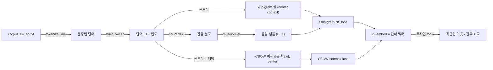

# P1-03 Word2Vec — 선택 과제

> **선택 과제 (P1-03A): 원리를 직접 구현해 보고 싶을 때.**
> 이 폴더는 Skip-gram·CBOW·Negative Sampling 을 PyTorch 로 직접 구현하고 gensim 과 비교하는 심화 개념 노트입니다(구현 코드는 삭제했고, 원리·수식·손계산·과제 아이디어만 남겼습니다). 메인 실습([../README.md](../README.md))은 라이브러리·API로 개념과 서비스 관점을 익히는 데 집중하고, 여기서는 같은 개념을 밑바닥부터 구현합니다. 메인 실습을 마친 뒤 시간이 있을 때 도전하세요.

> **최종 서비스에서의 위치:** 서비스 코드에서는 라이브러리·API를 쓰므로 이 노트는 필수가 아닙니다. 다만 Skip-gram·Negative Sampling을 직접 만들어 보면 임베딩이 "주변 단어로 학습된다"는 원리와 한계(다의어)가 보입니다.

> 이 문서에 나오는 `함수·파일 이름`(예: `run_demo.py`)은 이전 실습 코드(커밋 `aa46d2f`)의 이름입니다. 그 코드는 지웠고 개념만 남겼습니다. 옛 코드가 필요하면 `git checkout aa46d2f`(복구 방법은 [루트 README](../../../README.md#지금-어디를-보면-되나-학습-방식)).

| 항목 | 값 |
|---|---|
| 실습 ID | P1-03 |
| 필요 패키지 | torch(CPU판으로 충분). Level 3 비교만 `gensim` ([requirements/part1.txt](../../../requirements/part1.txt), 없으면 건너뜀) |

## 1. 목표

- **분포 가설**을 학습 목표로 바꾸는 방법(윈도우 안의 주변 단어 맞히기)을 이해한다.
- 문장 → 단어 ID → (중심, 문맥) 쌍 / (문맥들, 중심) 예제로 이어지는 **데이터 흐름**을 직접 만든다.
- **Skip-gram + Negative Sampling**과 **CBOW**를 `nn.Module`로 직접 구현하고 학습한다.
- 음성 샘플링 분포가 왜 unigram 빈도의 **3/4 제곱**인지 설명한다.
- 학습 전후 단어 벡터를 비교하고, gensim Word2Vec과 **경향**이 같은지 확인한다.

## 2. 선수지식

- [P1-04 PyTorch 기초](../../pytorch/README.md): 학습 루프(zero_grad → forward → backward → step), `torch.bmm`
- [P1-01 Tokenizer](../../tokenizer/README.md): 단어 → ID, padding
- [P1-02 Embedding](../../embedding/README.md): `nn.Embedding`, `padding_idx`, 코사인 유사도, 최근접 이웃

## 3. 핵심 개념

| 개념 | 한 줄 설명 |
|---|---|
| 분포 가설 | 비슷한 문맥에 나오는 단어는 비슷한 뜻을 갖는다 |
| 윈도우 | 중심 단어 앞뒤 `window`개 단어 = 문맥 (같은 문장 안에서만) |
| Skip-gram | 중심 단어 → 문맥 단어 각각을 맞힘 (쌍 단위) |
| CBOW | 문맥 단어들의 평균 → 중심 단어를 맞힘 (순서를 버린 "단어 주머니") |
| 두 개의 테이블 | 중심 단어용 `v`(in_embed)와 문맥 단어용 `u`(out_embed). 최종 단어 벡터는 보통 `v` |
| Negative Sampling | 전체 어휘 softmax 대신 "진짜 문맥 1개 vs 무작위 단어 K개" 이진 분류 |
| 잡음 분포 `P_n` | 음성 단어를 뽑는 분포. `count^0.75`에 비례 |

## 4. 내부 원리

**왜 윈도우의 주변 단어로 의미를 학습하나?**
`the cat sat on the mat`과 `the dog sat on the log`에서 cat과 dog는 주변 단어(the, sat, on)가 같습니다.
"단어 벡터로 주변 단어를 맞혀라"를 학습 목표로 두면, 주변이 같은 두 단어는 같은 예측을 해야 하므로 **벡터가 비슷해질 수밖에 없습니다.**
의미를 직접 가르치지 않아도 분포 가설이 학습 목표 안에 들어가 있는 셈입니다.



**왜 Negative Sampling으로 softmax를 피하나?**
Skip-gram을 softmax로 학습하면 `P(o|c) = exp(u_o·v_c) / Σ_{w=1}^{V} exp(u_w·v_c)` 입니다. 분모 때문에 쌍 하나마다 어휘 **V개 전부**의 내적이 필요합니다(어휘 10만이면 10만 번).
Negative Sampling은 문제를 "이 쌍이 진짜 문맥인가?"라는 이진 분류로 바꿉니다. 진짜 문맥 1개는 1로, 잡음 분포에서 뽑은 단어 K개(5~20)는 0으로 맞히므로 계산량이 **O(V) → O(K)** 로 줄어듭니다.
이 실습의 CBOW는 어휘가 작아(345개) 일부러 full softmax를 쓰고, 그 비용을 Skip-gram과 비교해 볼 수 있게 했습니다.

**왜 3/4 제곱인가?**
음성 단어를 빈도 그대로(`count^1`) 뽑으면 "the" 같은 고빈도어가 음성 샘플을 거의 독차지합니다. 그러면 모델은 "the가 아니다"만 반복해서 배웁니다.
균등하게(`count^0`) 뽑으면 거의 나오지 않는 희귀어만 계속 밀어냅니다.
3/4 제곱은 그 사이의 절충입니다. 빈도 16과 1의 비율이 16:1에서 **8:1**로 줄어 고빈도어 과대표집이 완화됩니다(테스트 `test_noise_distribution_three_quarter_power`).
Mikolov et al.(2013b, §2.2)은 unigram 분포의 3/4 제곱이 실험에서 다른 선택보다 좋았다고 보고합니다. 이론에서 유도한 값이 아니라 **실험으로 고른 값**입니다.

**왜 테이블이 두 개인가?**
하나만 쓰면 단어 w가 자기 자신의 문맥이 되는 점수 `v_w·v_w = |v_w|²`가 항상 크게 나와, "단어는 자기 자신과 함께 나온다"라는 잘못된 신호가 섞입니다.
그래서 중심 역할(`v`)과 문맥 역할(`u`)을 분리합니다. 초기화도 원 구현(C 코드)처럼 `v`는 ±0.5/D 균등분포, `u`는 0입니다.

## 5. 수식

Skip-gram + Negative Sampling 손실 (, Mikolov et al., 2013b, 식 4의 음수), 중심 `c`, 문맥 `o`, 음성 `w_1..w_K ~ P_n`:

$$
\mathcal{L} = -\log \sigma(\mathbf{u}_o^\top \mathbf{v}_c) - \sum_{k=1}^{K} \log \sigma(-\mathbf{u}_{w_k}^\top \mathbf{v}_c)
$$

잡음 분포:

$$
P_n(w) = \frac{\text{count}(w)^{3/4}}{\sum_{w'} \text{count}(w')^{3/4}}
$$

CBOW, 패딩을 뺀 문맥 집합 `C` (|C| ≥ 1):

$$
\mathbf{h} = \frac{1}{|C|}\sum_{j \in C} \mathbf{e}_{x_j},\qquad
\mathcal{L} = -\log \frac{\exp(\mathbf{w}_{c}^\top \mathbf{h})}{\sum_{w=1}^{V} \exp(\mathbf{w}_{w}^\top \mathbf{h})}
$$

윈도우 예시 (`window=2`, 문장 `the cat sat on the mat`):

```text
위치:      0     1     2     3     4     5
단어:     the   cat   sat   on    the   mat
중심 = cat(1) → Skip-gram 쌍: (cat,the) (cat,sat) (cat,on)        ← 왼쪽은 문장 시작에서 잘림
             → CBOW 예제:   ([the, sat, on, <pad>], cat)         ← 모자란 자리는 <pad>, 평균에서 제외

shape:  Skip-gram  center (B,) · context (B,) · negatives (B, K) → v (B, D) · u_pos (B, D) · u_neg (B, K, D)
        CBOW       contexts (B, 2w) → embed (B, 2w, D) × mask (B, 2w, 1) → 평균 h (B, D) → logits (B, V)
```

## 6. 자주 나는 오류

| 증상 | 원인 | 해결 |
|---|---|---|
| **CBOW 테스트 실패: 그룹 순도 0.33 (기준 0.6)** — 이 저장소에서 실제로 겪은 문제 | ① 이전 구현은 **양쪽 문맥이 다 있는 위치만** 예제로 썼다. 생성 말뭉치 기준으로 그룹 단어(cat, car, apple)가 중심 단어로 나온 예제는 3,376개 중 335개뿐이었고, 4단어 과일 문장(`the apple is sweet`)에서는 예제가 하나도 나오지 않았다. ② 그룹 단어가 문맥으로만 나올 때는 다른 문맥 단어(`in`/`on`)가 정답을 이미 알려 줘서, 그룹 단어 벡터가 서로 모일 이유가 없었다. epoch·lr만 바꾼 결과(이전 구현, 실측): 5ep/0.01 0.33, 10ep/0.01 0.39, 20ep/0.01 0.39, 30ep/0.01 0.42, 5ep/0.05 0.39, 10ep/0.05 0.36, 20ep/0.05 0.53. 가장 좋은 경우도 기준 0.6 미만이고, epoch를 4배(5→20)로 늘리면 학습 시간도 약 2~4배(0.06~0.11s → 0.25s) 늘었다. **하이퍼파라미터만으로는 부족** | **모든 위치**를 예제로 쓰고, 모자란 문맥은 `<pad>`로 채운 뒤 **마스크 평균**에서 뺀다. 수정 후 생성 말뭉치 그룹 순도: 5 epoch 0.69, 10 epoch 0.86 |
| 다른 문장 단어가 문맥에 섞임 | 말뭉치를 한 줄로 이어 붙여 윈도우를 만듦 | 문장(줄) 단위로 `skipgram_pairs` 적용 |
| `(cat, cat)` 같은 쌍이 생김 | `j == i` 제외 누락 | 자기 자신 제외 |
| loss가 `inf` / `nan` | `torch.log(torch.sigmoid(x))`를 나눠 계산 | `F.logsigmoid` |
| `bmm` shape 오류 | `v`를 (B, D, 1)로 늘리지 않음 | `v.unsqueeze(-1)`, 결과 `.squeeze(-1)` |
| 음성 샘플이 고빈도어로 도배됨 | `power=1` | `count ** 0.75` |
| 음성 샘플이 실행마다 달라 테스트가 흔들림 | generator 미사용 | `torch.multinomial(..., generator=gen)` |
| CBOW 평균이 문장 끝에서만 작아짐 | 패딩 수까지 나눔 | 마스크 합(실제 문맥 수)으로 나눔, `clamp(min=1)` |
| 학습 후에도 이웃이 무작위 | `out_embed`(또는 CBOW `out`)를 단어 벡터로 씀 / 학습 전 벡터를 봄 | 입력 쪽 테이블(`in_embed`, `embed`)을 사용, `vectors_before`와 구분 |
| 최근접 1순위가 자기 자신 | 자기 제외 누락 | 자기 위치를 −2로 |
| gensim과 값이 다름 | 구현 차이(정상) — 최적화(Adam·미니배치 vs SGD·학습률 감소), gensim의 윈도우 크기 무작위 축소, gensim CBOW는 음성 샘플링, 난수 생성기 차이 | 값이 아니라 **경향**(같은 구조 쌍 > 대조군, 그룹 순도)을 비교 |
| Windows에서 한글 깨짐 | 기본 인코딩 cp949 | `$env:PYTHONUTF8 = "1"` |

## 7. 과제

1. **3/4의 효과:** `noise_distribution`의 `power`를 0, 0.75, 1로 바꿔 학습한 뒤 `cat–dog`, `cat–coffee` 코사인을 비교하세요. 대조군과의 차이가 가장 큰 값은 무엇인가요?
2. **음성 샘플 수 K:** 2, 5, 15로 바꿔 학습 시간과 결과를 비교하세요.
3. **CBOW + Negative Sampling:** `CBOWSoftmax`를 음성 샘플링 버전으로 바꾸고, 어휘를 크게 했을 때(생성 말뭉치에 단어 추가) softmax 버전과 학습 시간을 비교하세요.
4. **다운샘플링(subsampling):** 고빈도어를 확률적으로 버리는 기법(Mikolov et al., 2013b, §2.3)을 구현해 "the"가 결과에 주는 영향을 확인하세요.
5. **(Level 3+) 더 큰 말뭉치:** 라이선스가 명확한 공개 텍스트로 학습해 `king − man + woman` 같은 유추를 시도해 보세요. 이 저장소의 말뭉치로는 불가능한 이유도 설명하세요.

## 8. 체크리스트

- [ ] 분포 가설이 Skip-gram/CBOW 학습 목표에 어떻게 들어가 있는지 설명할 수 있다
- [ ] softmax 대신 Negative Sampling을 쓰는 이유를 계산량(O(V) vs O(K))으로 설명할 수 있다
- [ ] 3/4 제곱의 효과를 빈도 16:1 예시로 설명할 수 있다
- [ ] CBOW 실패 원인(양쪽 문맥만 쓰기)과 해결(패딩 + 마스크 평균)을 설명할 수 있다
- [ ] "값이 올랐다"가 아니라 "대조군보다 가까운가"로 판단해야 하는 이유를 설명할 수 있다

## 9. 다음 단계 연결

- **P1-05 Transformer:** Word2Vec 벡터는 단어마다 **하나**뿐이라, "bank"(은행/강둑)처럼 문맥에 따라 뜻이 바뀌는 단어를 구별하지 못합니다. Transformer는 어텐션으로 주변 단어를 섞어 **문맥마다 다른 벡터**를 만듭니다. 이번 `u·v` 내적 점수가 어텐션의 `q·k` 점수로 이어집니다.
- **Part 3 RAG:** 문서 검색용 임베딩도 "비슷한 것은 가깝게" 학습한 벡터입니다. Part 5에서는 음성 샘플링과 같은 아이디어(hard negative)로 임베딩 모델을 미세조정합니다.
- 내가 만든 것은 [docs/PROGRESS.md](../../../docs/PROGRESS.md)에 기록합니다.
