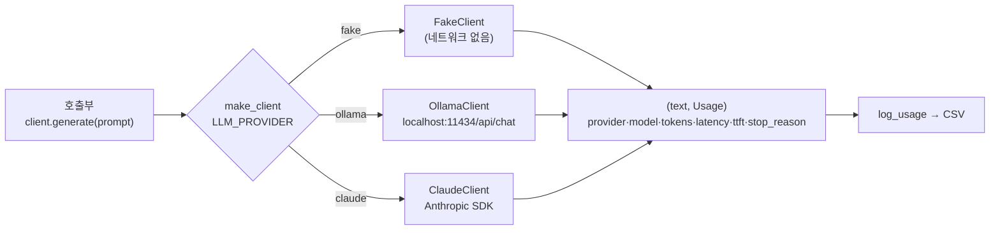

# P2-01B 로컬 LLM 서빙과 공급자 교체 — "LLM 호출부를 공급자와 분리하기"

| 항목 | 값 |
|---|---|
| 실습 ID | P2-01B (메인) |
| 주차 · 진행 순서 | W5(–6) · P2-01 다음, P2-02 전 |
| 예상 시간 | 3~4시간 (+ 사용자 PC 측정 1시간) |
| 파일 | `starter.py`(직접 채우기), `solution.py`(정답), `tests/test_p2_01b_local_llm.py`, `run_demo.py`, 선택: `measure_local_models.py`(사용자 PC, Ollama·GPU 필요) |
| 소속 | [Part 2 — LLM 활용 원리](../README.md) |

> 방향: **개념은 깊게, 구현은 얕게.** 로컬 LLM 서버(Ollama)를 HTTP API처럼 부르고, Claude·로컬·가짜 공급자를 **같은 인터페이스**로 설정만 바꿔 교체합니다. RTX 3070에서의 속도·메모리는 사용자 PC에서 직접 잽니다.
> transformers로 모델을 직접 불러오는 방법은 [P2-01 `run_qwen.py`](../next_token_prediction/run_qwen.py)에 있습니다(여기서는 서버 방식만).
> 이 실습의 `LLMClient` 인터페이스는 Part 4 엔티티·관계 추출의 로컬 LLM 비교와 Part 6 AI 서버(공급자 교체·타임아웃·폴백)에서 재사용합니다.

## 1. 목표

- 로컬 LLM 서버의 요청·응답 형식을 읽고, 비스트리밍·스트리밍 응답을 파싱한다.
- 스트리밍에서 **첫 토큰 시간(TTFT)**과 **토큰/초**를 계산한다.
- `generate(prompt) -> (text, Usage)` 공통 인터페이스로 공급자를 `LLM_PROVIDER` 설정만으로 교체한다.
- 주 공급자 장애 시 다른 공급자로 넘어가는 **폴백**을, 넘어가면 안 되는 오류와 구분해 설계한다.
- 사용량·지연을 같은 모양으로 기록하고, API와 로컬의 비용을 같은 단위로 비교한다.
- RTX 3070(8GB)에서 어떤 크기의 모델까지 쓸 수 있는지 측정으로 판단한다.

## 2. 선수지식

- P2-01: 모델 = 토큰 목록 → 다음 토큰 점수, 생성 상한(`max_new_tokens`)
- P1-05: prefill(입력 병렬 처리)·decode(출력 순차 생성), TTFT, KV 캐시 메모리
- P1-01: 토큰은 모델(토크나이저)마다 다르다, 입력·출력 단가
- HTTP 요청·JSON (Spring의 RestTemplate/WebClient 경험이 그대로 쓰입니다)

## 3. 핵심 개념

| 개념 | 한 줄 설명 |
|---|---|
| 로컬 LLM 서버 | 모델을 메모리에 올려 두고 HTTP 요청에 답하는 프로그램. "내 PC 안의 API" |
| Ollama | 로컬 LLM 서버 중 하나. 기본 주소 `http://localhost:11434`, 런타임 라이선스 MIT |
| 스트리밍 | 답을 다 만들기 전에 조각마다 보내기. Ollama는 줄마다 JSON 객체 하나 |
| TTFT | 요청 → 내용이 있는 첫 조각까지의 시간. 체감 반응 속도 |
| 토큰/초 | 출력 생성 속도. 긴 답의 대기 시간을 정한다 |
| 공급자(provider) | 실제로 답을 만드는 쪽(Claude API, 로컬 Ollama, 가짜) |
| 공통 인터페이스 | 호출부가 공급자를 몰라도 되게 하는 같은 모양의 함수(`generate`) |
| 폴백 | 주 공급자가 **일시 장애**일 때 다른 공급자로 답하기 |
| 양자화 | 가중치를 적은 비트(예: 4비트)로 저장해 메모리를 줄이기. 품질이 조금 떨어질 수 있다 |

## 4. 내부 원리

### 4-1. 요청과 응답 (Ollama `/api/chat`)

Ollama API 문서(github.com/ollama/ollama `docs/api.md`, 2026-11-13 확인)의 형식입니다.

```
POST http://localhost:11434/api/chat
{"model": "qwen2.5:0.5b", "messages": [{"role": "user", "content": "안녕"}],
 "stream": true, "options": {"num_predict": 256}}

스트리밍 응답 (줄마다 JSON 하나):
{"message": {"role": "assistant", "content": "안"}, "done": false}
{"message": {"role": "assistant", "content": "녕"}, "done": false}
{"message": {"role": "assistant", "content": ""}, "done": true,
 "prompt_eval_count": 26, "eval_count": 282, "eval_duration": 4535599000, ...}
```

- `stream`을 생략하면 **스트리밍이 기본**입니다. 비스트리밍이면 `"stream": false`를 꼭 넣습니다.
- `prompt_eval_count`는 입력 토큰 수, `eval_count`는 출력 토큰 수입니다. 시간 값(`*_duration`)은 **나노초**입니다.
- 토큰/초 = 282 / (4,535,599,000 / 10⁹) = 282 / 4.54 ≈ **62.2**

### 4-2. 공통 인터페이스와 폴백



`generate_with_fallback([주, 보조], prompt)`는 `ProviderError`일 때만 다음 공급자로 넘어갑니다.

| 오류 | 예 | 폴백? | 이유 |
|---|---|---|---|
| 일시 장애 (`ProviderError`) | 연결 실패, 시간 초과, 5xx, Ollama 과부하 503, Claude 과부하·rate limit | **예** | 다른 공급자는 정상일 수 있다 |
| 설정·요청 오류 | 모델 이름 오타(404), 잘못된 요청(400), 키 없음·인증 실패(401) | 아니오 | 넘겨도 해결되지 않거나 문제를 숨긴다 |
| 코드 버그 | `ValueError` 등 | 아니오 | 다른 공급자에서도 같은 버그 |

Claude SDK는 연결 오류·429·5xx를 `max_retries`(이 실습은 2)만큼 **스스로 재시도한 뒤에** 오류를 올립니다(claude-api 스킬, 작성 시점 2026-11). 그래서 폴백은 "재시도도 실패했을 때"의 다음 단계입니다. 재시도(같은 공급자 다시)와 폴백(다른 공급자)은 다른 결정입니다.

### 4-3. RTX 3070(8GB)에 어떤 크기까지 올라가나

필요 메모리 ≈ **가중치** + **KV 캐시**(P1-05 식: 토큰 수 × 층 수 × 2 × KV 헤드 수 × 헤드 차원 × 바이트) + **런타임 여유**.

가중치만 계산한 **추정**(파라미터 수 × 바이트, 실측 아님):

| 모델 | fp16(2바이트) | 4비트(약 0.5바이트) | 이 저장소 계획(ENVIRONMENT §4-1) |
|---|---|---|---|
| 0.5B | ≈ 1.0 GB | ≈ 0.25 GB | 추론 가능(fp16) |
| 1.5B | ≈ 3.0 GB | ≈ 0.75 GB | 추론 가능(fp16) |
| 3B | ≈ 6.0 GB | ≈ 1.5 GB | 4비트 가능 |
| 7B | ≈ 14 GB (불가) | ≈ 3.5 GB | 4비트 가능(여유 적음) |

판단 기준:
1. `ollama ps`의 PROCESSOR가 **`100% GPU`**인가(일부가 CPU로 내려가면 크게 느려진다. Ollama FAQ, 2026-11-13 확인).
2. 실측 토큰/초가 서비스 요구(예: 사람이 읽는 속도보다 빠른가)를 넘는가.
3. 다른 프로그램(브라우저·IDE)이 쓰는 VRAM과 동시 요청·긴 컨텍스트의 KV 캐시 여유가 남는가.

Ollama 라이브러리 태그의 기본 양자화 수준은 작성 환경에서 확인하지 못했습니다(미확인). `measure_local_models.py`가 `/api/ps`의 `quantization_level`로 실제 값을 기록합니다.

### 4-4. 모델 라이선스

| 모델 | 라이선스 | 서비스 기본값 | 출처·기준일 |
|---|---|---|---|
| Qwen2.5-0.5B / 1.5B / 7B (Instruct) | Apache-2.0 | 가능 | 이 저장소 [ENVIRONMENT §4-2](../../docs/ENVIRONMENT.md) 계획 시점 표. 사용 전 Hugging Face 모델 카드에서 재확인(작성 환경 접속 불가 → 미확인) |
| **Qwen2.5-3B** (Instruct) | **Qwen Research License(비상업)** | **금지(학습용만)** | 위와 같음 |
| Ollama (런타임) | MIT | — | github.com/ollama/ollama `LICENSE`, 2026-11-13 확인. 모델 라이선스는 별도 |

## 서비스 관점

| 질문 | 판단 |
|---|---|
| 공급자를 바꾸면 무엇이 달라지나? | **토큰 세는 방식**(토크나이저가 달라 같은 글도 토큰 수가 다름), **스트리밍 형식**(Ollama 줄 JSON vs Claude SSE 이벤트), **오류·재시도 규칙**, **품질·한국어 능력·최대 컨텍스트**. 인터페이스가 같아도 결과가 같지는 않다 → 바꾸면 평가를 다시 한다 |
| API vs 로컬 트레이드오프는? | API: 높은 품질, 동시 처리량, 운영 부담 없음 / 토큰 비용, 데이터가 외부로 나감, 네트워크 필요. 로컬: 프라이버시, 오프라인, 고정 비용 / 품질 한계, GPU 메모리 한계, 운영 부담 |
| 로컬 모델을 서비스에 쓰면? | 동시 요청이 병목이다. Ollama는 모델당 동시 처리 수(`OLLAMA_NUM_PARALLEL`) 기본값이 1이고, 필요 메모리는 동시 수 × 컨텍스트 길이에 비례한다. 몰리면 대기열(`OLLAMA_MAX_QUEUE`, 기본 512)을 넘는 요청에 503을 돌려준다(Ollama FAQ, 2026-11-13 확인) → 이 503은 폴백 대상이다 |
| 로컬은 공짜인가? | 아니다. 전기·장비 감가·운영 시간이 든다. 트래픽이 적으면 API, 많고 일정하면 로컬이 유리할 수 있다. 다만 품질이 다르면 비용 비교만으로 고르지 않는다(§8 [6]) |
| 폴백 설계에서 꼭 지킬 것은? | ① 일시 장애만 넘긴다 ② **누가 답했는지 기록**한다(`usage.provider`) ③ 폴백 비율을 모니터링한다 ④ 폴백 공급자의 품질·형식 차이를 사용자에게 어떻게 보일지 정한다(Part 6 P6-03·P6-04) |
| 무엇을 기록하나? | 공급자·모델·입출력 토큰·지연·TTFT·stop_reason. 프롬프트 원문은 개인정보일 수 있어 기본적으로 남기지 않는다 |
| `stop_reason`은 왜 기록하나? | `max_tokens`(답이 잘림)·`refusal`(Claude가 안전상 거절)은 답이 불완전하다는 신호다. 성공 응답처럼 그대로 쓰면 품질 사고가 된다 |

## 5. 수식

- TTFT = t(내용이 있는 첫 조각) − t(요청)
- 토큰/초 = `eval_count` / (`eval_duration` / 10⁹) (서버 값이 없으면 출력 토큰 / (t_마지막 − t_첫 조각))
- API 100만 토큰당 비용 = 입력 단가 × (1 − r) + 출력 단가 × r (r = 출력 비율)
- 로컬 출력 100만 토큰 비용 = W × h / 1000 × (kWh 단가) + (시간당 장비 감가) × h,  h = 10⁶ / 토큰/초 / 3600
- 가중치 메모리 ≈ 파라미터 수 × 파라미터당 바이트 (fp16 = 2, 4비트 ≈ 0.5)

## 6. 실행법

저장소 루트에서 실행합니다.

**Windows PowerShell — 실습(서버·키 불필요)**

```powershell
.\.venv\Scripts\Activate.ps1
$env:PYTHONUTF8 = "1"

# 1) 남은 TODO 확인
python part2_llm/local_llm_serving/starter.py

# 2) 직접 구현 검사 (TODO 가 남은 테스트는 skip)
$env:IMPL = "starter"; pytest part2_llm/local_llm_serving/tests; Remove-Item Env:IMPL

# 3) 정답 코드 검사
pytest part2_llm/local_llm_serving/tests

# 4) 데모 (가짜 공급자, 네트워크 없음)
python part2_llm/local_llm_serving/run_demo.py --impl starter
```

**Windows PowerShell — 사용자 PC에서 실제 로컬 서버(선택)**

```powershell
# 1) Ollama 설치 (공식 README 의 Windows 명령, 2026-11-13 확인. 설치 파일: https://ollama.com/download/OllamaSetup.exe)
irm https://ollama.com/install.ps1 | iex
ollama --version

# 2) 모델 받기 (태그 이름은 https://ollama.com/library/qwen2.5 에서 확인 — 작성 환경 접속 불가로 미확인)
ollama pull qwen2.5:0.5b
ollama pull qwen2.5:1.5b
ollama pull qwen2.5:3b          # 비상업 라이선스: 학습·측정용만

# 3) 데모를 실제 Ollama 로
$env:LLM_PROVIDER = "ollama"; $env:OLLAMA_MODEL = "qwen2.5:0.5b"
python part2_llm/local_llm_serving/run_demo.py
ollama ps                        # PROCESSOR 가 100% GPU 인지 확인

# 4) 크기별 측정 → part2_llm/local_llm_serving/outputs/local_models.csv
python part2_llm/local_llm_serving/measure_local_models.py qwen2.5:0.5b qwen2.5:1.5b qwen2.5:3b
Remove-Item Env:LLM_PROVIDER; Remove-Item Env:OLLAMA_MODEL
```

**bash (Linux/macOS)**

```bash
source .venv/bin/activate
IMPL=starter pytest part2_llm/local_llm_serving/tests
pytest part2_llm/local_llm_serving/tests
python part2_llm/local_llm_serving/run_demo.py
LLM_PROVIDER=ollama OLLAMA_MODEL=qwen2.5:0.5b python part2_llm/local_llm_serving/run_demo.py   # 선택
```

- 설정은 `.env`에도 둘 수 있습니다(`.env.example`의 `LLM_PROVIDER`, `OLLAMA_MODEL`, `OLLAMA_BASE_URL`). Claude는 `LLM_PROVIDER=claude`와 `ANTHROPIC_API_KEY`가 필요합니다(유료).
- 클라이언트 주소는 `OLLAMA_BASE_URL`입니다. `OLLAMA_HOST`는 Ollama **서버**가 바인드할 주소(예: `0.0.0.0:11434`)라 이름을 나눴습니다(Ollama FAQ, 2026-11-13 확인).
- 테스트는 네트워크·서버·키가 필요 없습니다. Ollama 전송은 가짜 함수, Claude는 가짜 SDK 객체, 시계는 가짜 시계입니다. 서버를 띄우는 스레드나 기다리는 반복이 없습니다.
- `IMPL=starter`에서도 **제공 코드만 검사하는 테스트 5개**(전송 오류 매핑, Claude 클라이언트 3개, nvidia-smi 파싱)는 통과합니다. 나머지 13개가 TODO 미구현으로 skip입니다.

## 7. TODO 목록

| TODO | 함수 | 내용 |
|---|---|---|
| 1 | `build_chat_payload`, `parse_chat_response` | 요청 본문(`stream` 명시, `options.num_predict`), 응답 → (text, 입력 토큰, 출력 토큰), 빠진 필드는 기본값 |
| 2 | `parse_chat_stream` | 줄 JSON 이어 붙이기, 빈 줄 건너뛰기, TTFT·전체 시간·토큰/초(서버 값 우선) |
| 3 | `make_client` | `LLM_PROVIDER`(기본 fake) → Fake/Ollama/Claude, Claude는 키를 먼저 확인, 모르는 이름은 `ValueError` |
| 4 | `generate_with_fallback` | `ProviderError`만 잡고 다음 공급자, 실패 기록, 모두 실패 시 `ProviderError` |
| 5 | `log_usage` | CSV 덧붙이기, 머리글은 처음 한 번, `None`은 빈 칸 |
| 6 (선택) | `api_cost_per_mtok`, `local_cost_per_mtok` | 입출력 가중 단가, 로컬 전기료 + 장비 감가 |

제공 코드: `Usage`, `ProviderError`, `http_post_lines`(urllib, 오류 → `ProviderError` 매핑), `FakeClient`, `OllamaClient`(TODO 1·2 사용), `ClaudeClient`(Anthropic SDK 스트리밍), `parse_nvidia_smi_memory`.

`ClaudeClient`는 claude-api 스킬로 현재 SDK 형태를 확인해 작성했습니다(작성 시점 2026-11).
- 호출 형태: `client.messages.stream(model, max_tokens, messages)` → `text_stream` → `get_final_message()`.
- 모델은 `LLM_MODEL`로 바꾸며, 기본값은 `claude-opus-5-5`입니다.
- 샘플링 파라미터·prefill·강제 `tool_choice`는 쓰지 않습니다. 테스트가 호출 인자를 정확히 검사합니다.
- 일시 장애만 `ProviderError`로 바꿉니다(`APIConnectionError`·`RateLimitError`·`InternalServerError` 계열). `APITimeoutError`와 과부하(`OverloadedError`)가 이 계열에 포함되는 것은 설치된 anthropic 2.6.0에서 확인했습니다.

## 8. 예상 결과

아래는 클라우드 작업 환경(Python 3.12.13)에서 `run_demo.py --impl solution`을 **실제로 실행한 출력**입니다. 공급자는 가짜(`LLM_PROVIDER=fake`)입니다. **[2]는 Ollama 문서의 응답 예시 숫자로 만든 예시 데이터와 가짜 시계로 계산한 값**이고, **[6]은 모두 가정값**입니다. 둘 다 측정값이 아닙니다. 실제 Ollama·GPU 결과는 사용자 PC에서 측정해야 합니다(experiments 기록의 빈 표).

```
[1] Ollama /api/chat 요청 본문 (TODO 1)
    {"model": "qwen2.5:0.5b", "messages": [{"role": "user", "content": "RAG 를 한 문장으로"}], "stream": true, "options": {"num_predict": 128}}
[2] 스트림 파싱 (TODO 2) — 예시 데이터: 조각 3개 + 마지막 줄(Ollama 문서 예시 숫자 eval_count 282, eval_duration 4,535,599,000ns)
    text='검색한 문서로 답한다'  TTFT 350 ms  전체 4890 ms  출력 282 토큰  62.2 토큰/초
[3] 공통 인터페이스 (TODO 3): LLM_PROVIDER=fake
    fake/fake-echo: '가짜 답변: 로컬 LLM 과 API 의 차이를 한 줄로'  (입력 8, 출력 10 토큰)
[4] 폴백 (TODO 4): 주 공급자(장애) → 보조 공급자
    답한 공급자: fake/backup, 실패 기록: ['fake: fake provider is down']
[5] 사용량 기록 (TODO 5): part2_llm/local_llm_serving/outputs/usage.csv
    timestamp,provider,model,input_tokens,output_tokens,latency_ms,ttft_ms,stop_reason
[6] (선택) 100만 토큰당 비용 (TODO 6) — 모두 가정값, 측정 아님
    API claude-opus-5-5, 출력만 100만 토큰           : $20.00
    API claude-opus-5-5, 입력 80%·출력 20% 섞인 100만 : $7.20
    로컬은 '출력 100만 토큰을 생성하는 시간' 기준(입력 처리 시간은 생략) → 위 첫 줄(출력만)과 비교:
    로컬  30 토큰/초 가정, 250W, $0.15/kWh: 전기만 $0.35, 장비 감가 $0.05/시간 포함 $0.81
    로컬  60 토큰/초 가정, 250W, $0.15/kWh: 전기만 $0.17, 장비 감가 $0.05/시간 포함 $0.41
    로컬 120 토큰/초 가정, 250W, $0.15/kWh: 전기만 $0.09, 장비 감가 $0.05/시간 포함 $0.20
    ※ 로컬 품질은 큰 API 모델과 다르다 — 같은 토큰 수라도 같은 결과가 아니다(비용만으로 고르지 않는다).
```

**해석**
- [2] TTFT(350ms)와 전체 시간(4.89초)은 다른 것을 잽니다. 채팅 UI는 TTFT가 짧으면 "빠르다"고 느끼고, 긴 답은 토큰/초가 대기 시간을 정합니다.
- [3]·[4] 호출부(`generate`)는 그대로이고 설정·목록만 바뀝니다. 폴백 뒤에도 `usage.provider/model`에 실제로 답한 공급자가 남습니다.
- [6] 전기료만 보면 로컬이 훨씬 싸 보이지만, 가정값(토큰/초·전력·전기 단가·장비 감가)에 따라 몇 배씩 바뀝니다. 0.5B 모델과 Opus는 품질이 전혀 다르므로 이 숫자만으로 고르면 안 됩니다. 실제 토큰/초는 `measure_local_models.py`로 재서 넣으세요. API 단가는 작성 시점 2026-10 기준(P1-01 표)이며 [공식 가격 페이지](https://platform.claude.com/docs/en/about-claude/pricing)에서 재확인하세요.

## 9. 자주 나는 오류

| 증상 | 원인 | 해결 |
|---|---|---|
| `ProviderError: cannot reach http://localhost:11434/...` | Ollama 서버가 안 떠 있음 | Ollama 실행, `ollama --version`·`ollama ps` 확인 |
| `HTTPError 404` | 모델을 안 받았거나 태그 오타 | `ollama pull <모델>`, `ollama list`(폴백 대상 아님) |
| 응답이 한 번에 안 오고 줄 여러 개 | 비스트리밍을 원했는데 `stream` 생략(기본 true) | `"stream": false` 명시 |
| `json.decoder.JSONDecodeError` | 스트림의 빈 줄을 파싱 | 빈 줄 건너뛰기 |
| 토큰/초가 비정상적으로 큼·작음 | `eval_duration`을 초로 착각 | 나노초 → `/ 1e9` |
| 매우 느림, `ollama ps`가 `CPU`/`GPU` 섞임 | 모델이 VRAM에 다 안 올라감 | 더 작은 모델·더 강한 양자화, 다른 프로그램 종료 |
| 클라이언트가 `0.0.0.0:11434/api/chat`으로 요청 | 서버용 `OLLAMA_HOST`를 클라이언트 주소로 씀 | 클라이언트는 `OLLAMA_BASE_URL=http://localhost:11434` |
| `LLM_PROVIDER=claude`인데 `ValueError` | 키 없음 | `.env`에 `ANTHROPIC_API_KEY`(커밋 금지) |
| CSV 중간에 머리글이 또 있음 | 덧붙일 때마다 머리글을 씀 | 파일이 없을 때만 `writeheader()` |

## 10. 과제

1. (사용자 PC) `measure_local_models.py`로 0.5B / 1.5B / 3B의 TTFT·토큰/초·VRAM을 측정해 experiments 표를 채우고, RTX 3070에서 "서비스 기본값으로 쓸 만한 크기"를 근거와 함께 고르세요(3B는 라이선스도 고려).
2. 같은 질문 5개를 `LLM_PROVIDER=ollama`(0.5B, 1.5B)와 `claude`로 보내 품질을 비교하세요(키가 있으면). 토큰 수가 공급자마다 어떻게 다른지도 `usage.csv`로 확인하세요.
3. `OLLAMA_NUM_PARALLEL`을 1과 2로 바꿔 동시 요청 2개를 보낼 때 TTFT가 어떻게 변하는지 재 보세요(서버 재시작 필요, Ollama FAQ 참고).
4. "Claude가 주, 로컬이 보조"인 고객 상담 봇에서 폴백이 일어났을 때 사용자에게 무엇을 보여 줄지, 어떤 지표를 모니터링할지 설계로 답하세요.

## 11. 체크리스트

- [ ] `IMPL=starter pytest part2_llm/local_llm_serving/tests` 가 모두 통과한다
- [ ] Ollama 스트리밍 줄 하나와 마지막 줄의 필드를 설명할 수 있다
- [ ] TTFT와 토큰/초의 차이, 각각이 사용자 경험의 어디에 영향을 주는지 안다
- [ ] 공급자를 바꾸면 달라지는 것 4가지(토큰·스트리밍 형식·오류·품질)를 말할 수 있다
- [ ] 폴백해야 하는 오류와 하면 안 되는 오류를 구분한다
- [ ] RTX 3070에서 모델 크기를 고르는 기준(100% GPU·토큰/초·여유 메모리·라이선스)을 안다

## 12. 다음 단계 연결

- **P2-02 Claude API 기초**: 이 실습의 `ClaudeClient`가 쓰는 메시지 구조·스트리밍·구조화 출력을 깊게 다룹니다.
- **P2-03 비용·지연**: `usage.csv` 같은 기록으로 프롬프트 캐싱·배치의 효과를 수치로 봅니다.
- **Part 4 P4-02/03**: 엔티티·관계 추출을 Claude와 로컬 LLM으로 비교할 때 이 인터페이스를 재사용합니다.
- **Part 6 P6-01~04**: FastAPI AI 서버의 공급자 교체·타임아웃·재시도·폴백·비용 추적으로 확장합니다.

## REF

- Ollama API 문서 — `/api/chat`(요청·스트리밍 응답·통계 필드), `/api/ps`(`size_vram`, `quantization_level`), 시간 단위 나노초: github.com/ollama/ollama `docs/api.md` (2026-11-13 확인)
- Ollama FAQ — `ollama ps` PROCESSOR 열, 기본 바인드 `127.0.0.1:11434`, `OLLAMA_HOST`, `OLLAMA_NUM_PARALLEL`(기본 1), `OLLAMA_MAX_QUEUE`(기본 512, 초과 시 503): github.com/ollama/ollama `docs/faq.mdx` (2026-11-13 확인)
- Ollama 설치(Windows `irm https://ollama.com/install.ps1 | iex`)·라이선스(MIT): github.com/ollama/ollama `README.md`, `LICENSE` (2026-11-13 확인)
- Anthropic Python SDK 스트리밍·오류 처리·stop_reason: claude-api 스킬 `python/claude-api/streaming.md`, `README.md` (작성 시점 2026-11), 예외 계층은 설치된 anthropic 2.6.0에서 확인
- Qwen2.5 모델 카드·라이선스: https://huggingface.co/Qwen (작성 환경 접속 불가 → 미확인, ENVIRONMENT §4-2 계획 시점 표 기준)
