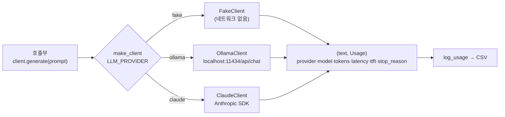

# P2-01B 로컬 LLM 서빙과 공급자 교체 — "LLM 호출부를 공급자와 분리하기"

| 항목 | 값 |
|---|---|
| 실습 ID | P2-01B (메인) |
| 소속 | [Part 2 — LLM 활용 원리](../README.md) |

> **최종 서비스에서의 위치:** Python AI 서버의 **LLM 어댑터**(공통 인터페이스로 Claude·로컬·가짜를 설정만 바꿔 교체, 타임아웃·폴백)입니다. Part 4 엔티티·관계 추출의 Claude vs 로컬 LLM 비교, Part 6 AI 서버(P6-01~03)에서 그대로 재사용합니다.

> 이 문서에 나오는 `함수·파일 이름`(예: `run_demo.py`)은 이전 실습 코드(커밋 `aa46d2f`)의 이름입니다. 그 코드는 지웠고 개념만 남겼습니다. 옛 코드가 필요하면 `git checkout aa46d2f`(복구 방법은 [루트 README](../../README.md#지금-어디를-보면-되나-학습-방식)).

> 방향: **개념은 깊게, 구현은 얕게.** 로컬 LLM 서버(Ollama)를 HTTP API처럼 부르고, Claude·로컬·가짜 공급자를 **같은 인터페이스**로 설정만 바꿔 교체합니다. RTX 3070에서의 속도·메모리는 사용자 PC에서 직접 잽니다.
> transformers로 모델을 직접 불러오는 방법은 이전 실습 코드(커밋 `aa46d2f`: `part2_llm/next_token_prediction/run_qwen.py`)에 있었고, 여기서는 서버 방식만 다룹니다.
> 이 실습의 `LLMClient` 인터페이스는 Part 4 엔티티·관계 추출의 로컬 LLM 비교와 Part 6 AI 서버(공급자 교체·타임아웃·폴백)에서 재사용합니다.

## 1. 목표

- 로컬 LLM 서버의 요청·응답 형식을 읽고, 비스트리밍·스트리밍 응답을 파싱한다.
- 스트리밍에서 **첫 토큰 시간(TTFT)**과 **토큰/초**를 계산한다.
- `generate(prompt) -> (text, Usage)` 공통 인터페이스로 공급자를 `LLM_PROVIDER` 설정만으로 교체한다.
- 주 공급자 장애 시 다른 공급자로 넘어가는 **폴백**을, 넘어가면 안 되는 오류와 구분해 설계한다.
- 사용량·지연을 같은 모양으로 기록하고, API와 로컬의 비용을 같은 단위로 비교한다.
- RTX 3070(8GB)에서 어떤 크기의 모델까지 쓸 수 있는지 측정으로 판단한다.

## 2. 선수지식

- P2-01: 모델 = 토큰 목록 → 다음 토큰 점수, 생성 상한(`max_new_tokens`)
- P1-05: prefill(입력 병렬 처리)·decode(출력 순차 생성), TTFT, KV 캐시 메모리
- P1-01: 토큰은 모델(토크나이저)마다 다르다, 입력·출력 단가
- HTTP 요청·JSON (Spring의 RestTemplate/WebClient 경험이 그대로 쓰입니다)

## 3. 핵심 개념

| 개념 | 한 줄 설명 |
|---|---|
| 로컬 LLM 서버 | 모델을 메모리에 올려 두고 HTTP 요청에 답하는 프로그램. "내 PC 안의 API" |
| Ollama | 로컬 LLM 서버 중 하나. 기본 주소 `http://localhost:11434`, 런타임 라이선스 MIT |
| 스트리밍 | 답을 다 만들기 전에 조각마다 보내기. Ollama는 줄마다 JSON 객체 하나 |
| TTFT | 요청 → 내용이 있는 첫 조각까지의 시간. 체감 반응 속도 |
| 토큰/초 | 출력 생성 속도. 긴 답의 대기 시간을 정한다 |
| 공급자(provider) | 실제로 답을 만드는 쪽(Claude API, 로컬 Ollama, 가짜) |
| 공통 인터페이스 | 호출부가 공급자를 몰라도 되게 하는 같은 모양의 함수(`generate`) |
| 폴백 | 주 공급자가 **일시 장애**일 때 다른 공급자로 답하기 |
| 양자화 | 가중치를 적은 비트(예: 4비트)로 저장해 메모리를 줄이기. 품질이 조금 떨어질 수 있다 |

## 4. 내부 원리

### 4-1. 요청과 응답 (Ollama `/api/chat`)

Ollama API 문서(github.com/ollama/ollama `docs/api.md`, 2026-11-13 확인)의 형식입니다.

```
POST http://localhost:11434/api/chat
{"model": "qwen2.5:0.5b", "messages": [{"role": "user", "content": "안녕"}],
 "stream": true, "options": {"num_predict": 256}}

스트리밍 응답 (줄마다 JSON 하나):
{"message": {"role": "assistant", "content": "안"}, "done": false}
{"message": {"role": "assistant", "content": "녕"}, "done": false}
{"message": {"role": "assistant", "content": ""}, "done": true,
 "prompt_eval_count": 26, "eval_count": 282, "eval_duration": 4535599000, ...}
```

- `stream`을 생략하면 **스트리밍이 기본**입니다. 비스트리밍이면 `"stream": false`를 꼭 넣습니다.
- `prompt_eval_count`는 입력 토큰 수, `eval_count`는 출력 토큰 수입니다. 시간 값(`*_duration`)은 **나노초**입니다.
- 토큰/초 = 282 / (4,535,599,000 / 10⁹) = 282 / 4.54 ≈ **62.2**

### 4-2. 공통 인터페이스와 폴백



`generate_with_fallback([주, 보조], prompt)`는 `ProviderError`일 때만 다음 공급자로 넘어갑니다.

| 오류 | 예 | 폴백? | 이유 |
|---|---|---|---|
| 일시 장애 (`ProviderError`) | 연결 실패, 시간 초과, 5xx, Ollama 과부하 503, Claude 과부하·rate limit | **예** | 다른 공급자는 정상일 수 있다 |
| 설정·요청 오류 | 모델 이름 오타(404), 잘못된 요청(400), 키 없음·인증 실패(401) | 아니오 | 넘겨도 해결되지 않거나 문제를 숨긴다 |
| 코드 버그 | `ValueError` 등 | 아니오 | 다른 공급자에서도 같은 버그 |

Claude SDK는 연결 오류·429·5xx를 `max_retries`(이 실습은 2)만큼 **스스로 재시도한 뒤에** 오류를 올립니다(claude-api 스킬, 작성 시점 2026-11). 그래서 폴백은 "재시도도 실패했을 때"의 다음 단계입니다. 재시도(같은 공급자 다시)와 폴백(다른 공급자)은 다른 결정입니다.

### 4-3. RTX 3070(8GB)에 어떤 크기까지 올라가나

필요 메모리 ≈ **가중치** + **KV 캐시**(P1-05 식: 토큰 수 × 층 수 × 2 × KV 헤드 수 × 헤드 차원 × 바이트) + **런타임 여유**.

가중치만 계산한 **추정**(파라미터 수 × 바이트, 실측 아님):

| 모델 | fp16(2바이트) | 4비트(약 0.5바이트) | 이 저장소 계획(ENVIRONMENT §4-1) |
|---|---|---|---|
| 0.5B | ≈ 1.0 GB | ≈ 0.25 GB | 추론 가능(fp16) |
| 1.5B | ≈ 3.0 GB | ≈ 0.75 GB | 추론 가능(fp16) |
| 3B | ≈ 6.0 GB | ≈ 1.5 GB | 4비트 가능 |
| 7B | ≈ 14 GB (불가) | ≈ 3.5 GB | 4비트 가능(여유 적음) |

판단 기준:
1. `ollama ps`의 PROCESSOR가 **`100% GPU`**인가(일부가 CPU로 내려가면 크게 느려진다. Ollama FAQ, 2026-11-13 확인).
2. 실측 토큰/초가 서비스 요구(예: 사람이 읽는 속도보다 빠른가)를 넘는가.
3. 다른 프로그램(브라우저·IDE)이 쓰는 VRAM과 동시 요청·긴 컨텍스트의 KV 캐시 여유가 남는가.

Ollama 라이브러리 태그의 기본 양자화 수준은 작성 환경에서 확인하지 못했습니다(미확인). 직접 측정할 때는 Ollama `/api/ps`의 `quantization_level`로 실제 값을 확인하세요.

### 4-4. 모델 라이선스

| 모델 | 라이선스 | 서비스 기본값 | 출처·기준일 |
|---|---|---|---|
| Qwen2.5-0.5B / 1.5B / 7B (Instruct) | Apache-2.0 | 가능 | 이 저장소 [ENVIRONMENT §4-2](../../docs/ENVIRONMENT.md) 계획 시점 표. 사용 전 Hugging Face 모델 카드에서 재확인(작성 환경 접속 불가 → 미확인) |
| **Qwen2.5-3B** (Instruct) | **Qwen Research License(비상업)** | **금지(학습용만)** | 위와 같음 |
| Ollama (런타임) | MIT | — | github.com/ollama/ollama `LICENSE`, 2026-11-13 확인. 모델 라이선스는 별도 |

## 서비스 관점

| 질문 | 판단 |
|---|---|
| 공급자를 바꾸면 무엇이 달라지나? | **토큰 세는 방식**(토크나이저가 달라 같은 글도 토큰 수가 다름), **스트리밍 형식**(Ollama 줄 JSON vs Claude SSE 이벤트), **오류·재시도 규칙**, **품질·한국어 능력·최대 컨텍스트**. 인터페이스가 같아도 결과가 같지는 않다 → 바꾸면 평가를 다시 한다 |
| API vs 로컬 트레이드오프는? | API: 높은 품질, 동시 처리량, 운영 부담 없음 / 토큰 비용, 데이터가 외부로 나감, 네트워크 필요. 로컬: 프라이버시, 오프라인, 고정 비용 / 품질 한계, GPU 메모리 한계, 운영 부담 |
| 로컬 모델을 서비스에 쓰면? | 동시 요청이 병목이다. Ollama는 모델당 동시 처리 수(`OLLAMA_NUM_PARALLEL`) 기본값이 1이고, 필요 메모리는 동시 수 × 컨텍스트 길이에 비례한다. 몰리면 대기열(`OLLAMA_MAX_QUEUE`, 기본 512)을 넘는 요청에 503을 돌려준다(Ollama FAQ, 2026-11-13 확인) → 이 503은 폴백 대상이다 |
| 로컬은 공짜인가? | 아니다. 전기·장비 감가·운영 시간이 든다. 트래픽이 적으면 API, 많고 일정하면 로컬이 유리할 수 있다. 다만 품질이 다르면 비용 비교만으로 고르지 않는다(§8 [6]) |
| 폴백 설계에서 꼭 지킬 것은? | ① 일시 장애만 넘긴다 ② **누가 답했는지 기록**한다(`usage.provider`) ③ 폴백 비율을 모니터링한다 ④ 폴백 공급자의 품질·형식 차이를 사용자에게 어떻게 보일지 정한다(Part 6 P6-03·P6-04) |
| 무엇을 기록하나? | 공급자·모델·입출력 토큰·지연·TTFT·stop_reason. 프롬프트 원문은 개인정보일 수 있어 기본적으로 남기지 않는다 |
| `stop_reason`은 왜 기록하나? | `max_tokens`(답이 잘림)·`refusal`(Claude가 안전상 거절)은 답이 불완전하다는 신호다. 성공 응답처럼 그대로 쓰면 품질 사고가 된다 |

## 5. 수식

- TTFT = t(내용이 있는 첫 조각) − t(요청)
- 토큰/초 = `eval_count` / (`eval_duration` / 10⁹) (서버 값이 없으면 출력 토큰 / (t_마지막 − t_첫 조각))
- API 100만 토큰당 비용 = 입력 단가 × (1 − r) + 출력 단가 × r (r = 출력 비율)
- 로컬 출력 100만 토큰 비용 = W × h / 1000 × (kWh 단가) + (시간당 장비 감가) × h,  h = 10⁶ / 토큰/초 / 3600
- 가중치 메모리 ≈ 파라미터 수 × 파라미터당 바이트 (fp16 = 2, 4비트 ≈ 0.5)

## 6. 자주 나는 오류

| 증상 | 원인 | 해결 |
|---|---|---|
| `ProviderError: cannot reach http://localhost:11434/...` | Ollama 서버가 안 떠 있음 | Ollama 실행, `ollama --version`·`ollama ps` 확인 |
| `HTTPError 404` | 모델을 안 받았거나 태그 오타 | `ollama pull <모델>`, `ollama list`(폴백 대상 아님) |
| 응답이 한 번에 안 오고 줄 여러 개 | 비스트리밍을 원했는데 `stream` 생략(기본 true) | `"stream": false` 명시 |
| `json.decoder.JSONDecodeError` | 스트림의 빈 줄을 파싱 | 빈 줄 건너뛰기 |
| 토큰/초가 비정상적으로 큼·작음 | `eval_duration`을 초로 착각 | 나노초 → `/ 1e9` |
| 매우 느림, `ollama ps`가 `CPU`/`GPU` 섞임 | 모델이 VRAM에 다 안 올라감 | 더 작은 모델·더 강한 양자화, 다른 프로그램 종료 |
| 클라이언트가 `0.0.0.0:11434/api/chat`으로 요청 | 서버용 `OLLAMA_HOST`를 클라이언트 주소로 씀 | 클라이언트는 `OLLAMA_BASE_URL=http://localhost:11434` |
| `LLM_PROVIDER=claude`인데 `ValueError` | 키 없음 | `.env`에 `ANTHROPIC_API_KEY`(커밋 금지) |
| CSV 중간에 머리글이 또 있음 | 덧붙일 때마다 머리글을 씀 | 파일이 없을 때만 `writeheader()` |

## 7. 과제

1. (사용자 PC) 0.5B / 1.5B / 3B 모델의 TTFT·토큰/초·VRAM을 직접 측정해 표로 정리하고, RTX 3070에서 "서비스 기본값으로 쓸 만한 크기"를 근거와 함께 고르세요(3B는 라이선스도 고려).
2. 같은 질문 5개를 `LLM_PROVIDER=ollama`(0.5B, 1.5B)와 `claude`로 보내 품질을 비교하세요(키가 있으면). 토큰 수가 공급자마다 어떻게 다른지도 `usage.csv`로 확인하세요.
3. `OLLAMA_NUM_PARALLEL`을 1과 2로 바꿔 동시 요청 2개를 보낼 때 TTFT가 어떻게 변하는지 재 보세요(서버 재시작 필요, Ollama FAQ 참고).
4. "Claude가 주, 로컬이 보조"인 고객 상담 봇에서 폴백이 일어났을 때 사용자에게 무엇을 보여 줄지, 어떤 지표를 모니터링할지 설계로 답하세요.

## 8. 체크리스트

- [ ] Ollama 스트리밍 줄 하나와 마지막 줄의 필드를 설명할 수 있다
- [ ] TTFT와 토큰/초의 차이, 각각이 사용자 경험의 어디에 영향을 주는지 안다
- [ ] 공급자를 바꾸면 달라지는 것 4가지(토큰·스트리밍 형식·오류·품질)를 말할 수 있다
- [ ] 폴백해야 하는 오류와 하면 안 되는 오류를 구분한다
- [ ] RTX 3070에서 모델 크기를 고르는 기준(100% GPU·토큰/초·여유 메모리·라이선스)을 안다

## 9. 다음 단계 연결

- **P2-02 Claude API 기초**: 이 실습의 `ClaudeClient`가 쓰는 메시지 구조·스트리밍·구조화 출력을 깊게 다룹니다.
- **P2-03 비용·지연**: `usage.csv` 같은 기록으로 프롬프트 캐싱·배치의 효과를 수치로 봅니다.
- **Part 4 P4-02/03**: 엔티티·관계 추출을 Claude와 로컬 LLM으로 비교할 때 이 인터페이스를 재사용합니다.
- **Part 6 P6-01~04**: FastAPI AI 서버의 공급자 교체·타임아웃·재시도·폴백·비용 추적으로 확장합니다.

## REF

- Ollama API 문서 — `/api/chat`(요청·스트리밍 응답·통계 필드), `/api/ps`(`size_vram`, `quantization_level`), 시간 단위 나노초: github.com/ollama/ollama `docs/api.md` (2026-11-13 확인)
- Ollama FAQ — `ollama ps` PROCESSOR 열, 기본 바인드 `127.0.0.1:11434`, `OLLAMA_HOST`, `OLLAMA_NUM_PARALLEL`(기본 1), `OLLAMA_MAX_QUEUE`(기본 512, 초과 시 503): github.com/ollama/ollama `docs/faq.mdx` (2026-11-13 확인)
- Ollama 설치(Windows `irm https://ollama.com/install.ps1 | iex`)·라이선스(MIT): github.com/ollama/ollama `README.md`, `LICENSE` (2026-11-13 확인)
- Anthropic Python SDK 스트리밍·오류 처리·stop_reason: claude-api 스킬 `python/claude-api/streaming.md`, `README.md` (작성 시점 2026-11), 예외 계층은 설치된 anthropic 2.6.0에서 확인
- Qwen2.5 모델 카드·라이선스: https://huggingface.co/Qwen (작성 환경 접속 불가 → 미확인, ENVIRONMENT §4-2 계획 시점 표 기준)
